# Geotecnia Minera y Control de Terreno

## Objetivo

Garantizar la seguridad de la fuerza laboral, la estabilidad estructural y la continuidad operativa en minas a cielo abierto superficiales y minas subterráneas mediante un control de terreno sistemático, la caracterización de la masa rocosa y el monitoreo geotécnico-hidrológico automatizado.

---

## 1. El Desafío Operacional en la Minería

A diferencia de la infraestructura civil diseñada con coeficientes de seguridad elevados ($FS \ge 1.5$) para una vida útil de 100 años, las excavaciones mineras son operaciones dinámicas y agresivas que equilibran la economía de la extracción de recursos con el manejo de riesgos transitorios ($FS \approx 1.2 - 1.3$).

La ingeniería geotécnica minera abarca dos entornos principales:

1. **Minería superficial (minas a cielo abierto y de tajo)**: Taludes de roca multibanco que alcanzan profundidades superiores a 500 m a 1 000 m. La estabilidad está controlada por las discontinuidades estructurales de la masa rocosa, la retención de bermas en los bancos, las presiones de poros dentro de los muros del tajo y el daño por vibración dinámica inducida por voladuras.
2. **Minería subterránea**: Socavones profundos, rampas de acceso, vías de transporte, frentes largos (longwalls) y cámaras (stopes) operando en ambientes de alta tensión in situ virgen ($\sigma_v = \rho g z$, con tensiones horizontales tectónicas a menudo $\sigma_h / \sigma_v > 1.5 - 2.5$). Los peligros incluyen estallidos por deformación (strainbursting), golpes de roca (rockbursts), terreno compresivo (squeezing ground), falla de techo en cuña (cutter roof failure), colapso de pilares y ruptura de mamparas de relleno en pasta de relaves.

---

## 2. Marco Integrado: Del Control de Terreno al ADAQS

```mermaid
flowchart TD
    subgraph GEOLOGY["1. Geología y Caracterización de la Masa Rocosa"]
        G1["Registro de Testigos y Mapeo de Discontinuidades"]
        G2["Resistencia de la Roca Intacta (UCS / Triaxial)"]
        G3["Clasificación de la Masa Rocosa (GSI, RMR, Q)"]
    end

    subgraph DESIGN["2. Diseño de Mina y Sostenimiento de Terreno"]
        D1["Ángulos de Talud del Tajo (Intermedio y Global)"]
        D2["Dimensionamiento de Pilares (ALPS / ARMPS / Área Tributaria)"]
        D3["Sistemas de Sostenimiento: Barras de Refuerzo, Split Sets, Pernos de Cables, Shotcrete"]
    end

    subgraph HAZARDS["3. Peligros Mineros y Desencadenantes"]
        H1["Desprendimiento de Muro de Tajo / Bancos y Vuelco Profundo"]
        H2["Alta Presión de Poros / Presión Hidrostática de Grietas"]
        H3["Redistribución de Tensiones y Golpes de Roca Dinámicos"]
        H4["Licuación de la Instalación de Almacenamiento de Relaves (TSF)"]
    end

    subgraph ADAQS["4. Monitoreo Automatizado y Telemetría de Sensores"]
        M1["Radar de Estabilidad de Taludes en Tiempo Real Terrestre (SSR)"]
        M2["Piezómetros de Cuerda Vibrante (VWP) en Sondeos Profundos"]
        M3["Extensómetros Magnéticos de Sondeo y MPBX"]
        M4["Red de Sensores Microsísmicos (Geófonos y Acelerómetros)"]
        M5["Células de Presión de Sondeo (BPC) en Pilares de Carbón/Roca"]
    end

    subgraph ACTION["5. Planes de Acción ante Desencadenantes (TARP)"]
        T1["Verde: Explotación Minera Normal"]
        T2["Ámbar: Acceso Restringido, Telemetría Reforzada, Refuerzo Secundario"]
        T3["Rojo: Evacuación de Emergencia, Retiro de Equipos, Cierre de Cámaras"]
    end

    GEOLOGY --> DESIGN
    DESIGN --> HAZARDS
    HAZARDS --> ADAQS
    ADAQS --> ACTION
```

---

## 3. Minería Superficial: Estabilidad de Taludes de Tajo Abierto

### Modos de Falla en Tajos Abiertos
- **Deslizamiento plano y en cuña a escala de banco**: Discontinuidades que afloran en las caras individuales de los bancos.
- **Falla circular de taludes intermedios y globales**: Ocurre en masas rocosas altamente fracturadas, alteradas o meteorizadas ($GSI < 40$) regidas por los criterios de resistencia al corte de Hoek-Brown.
- **Falla por vuelco**: Diaclasas con buzamiento fuerte hacia el interior del talud que hacen que columnas altas se vuelquen hacia afuera.
- **Aumento hidrogeológico de la presión de poros**: Infiltración de agua de lluvia que llena grietas de tensión detrás de las coronas del tajo, multiplicando las fuerzas impulsoras mientras reduce a la mitad las tensiones normales efectivas ($\sigma' = \sigma - u$).

### Regímenes de Monitoreo para Tajos Abiertos
| Sistema de Instrumentación | Parámetro Medido | Aplicación y Función |
|------------------------|--------------------|--------------------|
| **Radar de Estabilidad de Taludes (SSR / InSAR)** | Desplazamiento en línea de vista (LOS) submilimétrico | Escaneo en tiempo real 24/7 de los muros del tajo; detecta deformación acelerada que conduce al colapso del talud |
| **Estaciones Totales Robóticas (RTS) + Prismas** | Coordenadas vectoriales 3D $(x, y, z)$ | Seguimiento a largo plazo de objetivos en coronas, rampas y vías de transporte |
| **Piezómetros de Cuerda Vibrante (VWP)** | Presión de poros profunda ($u$) | Evaluación de sondeos de despresurización y descenso del nivel freático detrás de los muros de tajo |
| **Inclinómetros In Situ (IPI)** | Desplazamiento de corte profundo vs. profundidad | Localiza la profundidad exacta del plano de corte y la velocidad de deslizamiento en el recubrimiento o zonas de falla débiles |
| **Reflectometría en el Dominio del Tiempo (TDR)** | Aplastamiento/corte de cable coaxial | Identifica el inicio del desplazamiento de corte a lo largo de horizontes de deslizamiento profundos en el estratificado |

---

## 4. Minería Subterránea: Mecánica de Rocas y Sostenimiento de Terreno

### Desafíos Clave en Aberturas Subterráneas
1. **Concentración de Tensiones**: La excavación cambia el campo de tensiones; las tensiones tangenciales ($\sigma_\theta$) alrededor de la abertura superan la resistencia compresiva de la roca intacta ($\sigma_c$), provocando descascaramiento (spalling) de la roca, cizallamiento y desarrollo de techo en cuña (cutter roof).
2. **Diseño de Pilares**: En minería de cámaras y pilares o de frentes largos (longwall), los pilares deben soportar el peso tributario del recubrimiento. Los pilares subdimensionados ceden violentamente, transfiriendo carga a pilares adyacentes e induciendo colapsos en efecto dominó.
3. **Golpes de Roca (Rockbursts)**: La minería profunda ($> 1,000\text{ m}$) almacena inmensa energía de deformación elástica ($U_e = \sigma^2 / 2E$). El deslizamiento de fallas o el colapso de la excavación desencadena una violenta eyección de energía sísmica.

### Regímenes de Monitoreo para Excavaciones Subterráneas
| Sistema de Instrumentación | Parámetro Medido | Aplicación y Función |
|------------------------|--------------------|--------------------|
| **Extensómetros Multipunto de Sondeo (MPBX)** | Dilatación relativa de la roca a varias profundidades (1–15 m) | Mide el aflojamiento y la delaminación del estrato de techo por encima del horizonte de pernos |
| **Redes de Monitoreo Microsísmico** | Ubicación del hipocentro de eventos, magnitud ($M_L$), liberación de energía | Mapea la redistribución de tensiones, localiza zonas de fracturamiento activo y proporciona alerta temprana de golpes de roca |
| **Células de Presión de Sondeo (BPC / CPC)** | Cambio de tensión dentro de los pilares ($\Delta\sigma$) | Monitorea la transferencia de carga hacia los pilares de estribo durante la minería de retroceso o el retroceso de frentes largos |
| **Pernos de Roca Instrumentados / Células de Carga** | Carga axial y distribución de deformación a lo largo del tendón del perno | Verifica que la capacidad de sostenimiento de terreno no sea excedida por la dilatación de la roca |
| **Medidores Digitales de Convergencia** | Cierre de techo a piso y de una pared a otra | Valida el modelado numérico (FLAC3D, RS2) y detecta tasas de cierre de vías |

---

## 5. Instalaciones de Almacenamiento de Relaves (TSF) en la Minería

Las presas de relaves representan el mayor pasivo catastrófico ambiental y de seguridad de vidas en el sector minero. Según se detalla en el **Boletín 194 de ICOLD**, el monitoreo de los TSF requiere:
- Líneas múltiples de piezómetros a lo largo de la corona de la presa, la presa de arranque y la punta aguas abajo para confirmar la depresión de la línea freática.
- Canaletas de monitoreo de filtración automatizadas con sensores de turbidez para señalar la erosión interna (tubificación).
- Seguimiento continuo en tiempo real del desplazamiento por satélite InSAR y GNSS para el asentamiento de la corona y la propagación lateral.

### Ejemplo trabajado: diques de relaves en tajo

Cuando los relaves se almacenan dentro de un tajo agotado en lugar de detrás de una presa externa, el problema de monitoreo cambia — la fundación ha sido **descargada por hasta 90 m de excavación**, y el dique se eleva continuamente mientras se depositan relaves detrás de él. Véase el caso de estudio completo:

- **[Caso de Estudio — Instrumentación de Diques de Relaves en Tajo en la Mina Muskeg River (2013)](in-pit-dykes-mrm/index.md)**: relaciones de presión de poros $r_u$ y $B$, límites de precaución por deformación (Verde → Rojo con una paralización de construcción en Rojo), y monitoreo de tensión total $K_o$ para la evaluación de fractura hidráulica. El artículo original y la traducción completa al vietnamita están disponibles como PDF.

---

## 6. Referencias Completas en Esta Base de Conocimiento

Esta sección de Minería enlaza directamente con los manuales y libros de ingeniería principales disponibles en esta plataforma:

- **[Ingeniería de Rocas Práctica (Dr. Evert Hoek)](../../reference-manuals/practical-rock-engineering/index.md)**: Resistencia de la roca intacta, criterio de falla de Hoek-Brown, Índice de Resistencia Geológica (GSI), diseño de pernos de roca, sostenimiento con shotcrete, daño por voladura y estabilidad de cavernas subterráneas.
- **[Seguridad de Presas de Relaves (Boletín 194 de ICOLD)](../../reference-manuals/tailings-dam-safety/index.md)**: Administración geotécnica crítica de las instalaciones de almacenamiento de desechos mineros, mecanismos de falla por licuación y planes de acción de emergencia.
- **[Geología Física (Steven Earle)](../../reference-manuals/physical-geology/index.md)**: Geología estructural, minerales formadores de roca, fallamiento, plegamiento, meteorización y procesos de remoción en masa.
- **[Monitoreo del Desempeño de Presas (ASCE MOP-135)](../../reference-manuals/monitoring-dam-performance/index.md)**: Análisis de modos de falla, filosofías de vigilancia y gestión del ciclo de vida de los instrumentos.
- **[Dunnicliff — Instrumentación Geotécnica](../../reference-manuals/dunnicliff/index.md)**: Principios fundamentales de instrumentación, adquisición, calibración de sensores y planificación sistemática.
- **[Manual de Referencia de Instrumentación Geotécnica de la FHWA](../../reference-manuals/fhwa/index.md)**: Cimentaciones profundas, taludes en corte en roca y estructuras de retención de tierras.
- **[La Gran Visión y Marco Integrado](../../reference-manuals/overarching-vision.md)**: La síntesis completa que enlaza la geología cortical planetaria hasta las telemetrías automatizadas diarias de sensores.

---

## Video Destacado y Recursos Prácticos

  <iframe src="https://www.youtube-nocookie.com/embed/wji5zK7c1Qo" title="Design Challenges, Disasters and Lessons in Rock Engineering" frameborder="0" allow="accelerometer; autoplay; clipboard-write; encrypted-media; gyroscope; picture-in-picture" allowfullscreen style="position: absolute; top: 0; left: 0; width: 100%; height: 100%; border-radius: 6px;"></iframe>

<em>Conferencia Magistral Destacada (Rocscience): Dr. Evert Hoek — Desafíos de Diseño, Desastres y Lecciones en Ingeniería de Rocas: Fallas de Tajo Abierto, Estabilidad de Excavaciones Subterráneas y Geomecánica Minera.</em>

!!! tip "Recursos Prácticos de Campo Complementarios de RST Instruments y Measurand (Terra Insights)"
    - **RST Instruments (@RSTgeotechnical):** [Recolección Inalámbrica de Datos con RSTAR](https://www.youtube.com/watch?v=xFplwoCngEU){ target="_blank" }  
      *Redes autónomas de sensores geotécnicos a nivel de mina para bancos a cielo abierto e instalaciones de relaves.*
    - **Measurand (@MeasurandVideos):** [Monitoreo de Deflexión en Tiempo Real con ShapeArray](https://www.youtube.com/watch?v=518Mx-65rI0){ target="_blank" }  
      *Seguimiento continuo de corte y movimiento subsuperficial a lo largo de los muros de tajo y depósitos de desechos de la mina.*
