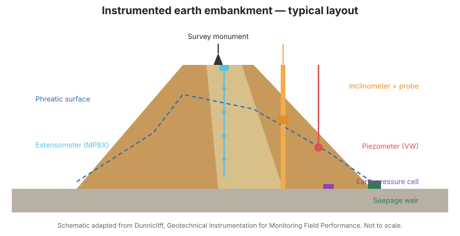

# Capítulo 1 — Introducción: Una Visión General

## 1.1 Qué es la instrumentación geotécnica

La instrumentación geotécnica es la medición de parámetros que revelan cómo se
comportan bajo carga el suelo, la roca, las cimentaciones y las estructuras.
Convierte lo invisible —la presión de poros interna, la deformación profunda, el
esfuerzo oculto— en números sobre los que el ingeniero puede actuar.

Los parámetros típicamente medidos incluyen:

- Presión de agua subterránea (poros)
- Esfuerzo total y efectivo
- Deformación (asentamiento, hinchamiento, movimiento lateral)
- Carga y deformación en elementos estructurales
- Temperatura (que afecta a casi todas las demás lecturas)

## 1.2 Por qué se necesita

No podemos ver bajo tierra. Un talud puede estar deslizando sobre un plano de
cizalle profundo, una cimentación puede asentarse de forma diferencial, un túnel
puede estar convergiendo —ninguno visible desde la superficie. La instrumentación
hace observable lo oculto y, de forma crucial, **medible en el tiempo**, de modo
que las tendencias se detectan temprano.

## 1.3 La cadena del éxito

Dunnicliff enmarca el monitoreo como una **cadena de 25 eslabones**, desde el
momento en que se define la necesidad del proyecto hasta el momento en que una
lectura informa una decisión. Rómpase un eslabón —mala planificación, instrumento
equivocado, instalación deficiente, datos no leídos— y todo el esfuerzo fracasa.
Este libro es, en efecto, un recorrido por esos eslabones.

## 1.4 Comportamiento del suelo y la roca (breve)

La selección de instrumentos depende de cómo responden realmente suelo y roca a la carga:

- **El suelo** se deforma, se consolida y puede perder resistencia cuando aumenta la presión de poros.
- **La roca** se comporta más por sus juntas y discontinuidades que por su resistencia intacta.
- **Las interfaces** (suelo–estructura, roca–soporte) son donde a menudo se concentra el movimiento.

Entender estos fundamentos es requisito previo para elegir qué medir.

## 1.5 Alcance de esta referencia

Este libro cubre la planificación, los instrumentos, la ejecución y la interpretación
del monitoreo geotécnico para taludes, terraplenes, presas, túneles, cimentaciones
y excavaciones. Es contenido original y educativo adaptado del alcance de Dunnicliff;
no es una reproducción del texto con derechos de autor.

**Figura.** Un terraplén de tierra instrumentado típico: monolito de referencia topográfica, extensómetro (MPBX), inclinómetro con sonda, piezómetro, célula de presión de tierras y represa de filtración, con la superficie freática (Dunnicliff, caps. 1 y 8).

## 1.6 Puntos clave

- La instrumentación hace observable y medible el subsuelo oculto.
- Es una cadena de 25 eslabones; la falla en cualquiera de ellos frustra el propósito.
- El suelo y la roca se comportan de forma distinta; la selección sigue al comportamiento.
- El criterio, no solo el hardware, produce un monitoreo útil.
