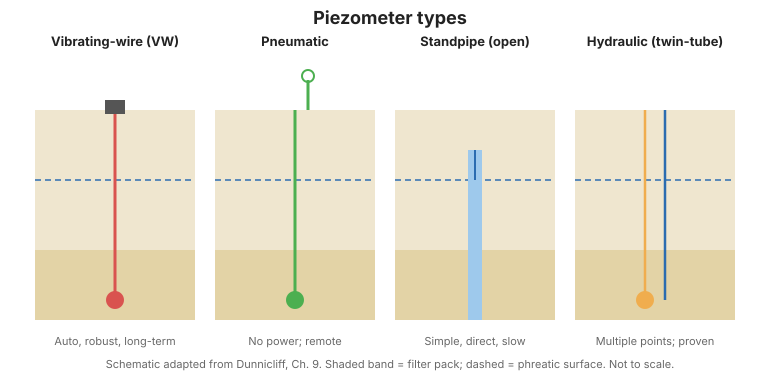

# Capítulo 6 — Medición de la Presión de Agua Subterránea

## 6.1 La presión de poros está en todas partes importante

La presión de agua subterránea (poros) gobierna el esfuerzo efectivo, la estabilidad
de taludes, el asentamiento y la licuefacción. Medirla es una de las tareas de
monitoreo más comunes y más consecuentes.

## 6.2 Tipos de piezómetro

| Tipo | Principio | Mejor para |
|------|----------|---------|
| **Cuerda vibratoria (VW)** | Cambio de frecuencia de un alambre tensado | Monitoreo automatizado a largo plazo; robusto |
| **Neumático** | La presión de gas equilibra la presión de agua | Remoto, sin energía |
| **Tubo abierto (pozo de observación)** | Nivel de agua en una tubería | Simple, directo, lento para equilibrar |
| **Hidráulico (doble tubo)** | Equilibrio de columna líquida | Varios puntos, método consolidado |

## 6.3 El imperativo de la saturación

Un piezómetro VW o neumático debe estar **totalmente saturado** —libre de aire en el
filtro poroso y el tubo conector— o lee disparates. El procedimiento de saturación
(desaireación, llenado y verificación) es el paso más descuidado en la instalación
de campo. Un piezómetro no saturado es una brecha silenciosa en el programa.

## 6.4 Instalación en suelo, roca y perforaciones

- **Suelo:** perforación cuidadosa para evitar sellar (smearing) el suelo circundante;
  empaque filtrante y sellado para prevenir el cortocircuito.
- **Roca:** instalaciones con empacador o lechada para aislar la zona de medición.
- **Multinivel (MPBX):** varios sensores en una perforación para perfilar la presión con la profundidad.

## 6.5 Lectura e interpretación

Las lecturas se convierten a **carga piezométrica**. Interprete frente a:

- **Ubicación y cambio de la superficie freática.**
- **Respuesta de presión de poros** a lluvia, nivel de embalse o carga.
- **Presión en exceso** tras eventos sísmicos o de construcción.

## 6.6 Peligros

- Ingreso de aire / pérdida de saturación → lecturas a la deriva.
- Cortocircuito de perforación → lee la zona equivocada.
- Daño de cableado → la falla automatizada más común.

!!! tip "Cruce con un tubo abierto"
    Donde la presión de poros es crítica, un simple tubo abierto junto a los sensores
    VW ofrece una verificación independiente e infalible de que los datos automatizados
    tienen sentido físico.

**Figura.** Cuatro tipos comunes de piezómetro: cuerda vibratoria, neumático, tubo abierto y hidráulico de doble tubo (Dunnicliff, cap. 9).

## 6.7 Puntos clave

- La presión de poros gobierna el esfuerzo efectivo y la estabilidad.
- Satura cada piezómetro; verifíquelo.
- Aisle la zona de medición; prevenga el cortocircuito.
- Los tubos abiertos ofrecen una verificación cruzada independiente y barata.
