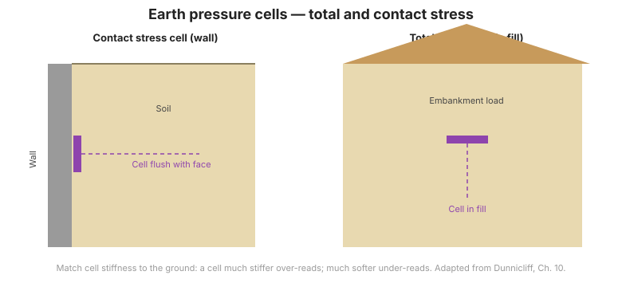

# Capítulo 7 — Medición del Esfuerzo

## 7.1 Dos problemas de esfuerzo distintos

El monitoreo de esfuerzos se divide en dos tareas distintas:

1. **Esfuerzo total en suelo** — la presión que ejerce el suelo o una estructura sobre un plano (p. ej., contra un muro de contención, bajo una zapata).
2. **Cambio de esfuerzo en roca** — el cambio en el campo de esfuerzos in-situ causado por una excavación o una carga.

Los instrumentos y métodos difieren marcadamente.

## 7.2 Esfuerzo total en suelo — células de presión de tierras

Las **células de presión de tierras** miden el esfuerzo normal total que actúa sobre un plano:

- **Células hidráulicas** — llenas de líquido, robustas, buenas para presión total.
- **Células de cuerda vibratoria** — automatizadas, comunes en muros y terraplenes.
- **Células neumáticas** — sin energía necesaria.
- **Células de esfuerzo de contacto** — miden la presión en una interfaz suelo–estructura.

La instalación debe colocar la cara sensible de la célula a ras con la superficie que
monitorea, con mínima perturbación, o la lectura está sesgada.

## 7.3 Cambio de esfuerzo en roca

Los cambios de esfuerzo en roca se miden con instrumentos colocados en perforaciones:

- **Células de presión / estresímetros de perforación** — monitorean el cambio de esfuerzo alrededor de aperturas.
- **Gatos planos (flat jacks)** — miden la liberación de esfuerzo en una ranura.
- **Overcoring** — un método de liberación de esfuerzo que, con medición de deformación, retro-calcula el estado de esfuerzo in-situ original.

## 7.4 Precauciones de interpretación

Las mediciones de esfuerzo son sensibles a la perturbación de instalación y al
desajuste de rigidez entre la célula y el terreno. Léalas como **cambio relativo** con
mayor confiabilidad que como valores absolutos, y corrélelas con la deformación (Capítulo 8).

!!! warning "Desajuste de rigidez"
    Una célula mucho más rígida que el suelo circundante sobre-lee; mucho más blanda,
    sub-lee. Ajuste la célula al medio, o interprete con ese sesgo en mente.

**Figura.** Células de presión de tierras. Una célula de esfuerzo de contacto mide la presión contra una estructura; una célula de esfuerzo total se entierra en el relleno. Ajuste la rigidez de la célula al terreno (Dunnicliff, cap. 10).

## 7.5 Puntos clave

- El esfuerzo total en suelo y el cambio de esfuerzo en roca necesitan instrumentos distintos.
- Las células de presión de tierras necesitan instalación a ras y sin perturbación.
- El esfuerzo en roca se lee mejor como cambio, vía células, gatos planos u overcoring.
- Considere el desajuste de rigidez al interpretar.
