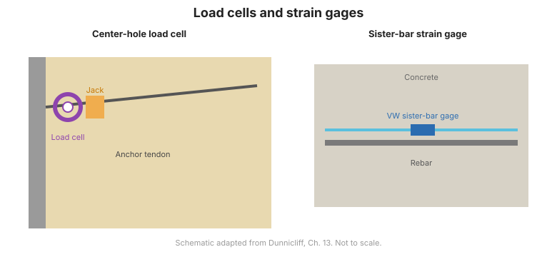

# Capítulo 9 — Medición de Carga, Deformación y Temperatura

## 9.1 Monitoreo de fuerzas en estructuras

Donde las obras geotécnicas interactúan con estructuras —struts, anclas, pilotes,
revestimientos— el monitoreo de la **carga y deformación** en esos elementos confirma
que se comportan como diseñados y revela el daño temprano.

## 9.2 Células de carga

Las **células de carga** miden fuerza. Tipos comunes:

- **Cuerda vibratoria** — automatizada, muy usada en struts, anclas y pilotes.
- **Hidráulica** — robusta, buena para fuerzas altas.
- **Eléctrica (galga extensométrica)** — versátil, sensible a efectos de cable.

Las aplicaciones incluyen cargas de strut en excavaciones apuntaladas, pretensado de
anclas y ensayos de carga de pilotes.

## 9.3 Galgas extensométricas

Las **galgas extensométricas** miden la deformación por unidad de longitud, a partir
de la cual se puede inferir el esfuerzo:

- **De alambre / lámina pegada** — montada en superficie de acero o concreto.
- **Cuerda vibratoria** — empotrable en concreto o adherida a acero.
- **Telltales** — dispositivos simples que indican movimiento relativo a través de una sección.

## 9.4 Medición de temperatura

La temperatura afecta a casi todos los demás instrumentos: cambia la salida del sensor,
la deformación del concreto y la presión de poros. Se usan **termistores, RTD,
termopares y termómetros de mercurio** para:

- Compensar otras lecturas por efectos térmicos.
- Detectar congelamiento, calor de hidratación o movimiento por efecto térmico.

## 9.5 Precauciones de interpretación

La deformación en concreto incluye retracción y fluencia; sepárelas de los efectos de
carga usando temperatura y especímenes compañeros. Las lecturas de célula de carga
deben referirse a un cero verificado.

!!! warning "La temperatura no es un afterthought"
    Ignorar la compensación térmica es una causa principal de datos de deformación y
    presión de poros mal interpretados. Mida y compense la temperatura donde los
    efectos térmicos sean plausibles.

**Figura.** Células de carga y galgas extensométricas. Una célula de carga de perforación central mide la fuerza de ancla o strut; una galga tipo sister-bar mide la deformación en una barra de refuerzo (Dunnicliff, cap. 13).

## 9.6 Puntos clave

- Las células de carga y galgas extensométricas confirman que los elementos estructurales se comportan como diseñados.
- Los tipos de cuerda vibratoria, hidráulica y eléctrica sirven distintas necesidades.
- La temperatura afecta casi toda lectura —midala y compénsela.
- Separe retracción/fluencia de los efectos de carga en concreto.
