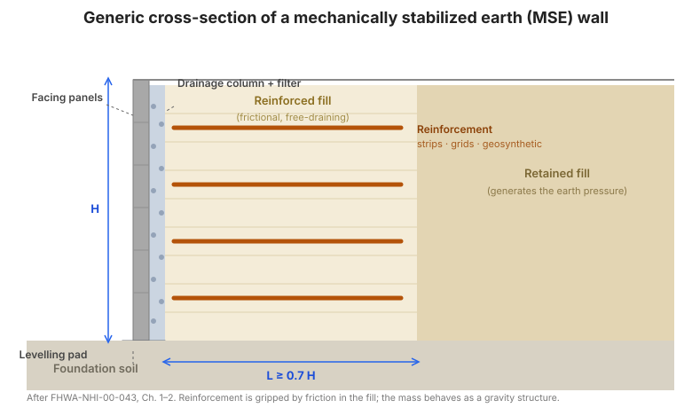

# Capítulo 4 — Diseño de muros MSE

## 4.1 Métodos de diseño

**Análisis de esfuerzos de trabajo.** El diseño de muros MSE es un procedimiento de
**esfuerzos de trabajo** (esfuerzo admisible): el refuerzo se verifica contra una
resistencia admisible reducida a largo plazo, y la estructura contra factores de
seguridad mínimos. (La práctica moderna replantea los mismos chequeos en forma de
carga y resistencia; la mecánica es idéntica.)

**Análisis de equilibrio límite.** La masa reforzada se trata como un **cuerpo rígido**
para la estabilidad externa, y como una pila de capas para la estabilidad interna, con
chequeos de equilibrio límite en cada nivel.

**Evaluaciones de deformación.** El diseño también debe anticipar la **deformación**:
la cara se inclina hacia afuera y el muro abombe ligeramente conforme el refuerzo se
deforma. El manual da una curva empírica (Figura 10) que relaciona el desplazamiento
lateral anticipado durante la construcción con la altura del muro y el tipo de
refuerzo, para que las tolerancias —especialmente para servicios y estructuras
adyacentes— puedan fijarse de forma realista.

**Refuerzo inextensible (acero).** El diseño usa un modelo de **gravedad coherente**:
un empuje de tierra activo tipo Rankine actúa sobre la masa reforzada, y la **línea de
fuerza tensil máxima** marca donde la tensión del refuerzo alcanza su pico. El
coeficiente de empuje lateral usado para la estabilidad interna es mayor que el valor
activo cerca de la parte superior del muro (una forma común es $K_r = 1.7K_a$ en la
zona superior, reduciéndose hacia el valor en reposo más abajo), reflejando la
restricción que impone el refuerzo rígido.

**Refuerzo extensible (geosintético).** Como el refuerzo se deforma con el suelo, la
carga se distribuye más uniformemente con la profundidad y se usa un modelo de **cuña
atirantada**, con un coeficiente de empuje lateral igual al valor activo $K_a$ (o un
valor ligeramente elevado según el método de diseño).

**Figura.** Sección transversal genérica de un muro MSE: paneles de cara, una columna
de drenaje y un filtro detrás de la cara, capas horizontales de refuerzo que se extienden
a través del relleno reforzado friccionante, el relleno retenido detrás de la zona
reforzada, y el suelo de cimentación (según FHWA-NHI-00-043, Cap. 1–2).

## 4.2 Dimensionamiento para estabilidad externa

**a. Definir geometría del muro y propiedades del suelo.** Altura del muro, ángulo de la
cara, longitud del refuerzo, perfil de cimentación, y los pesos unitarios y ángulos de
fricción del relleno reforzado, el relleno retenido y el suelo de cimentación.

**b. Seleccionar criterios de desempeño.** La deformación de cara aceptable, el
asentamiento diferencial y la apertura de junta.

**c. Dimensionamiento preliminar.** Fije la longitud del refuerzo. Una regla de partida
común es **$L \ge 0.7H$** con una longitud mínima práctica (unos 2.4 m / 8 pies); la
longitud se ajusta luego para la estabilidad externa.

**d. Empujes de tierra para estabilidad externa.** La masa reforzada está cargada por
el **empuje activo** del relleno retenido detrás de ella, más cualquier sobrecarga
(tráfico, estructuras) y, si el drenaje es inadecuado, presión **hidrostática**. La
resultante actúa en la parte posterior de la masa reforzada.

**e. Estabilidad al deslizamiento.** Verifique que la fricción de base más cualquier
resistencia pasiva frente al muro resista el empuje horizontal:

$$FS_{(sliding)} = \frac{\text{fuerza horizontal resistente}}{\text{fuerza horizontal motriz}} \ge 1.5$$

**f. Falla por capacidad de carga.** Verifique la capacidad de carga de la
cimentación bajo la carga excéntrica de la masa reforzada, y que la resultante quede
dentro de la base (sin tensión bajo el muro):

$$FS_{(bearing)} \ge 2.0 \quad \text{y} \quad e \le \frac{L}{6}$$

**g. Estabilidad global (general).** Realice un análisis de estabilidad de talud a
través de la masa reforzada y su cimentación para confirmar que las superficies de
falla profundas tienen un factor de seguridad adecuado (comúnmente $\ge 1.5$).

**h. Carga sísmica.** Aplique una fuerza inercial **pseudoestática** (un coeficiente
sísmico horizontal por la masa) y re-verifique la estabilidad externa; se usa el marco
de **Mononobe–Okabe** para modificar el empuje de tierra para el caso sísmico.

**i. Estimación de asentamiento.** Estime el asentamiento inmediato y por consolidación
de la cimentación, y compárelo con los criterios de desempeño —especialmente donde una
estructura o un servicio descansa sobre el muro.

## 4.3 Dimensionamiento para estabilidad interna

**a. Superficies de deslizamiento críticas.** Identifique las superficies de falla
interna potenciales (a través de la masa reforzada) y, para cada capa de refuerzo, la
**longitud de empotramiento efectiva** $L_e$ detrás de la superficie.

**b. Fuerzas tensiles máximas en las capas de refuerzo.** Para cada capa, la tensión
movilizada máxima es el empuje lateral por el área tributaria:

$$T_{max} = K_r\ \sigma_v\ S_v$$

donde $K_r$ es el coeficiente de empuje lateral, $\sigma_v$ es el esfuerzo vertical
efectivo en la capa (incluyendo sobrecarga y carga de tráfico), y $S_v$ es el
espaciamiento vertical del refuerzo. Para elementos discretos (tiras, barras), la
tensión se divide por el número de elementos por unidad de ancho.

**c. Estabilidad interna respecto a falla por arranque.** La resistencia de arranque
disponible $P_r$ (Capítulo 3) debe exceder la tensión movilizada con un factor de
seguridad adecuado:

$$FS_{(PO)} = \frac{P_r}{T_{max}} \ge 1.5$$

Este chequeo fija la **longitud** y el **espaciamiento** del refuerzo: aumente $L_e$ o
reduzca $S_v$ hasta que cada capa pase.

**d. Carga sísmica.** Añada el incremento dinámico a la tensión estática y re-verifique
arranque y conexión para el caso sísmico.

**e. Resistencia de conexión.** Donde el refuerzo se conecta a la cara, verifique la
**conexión** contra la tensión movilizada, usando la resistencia de conexión de los
ensayos (Apéndice A):

$$T_{conn} \ge T_{max}\ \cdot\ FS_{conn}$$

**f. Espaciamiento del refuerzo.** El espaciamiento vertical está limitado por el
sistema de cara, por los requisitos de compactación y por la necesidad de mantener la
$T_{max}$ de cada capa dentro de su capacidad. Un espaciamiento más cerrado reduce
generalmente la carga de cara y la longitud del refuerzo.

## 4.4 Diseño de elementos de cara

**Caras rígidas (concreto, acero, madera).** La cara se diseña para la presión lateral
del relleno retenido sobre su área tributaria, para las cargas de conexión del
refuerzo, y para sus propias cargas de manejo y erección.

**Caras flexibles (geosintético enrollado).** La cara es el propio refuerzo enrollado;
el diseño verifica la **resistencia del enrollado**, la conexión del enrollado al
refuerzo principal, y la estabilidad del relleno de cara bajo el enrollado.

## 4.5 Detalles de diseño

- **Barreras de tráfico** — la barrera y su carga de impacto deben ser llevadas por el
  muro o por un elemento estructural separado; la ruta de carga al refuerzo debe ser
  explícita.
- **Sistemas de drenaje** — el diseño asume relleno de drenaje libre. Provea agregado
  de drenaje, geotextil filtrante y tubos de salida, y mantenga el sistema de drenaje
  funcional durante la vida de diseño.
- **Terminación a estructuras coladas en sitio** — la junta entre un muro MSE y una
  estructura rígida (estribo, alcantarilla) debe acomodar el movimiento diferencial.
- **Presiones hidrostáticas** — si el drenaje puede bloquearse o el relleno no es de
  drenaje libre, añada presión hidrostática al diseño, o diseñe el drenaje para que no
  pueda bloquearse.
- **Obstrucciones en la zona de suelo reforzado** — tuberías, captaciones y servicios
  interrumpen el refuerzo; diseñe el disposición del refuerzo y cualquier refuerzo
  local alrededor de ellos.
- **Detalles internos** — conexiones panel a panel, almohadillas de apoyo, tapajuntas,
  y los detalles de conexión refuerzo–cara.

## 4.6 Ejemplo de diseño — refuerzo de tira de acero

El manual desarrolla un muro MSE de tira de acero completo: geometría y propiedades del
suelo, estabilidad externa (deslizamiento, capacidad de carga, global), estabilidad
interna ($T_{max}$, arranque, conexión), y el tamaño, espaciamiento y longitud de tira
resultantes —primero por cálculo manual, luego con el programa de computadora de FHWA,
para que ambos puedan compararse.

## 4.7 Ejemplo de diseño — refuerzo geosintético

Un ejemplo paralelo con refuerzo geosintético, usando el modelo de refuerzo extensible,
los factores de reducción por fluencia/instalación/durabilidad, y la resistencia de
conexión geosintética —de nuevo manual y por computadora.

## 4.8 Diseños MSEW estándar

El manual provee **diseños estándar** —geometrías y disposiciones de refuerzo
pre-elaboradas para alturas y condiciones comunes de muro— para que los muros rutinarios
no deban rediseñarse desde cero. Estos diseños estándar son la base del enfoque de
contratación de "diseño estándar" del
[Capítulo 8](chapter-08-contracting-specifications.md).

## 4.9 Puntos clave

- Diseñe en dos pasadas: **estabilidad externa** de la masa como cuerpo rígido, luego
  **estabilidad interna** de cada capa de refuerzo.
- Chequeos externos: **deslizamiento ($\ge 1.5$)**, **capacidad de carga ($\ge 2.0$)**,
  **excentricidad ($e \le L/6$)**, y **estabilidad global ($\ge 1.5$)**.
- Chequeos internos: **tensión ($T_{max} = K_r\sigma_v S_v$)**, **arranque
  ($FS_{(PO)} \ge 1.5$)**, y **conexión**.
- **La longitud la fija el arranque**, no el hábito —parta de $L \approx 0.7H$ y
  ajuste hasta que cada capa pase.
- El **drenaje y la presión hidrostática** son decisiones de diseño, no detalles de
  sitio.
