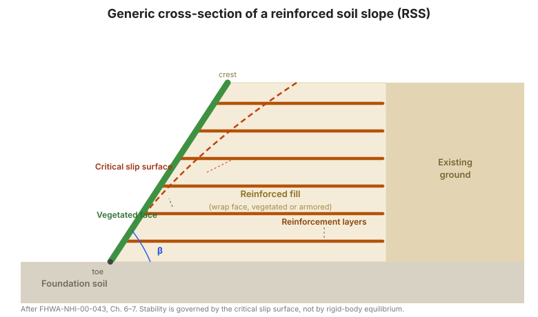

# Capítulo 7 — Diseño de taludes de suelo reforzado

## 7.1 Introducción

El diseño de taludes reforzados eleva el factor de seguridad de un talud añadiendo
refuerzo a través de las superficies de deslizamiento potenciales. La fuerza de refuerzo
se introduce en un **análisis de equilibrio límite modificado**: el momento resistente del
refuerzo (su tensión por su brazo de palanca respecto al centro de rotación) se suma al
momento resistente del suelo, y la longitud de refuerzo detrás de la superficie de
deslizamiento debe ser suficiente para desarrollar esa tensión por arranque.

Como la superficie de deslizamiento crítica no se conoce de antemano, el diseño es
iterativo: elija una superficie, calcule el refuerzo requerido, verifique que el refuerzo
puede desarrollar su fuerza por arranque, y luego re-busque la superficie crítica con el
refuerzo incluido.

**Figura.** Sección transversal genérica de un talud de suelo reforzado: capas de
refuerzo que se extienden desde la cara vegetada hacia atrás hasta el terreno estable
detrás de la superficie de deslizamiento crítica, con la cara parada al ángulo β (según
FHWA-NHI-00-043, Cap. 6–7).

## 7.2 Guías de diseño de taludes reforzados

El manual plantea un **procedimiento de nueve pasos**:

**Paso 1 — Establecer los requisitos geométricos, de carga y de desempeño.** Geometría
del talud, cargas externas (tráfico, estructuras), factor de seguridad requerido y
criterios de desempeño.

**Paso 2 — Determinar las propiedades de ingeniería de los suelos in situ.** Peso
unitario, resistencia al corte (drenada y no drenada), y régimen de presión de poro del
terreno existente y la cimentación.

**Paso 3 — Determinar las propiedades del relleno reforzado (y, si es distinto, del
relleno retenido).** Peso unitario, ángulo de fricción, y límites de granulometría/
plasticidad para el relleno reforzado.

**Paso 4 — Evaluar los parámetros de diseño del refuerzo.** La resistencia admisible a
largo plazo —tras reducción por fluencia, daño por instalación y durabilidad para
geosintéticos, o tras pérdida por corrosión para acero— y el factor de fricción de
arranque $F^{*}$ y el factor de escala $\alpha$ para el par suelo–refuerzo.

**Paso 5 — Verificar la estabilidad sin refuerzo.** Analice el talud sin refuerzo para
establecer el factor de seguridad base y localizar la superficie crítica. Esto le dice
cuánto refuerzo se necesita.

**Paso 6 — Diseñar el refuerzo para proveer un talud estable.** Seleccione la
disposición del refuerzo (espaciamiento, longitud, resistencia) de modo que el talud
reforzado alcance el factor de seguridad requerido. La **fuerza de refuerzo requerida** se
obtiene de la diferencia entre los momentos resistentes requeridos y disponibles:

$$T_{req} = \frac{FS_{req}\ \cdot\ M_{driving} - M_{resisting}}{\sum (\text{brazo de palanca}_i)}$$

El refuerzo se distribuye sobre la altura del talud, típicamente más junta cerca de la
punta donde los esfuerzos motrices son mayores, y cada capa se verifica por **arranque**
detrás de la superficie crítica.

**Paso 7 — Verificar la estabilidad externa.** Confirme que el talud reforzado no se
desliza a lo largo de una capa de cimentación débil, no sobrecarga la cimentación en
capacidad de carga, y no falla en una superficie profunda que pasa por debajo de la zona
reforzada.

**Paso 8 — Estabilidad sísmica.** Aplique fuerzas inerciales pseudoestáticas y re-verifique
el talud reforzado, añadiendo el incremento sísmico a las fuerzas de refuerzo.

**Paso 9 — Evaluar los requisitos de control de escorrentía subterránea y superficial.**
Diseñe el drenaje de modo que las presiones de poro en la zona reforzada se mantengan en
los valores de diseño y el agua superficial se intercepte y conduzca.

## 7.3 Diseño asistido por computadora

Como el Paso 6 requiere buscar la superficie crítica con el refuerzo presente, el diseño
RSS se hace normalmente con un programa de estabilidad de talud que soporta elementos de
refuerzo. Los ejemplos resueltos del manual incluyen tanto cálculos manuales como la
solución computacional correspondiente, para que puedan compararse.

## 7.4 Ejemplos de diseño

- **Ejemplo 1 — Diseño de talud reforzado, ensanche de carretera.** Un talud ensanchado
  empinando la cara, diseñado con capas de refuerzo.
- **Ejemplo 2 — Diseño de talud reforzado, nueva construcción de carretera.** Un talud de
  terraplén nuevo construido con refuerzo desde el principio.
- **Ejemplo 3 — Solución asistida por computadora.** El mismo problema resuelto con el
  programa de estabilidad de talud.
- **Ejemplo 4 — Cálculo de estabilidad de cara.** Una verificación de la estabilidad de la
  cara (enrollado y relleno de cara) bajo la fuerza propia del refuerzo.

## 7.5 Estimaciones de costo de proyecto

El manual cierra con un **procedimiento de estimación de costo** para taludes reforzados —
cómputo de cantidades para refuerzo, relleno, tratamiento de cara y drenaje— nuevamente
como dato de referencia desactualizado que debe reexpresarse a precios locales.

## 7.6 Puntos clave

- El diseño RSS es **equilibrio límite iterativo con refuerzo**: localice la superficie
  crítica, añada la fuerza de refuerzo, re-verifique.
- **El Paso 5 (estabilidad sin refuerzo) le dice cuánto refuerzo necesita**; no lo
  omita.
- Distribuya el refuerzo **más junta cerca de la punta** donde los esfuerzos motrices
  peakan, y verifique el **arranque** detrás de la superficie crítica para cada capa.
- Verifique la **estabilidad externa** independientemente —un talud reforzado aún puede
  deslizar sobre una cimentación débil.
- El **diseño de drenaje (Paso 9)** es parte del diseño de estabilidad, no un detalle.
