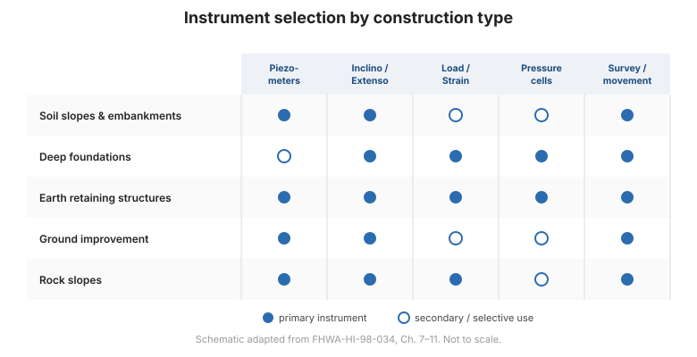

# Capítulo 1 — Introducción y la clave del éxito

## 1.1 Alcance de este módulo

Existen dos categorías generales de instrumentos de medición en trabajos geotécnicos:

1. **Instrumentos de investigación del subsuelo** — utilizados durante la *fase de diseño* para
   determinar propiedades del suelo y la roca tales como resistencia, compresibilidad y
   permeabilidad (por ejemplo, ensayos in situ y sondeos).
2. **Instrumentos de monitoreo de desempeño** — utilizados durante las fases de *construcción y
   operación* para observar cómo se comportan realmente el terreno y la estructura, midiendo
   típicamente presión del agua subterránea, esfuerzo total, deformación, carga o deformación
   unitaria.

Esta referencia trata **únicamente con la segunda categoría**. Cubre el
hardware para medir presión del agua subterránea, deformación, esfuerzo total en el suelo,
y carga y deformación unitaria en elementos estructurales; un enfoque sistemático para planificar
programas de monitoreo; la selección de instrumentos para cada tipo de construcción; y
las tareas de campo en general: calibración, mantenimiento, instalación, recolección,
procesamiento, presentación, interpretación e informe de datos.

## 1.2 El papel general de la instrumentación geotécnica

Todo diseño geotécnico es, hasta cierto punto, **hipotético**. Los materiales naturales
fueron creados por procesos que rara vez producen condiciones uniformes, y los procedimientos
exploratorios no pueden detectar de antemano cada propiedad o condición significativa.
El diseñador debe, por tanto, hacer supuestos que pueden diferir de la realidad, y el
constructor debe elegir equipo y procedimientos sin conocimiento completo de lo que encontrará.

Las observaciones de campo —incluidas las mediciones cuantitativas de la instrumentación—
son el medio por el cual el ingeniero puede, a pesar de estas limitaciones, diseñar un
proyecto seguro y eficiente, y por el cual el constructor puede ejecutar la
obra con seguridad y economía. Por esto la ingeniería geotécnica difiere de la
mayoría de las otras ramas de la ingeniería, donde los profesionales tienen mucho mayor control
sobre los materiales que utilizan. Para el ingeniero geotécnico, la instrumentación no es
un accesorio opcional — **es una herramienta de trabajo**.

La práctica de la instrumentación geotécnica es un **matrimonio entre las
capacidades de los instrumentos de medición y las capacidades de las personas**. Sacar
un instrumento de un estante, instalarlo y tomar lecturas puede parecer simple,
pero obtener información útil requiere considerable ingeniería y planificación.

## 1.3 La clave del éxito — una cadena de eslabones

El beneficio completo se logra solo si **cada paso** del proceso de planificación y
ejecución se lleva a cabo con gran cuidado. La analogía útil es una **cadena con muchos
eslabones potencialmente débiles**: un programa de monitoreo fracasa más fácil y más
a menudo que la mayoría de los otros esfuerzos geotécnicos, y la falla suele
rastrearse a una debilidad en uno o más eslabones.

El programa tiene:

- **21 eslabones de planificación** (Fase I), definidos en el [Capítulo 6](chapter-06-planning.md),
  desde *definir las condiciones del proyecto* hasta *escribir las especificaciones para los
  servicios de instrumentación de campo*.
- **10 eslabones de ejecución** (Fase II), discutidos en el
  [Capítulo 13](chapter-13-data-interpretation.md), desde *adquirir los instrumentos*
  hasta *implementar*.

La fortaleza de estos **31 eslabones** depende tanto de los instrumentos como de las personas.
El éxito se maximiza maximizando la fortaleza de **cada** eslabón.

## 1.4 La regla de oro

> Todo instrumento en un proyecto debe seleccionarse y colocarse para ayudar a
> responder una **pregunta específica**: **si no hay pregunta, no debe haber
> instrumentación.**

Esta regla, reiterada a lo largo del manual, es el filtro más importante en la
planificación de instrumentación. Los instrumentos instalados sin una pregunta se vuelven
desorden, consumen presupuesto y —peor aún— pueden ser ignorados, desacreditando el valor del
monitoreo en su conjunto.

## 1.5 Objetivos del curso

Al completar el material de esta referencia, el lector debería ser capaz de:

1. **Seleccionar equipo de monitoreo** con conocimiento del rango de
   instrumentación disponible.
2. **Planificar programas de instrumentación** de manera sistemática.
3. Comprender el papel general de la instrumentación, las principales preguntas geotécnicas
   y los instrumentos aplicables para:
    - taludes de suelo y terraplenes,
    - cimentaciones profundas,
    - estructuras de contención de tierra,
    - técnicas de mejoramiento de suelos,
    - taludes en roca.
4. Comprender métodos prácticos de calibración y mantenimiento, instalación,
   recolección, procesamiento y presentación, interpretación e informe de datos.
5. Aplicar la **regla de oro** a cada instrumento de un proyecto.

**Figura.** Qué familias de instrumentos responden las preguntas planteadas por cada tipo de construcción — el mapa para los Capítulos 7–11 (según FHWA-HI-98-034, Cap. 7–11).

## 1.6 Puntos clave

- La instrumentación para **monitoreo de desempeño** es una disciplina distinta de la
  investigación del subsuelo.
- El diseño geotécnico es hipotético; la instrumentación es cómo lo comprobamos en el
  campo.
- Un programa de monitoreo es una **cadena de 31 eslabones** (21 de planificación + 10 de ejecución) —
  un eslabón débil puede romperla.
- **Sin pregunta, sin instrumento.** La regla de oro rige cada decisión.
