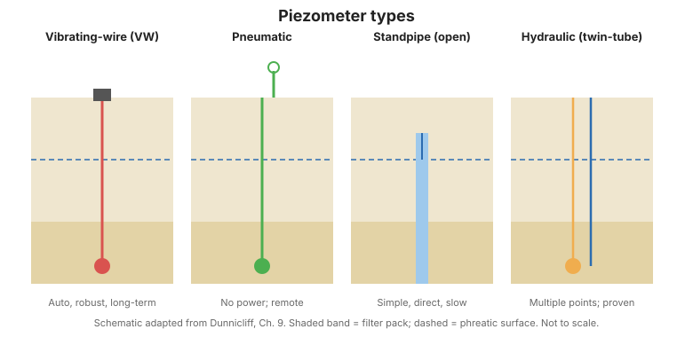
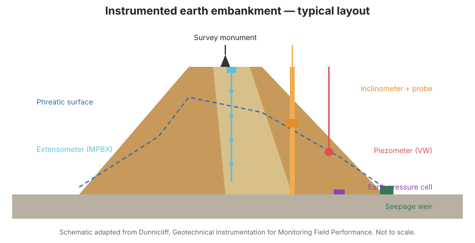

# Capítulo 2 — Resumen del hardware para presión del agua subterránea

## 2.1 Qué es un piezómetro

En esta referencia, un **piezómetro** es un dispositivo sellado dentro del terreno de modo que
responde **solo** a la presión del agua subterránea a su alrededor y no a presiones en
otras elevaciones. Los piezómetros monitorean **presión de poro en el suelo** y **presión de
agua en juntas en la roca**. (El término *celda de presión de poro* a veces se usa como
sinónimo). Un **pozo de observación** es un instrumento diferente: no tiene sellos en el
subsuelo y por tanto crea una conexión vertical entre estratos.

Las aplicaciones de los piezómetros caen en dos categorías generales:

1. **Mapear el patrón de flujo de agua** — por ejemplo, monitorear el flujo subsuperficial
   durante grandes pruebas de bombeo para determinar la permeabilidad in situ, o rastrear
   la filtración a largo plazo en taludes.
2. **Proveer un índice de resistencia** — la presión de poro permite estimar el esfuerzo
   efectivo ($\sigma' = \sigma - u$), y así evaluar la resistencia. Ejemplos
   incluyen la resistencia a lo largo de un plano de falla potencial detrás de un talud de corte, y
   el control de presión de poro durante la construcción por etapas sobre fundaciones de arcilla blanda.

La diferencia entre piezómetros en suelo y en roca no es el instrumento sino la
**instalación**: en suelo, se coloca una corta columna de arena (típicamente ~750 mm) alrededor
del piezómetro; en roca, la columna de arena es mucho más larga para asegurar que intersecte una
discontinuidad.

## 2.2 Pozos de observación

Un pozo de observación es una sección perforada de tubo unida a una columna de subida, instalada
en un sondeo relleno de arena o grava. Un sello superficial evita que el escurrimiento entre y
una ventilación en la tapa permite que el agua fluya libremente. El nivel de agua se encuentra por sondeo.

**Las aplicaciones apropiadas son muy limitadas.** Debido a que un pozo de observación crea
una **conexión vertical entre estratos**, solo es válido en terreno continuamente
permeable donde la presión del agua subterránea aumenta uniformemente con la profundidad —una
condición que rara vez puede asumirse. En la práctica actual se instalan frecuentemente durante la
investigación del sitio "para definir las presiones iniciales del agua subterránea", pero
las lecturas a menudo son engañosas. **Los pozos de observación rara vez deben usarse** para
el monitoreo de desempeño.

## 2.3 Piezómetros de tubo abierto (standpipe)

El **piezómetro de tubo abierto (Casagrande)** es una punta filtrante conectada a un tubo de subida,
con el espacio anular sellado por encima del filtro de modo que solo se conecta la zona objetivo.
Es confiable, tiene un largo historial de desempeño exitoso, y su
integridad de sello puede verificarse después de la instalación con una prueba de carga decreciente. Puede
convertirse en un instrumento de lectura remota insertando un transductor de presión.

Su gran limitación es el **largo retardo hidrodinámico** (Sección 2.7). Otras
limitaciones: puede dañarse por equipo de construcción o por la compresión vertical del
suelo circundante; puede congelarse si el nivel piezométrico sube por encima de la
línea de helada; extender el tubo a través de un terraplén interrumpe la colocación del relleno y
causa compactación inferior; y el filtro poroso puede obstruirse con flujo repetido de entrada y salida.

## 2.4 Piezómetros neumáticos

Un **piezómetro neumático** usa un diafragma flexible equilibrado por presión de gas
suministrada y devuelta a través de tubos gemelos. Ventajas: corto retardo temporal, la
parte calibrada del sistema permanece accesible en la lectura, mínima interferencia
con la construcción, y sin problemas de congelación. Limitaciones: las lecturas dependen algo del
operador, y la precisión se reduce cuando se leen bajo una condición de gas en flujo.

## 2.5 Piezómetros de alambre vibrante

Un **piezómetro de alambre vibrante (VW)** mide el cambio en la frecuencia resonante de un
alambre tensionado a medida que un diafragma se deflexiona bajo la presión del agua. Ventajas: fácil de
leer, corto retardo temporal, mínima interferencia con la construcción, efectos mínimos de los
cables de conexión, sin problemas de congelación, y fácil conexión a un **registrador de datos** para
monitoreo automatizado. Su principal limitación es que **debe evaluarse la necesidad de protección
contra rayos**.

## 2.6 Piezómetros multipunto

Un **piezómetro multipunto** coloca varios sensores en un solo sondeo para dar mediciones
detalladas de presión versus profundidad, con un número ilimitado de puntos de medición
y una parte calibrada del sistema accesible en la superficie. El compromiso es un
**procedimiento de instalación complejo**, y típicamente solo lecturas manuales periódicas.

**Figura.** Comparación de tipos comunes de piezómetros: alambre vibrante, neumático, tubo abierto, e hidráulico de tubo gemelo (según FHWA-HI-98-034, Cap. 2).

## 2.7 Retardo hidrodinámico

El **retardo hidrodinámico** es el tiempo que tarda el agua en moverse a través del filtro y
igualar la presión con el terreno circundante. Está gobernado por la **flexibilidad de cambio de
volumen** del instrumento relativa a la permeabilidad del terreno:

- Un **tubo de subida** debe admitir un gran volumen de agua para elevar la columna — así en
  arcilla de baja permeabilidad el retardo puede ser de **semanas a meses**.
- Un **instrumento de diafragma** (neumático o VW) cambia de volumen solo una pequeña cantidad,
  por lo que su retardo es de **segundos a minutos**.

Por esto el terreno de baja permeabilidad exige un instrumento de diafragma rígido, y un
tubo de subida solo es apropiado en suelo relativamente permeable.

## 2.8 Instrumentos recomendados y asuntos varios

- **Selección:** use la tabla de ventajas y limitaciones para igualar el instrumento
  al terreno y a la velocidad de respuesta requerida.
- **Tipo de filtro:** el filtro poroso debe elegirse de modo que no se obstruya y no
  añada retardo por sí mismo.
- **Sello de bentonita granular por encima del piezómetro**, luego **lechada por encima de ese sello**,
  para aislar la zona de medición.
- **Martillo/sonda de sondeo:** se usa para localizar el nivel de agua en tubos de subida y
  pozos de observación.

!!! warning "Los piezómetros de diafragma leen carga, no elevación"
    Una lectura de piezómetro de diafragma indica la **carga por encima del piezómetro**; la
    elevación propia del piezómetro debe medirse o estimarse si se requiere una *elevación*
    piezométrica. Todos los piezómetros de diafragma (excepto los tipos ventilados) son
    sensibles a cambios de **presión barométrica**.

**Figura.** Sección transversal típica de instalación en sondeo que muestra la zona de filtro, el sello y el relleno de lechada que aíslan un piezómetro (según FHWA-HI-98-034, Cap. 2).

## 2.9 Puntos clave

- Un piezómetro debe estar **sellado** para responder solo a su propia zona.
- **Los pozos de observación crean una conexión vertical** y rara vez deben usarse para
  el monitoreo.
- El **retardo temporal** es el factor decisivo: los tubos de subida son lentos, los instrumentos de
  diafragma son rápidos.
- Los piezómetros VW son el valor por defecto para monitoreo automatizado a largo plazo — pero planifique
  la **protección contra rayos**.
- Siempre registre la **elevación** del piezómetro, y vigile los efectos **barométricos**.
