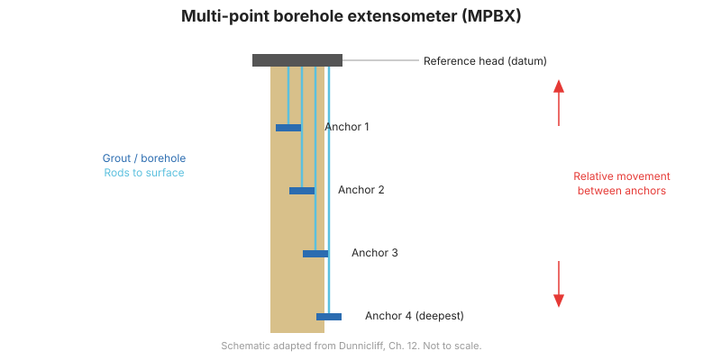
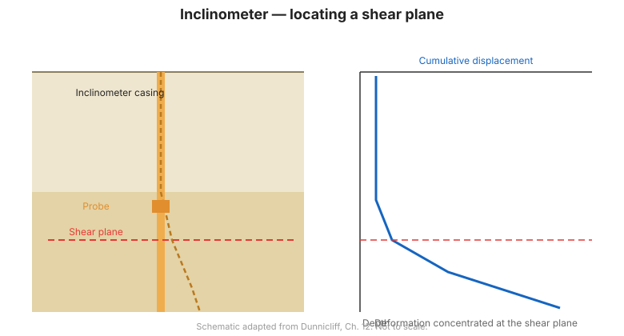

# Capítulo 3 — Resumen del hardware para deformación

## 3.1 Introducción

La deformación es el parámetro que revela más directamente si el terreno o una
estructura se comporta como se predijo. Los instrumentos para medir deformación abarcan un
amplio rango, desde simples medidores de grietas superficiales hasta inclinómetros profundos en sondeos. Se
agrupan en categorías (superficie vs. subsuelo; discreto vs. perfil) para que
el instrumento correcto pueda igualarse a la geometría del movimiento esperado.

## 3.2 Métodos de topografía

La **topografía óptica y GPS** mide el movimiento de puntos superficiales —asentamiento,
hinchamiento y desplazamiento horizontal— relativo a monolitos de referencia estables. Dan
una visión general amplia y de bajo costo y a menudo son la primera línea de monitoreo de
deformación, pero no pueden ver el movimiento en profundidad.

## 3.3 Medidores de grietas

Los medidores de grietas monitorean la apertura o cierre de una sola grieta o junta:

- **Tipos mecánicos:** clavijas y cinta, clavijas con regla de acero o calibrador,
  clavijas con alambre tensionado y peso, el **monitor de grietas de cuadrícula**, medidor de
  deformación mecánico, e indicador de cuadrante.
- **Tipos eléctricos:** transductores que convierten el movimiento de la grieta en una señal
  eléctrica para registro.

## 3.4 Medidores de convergencia

Los **medidores de convergencia** miden el cambio en la distancia entre dos puntos de una
estructura —por ejemplo, el estrechamiento de un túnel o el cierre de una excavación.

## 3.5 Inclinómetros de inclinación (tiltmeters)

Un **medidor de inclinación (tiltmeter)** mide la rotación de una superficie o estructura a partir del
cambio en la orientación de un sensor. Dos tipos comunes de transductores son:

- **Medidores de inclinación basados en acelerómetro** — robustos, usados para inclinación
  estructural y del terreno.
- **Medidores de inclinación de nivel electrolítico** — muy alta resolución para pequeñas rotaciones.

## 3.6 Extensómetros de sonda

Un **extensómetro de sonda** mide el desplazamiento a profundidades discretas a lo largo de un sondeo
bajando una sonda a blancos magnéticos o inductivos:

- **Medidores de bobina de inducción** — una sonda detecta la posición de blancos metálicos.
- **Medidores de imán / interruptor reed** — una sonda detecta anillos imantados empotrados en
  profundidades elegidas.

**Figura.** Principios de extensómetro de sonda y fijo: los blancos/puntos de anclaje en profundidad registran el movimiento relativo a una referencia estable (según FHWA-HI-98-034, Cap. 3).

## 3.7 Plataformas de asentamiento y puntos de asentamiento subsuperficiales

- **Plataformas de asentamiento** — placas superficiales (a menudo con tubos de subida) que registran el
  asentamiento del relleno a medida que se construyen los terraplenes.
- **Puntos de asentamiento subsuperficiales** — anclas colocadas en profundidad, ya sea un **ancla
  hincada o empotrada con lechada** o un **ancla Borros**, para registrar el asentamiento de una capa enterrada.

## 3.8 Extensómetros de sondeo fijos y extensómetros en serie

- **Extensómetros de sondeo fijos** — anclas instaladas permanentemente con barras o
  alambres a una cabeza de referencia, dando medición continua de la distancia entre
  profundidades fijas.
- **Extensómetros en serie** — una pila de anclas en un solo sondeo que resuelve
  la deformación en **incrementos entre anclas adyacentes**, útil para localizar la
  zona de movimiento.

## 3.9 Inclinómetros

El **inclinómetro** es el caballo de batalla para medir la deformación horizontal con
profundidad — en taludes, terraplenes, excavaciones y alrededor de cimentaciones. Una sonda con
dos acelerómetros servo-ortogonales recorre una carcasa estriada, y la
inclinación acumulada da el perfil de deflexión.

Las variantes incluyen:

- **Inclinómetros horizontales** — miden perfiles de asentamiento a lo largo de una carcasa horizontal.
- **Inclinómetros in situ (fijos)** — una cadena de sensores dejada en la carcasa para
  monitoreo continuo y automatizado.
- **Indicadores de plano de corte** — detectan la profundidad a la cual se corta una carcasa.

**Figura.** Principio del inclinómetro: la sonda recorre la carcasa estriada y la inclinación acumulada produce el perfil de deflexión con la profundidad (según FHWA-HI-98-034, Cap. 3).

## 3.10 Medidores de nivel de líquido

Los **medidores de nivel de líquido (asentamiento)** usan un tubo lleno de líquido conectado a una celda para
medir asentamiento o hinchamiento por el cambio de presión o nivel del líquido:

- **Medidores de punto único** — con ambos extremos a la misma elevación, con la unidad de lectura
  más alta que la celda, o con la celda y el tubo instalados dentro de un sondeo.
- **Medidores de perfil completo** — una serie de celdas que dan un perfil de asentamiento completo.

## 3.11 Testigos (telltales) y medidores de convergencia para pantallas de lodo

- **Testigos (telltales)** — barras o alambres simples anclados en profundidad que miden el movimiento de un
  punto específico relativo a la superficie; **múltiples testigos** resuelven el movimiento
  entre varios puntos.
- **Medidores de convergencia para pantallas de lodo** — medidores hidráulicos que miden la
  convergencia de una zanja durante la construcción.

## 3.12 Reflectometría en el dominio del tiempo metálica (TDR)

La **TDR metálica** envía un pulso por un cable coaxial y detecta reflexiones de
torceduras o rupturas causadas por el movimiento del terreno. Es una forma de bajo costo de detectar y
localizar **deformación por corte** en suelo y roca.

## 3.13 Monitoreo de emisión acústica

El monitoreo de **emisión acústica (AE)** detecta el sonido de alta frecuencia generado
cuando los granos de suelo o roca resbalan y se rompen. Contar los eventos de emisión o la
tasa de conteo da una advertencia temprana del desarrollo de inestabilidad.

## 3.14 Puntos clave

- Los instrumentos de deformación van desde el **levantamiento superficial** hasta el perfilado
  **profundo en sondeo**.
- Los **inclinómetros** son el estándar para movimiento horizontal con profundidad;
  los **extensómetros** para movimiento vertical o axial.
- Los **extensómetros en serie** y los **múltiples testigos** resuelven el movimiento *entre*
  anclas para localizar la zona activa.
- La **TDR** y la **emisión acústica** son herramientas de bajo costo para advertencia temprana.
- Iguale el **rango y resolución** del instrumento a la magnitud del movimiento que
  espera.
