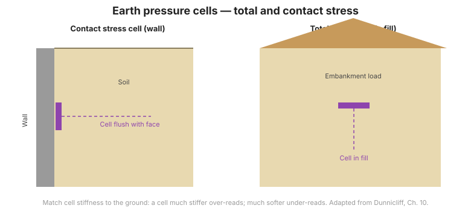

# Capítulo 4 — Resumen del hardware para esfuerzo total en el suelo

## 4.1 Introducción

El esfuerzo total es la suma del esfuerzo efectivo y la presión de poro ($\sigma = \sigma' +
u$). Como la presión de poro se mide por separado con piezómetros
([Capítulo 2](chapter-02-groundwater-pressure.md)), medir el **esfuerzo total** permite
al ingeniero separar ambos y obtener el esfuerzo efectivo — la cantidad que
realmente gobierna la resistencia y la deformación. El esfuerzo total en el suelo se mide con
**celdas de presión de tierra**.

## 4.2 Celdas de presión de tierra empotradas

Una **celda de presión de tierra empotrada** es una almohadilla plana, llena de fluido o diafragma,
empotrada en el suelo que mide el esfuerzo total que actúa normal a su cara.

### 4.2.1 Celdas típicas

La celda consiste en dos placas soldadas en los bordes con una delgada capa de fluido
entre ellas; el esfuerzo total deflexiona las placas y se lee por un transductor de
presión (frecuentemente de **alambre vibrante**). La celda debe **empotrarse** de modo que
el suelo actúe sobre ella como lo haría sobre el terreno circundante.

### 4.2.2 Limitaciones impuestas por el ambiente del suelo

Como una celda es más rígida o más blanda que el suelo a su alrededor, **redistribuye**
el esfuerzo localmente, por lo que la celda mide un esfuerzo que puede diferir del valor real de campo libre.
Este es el problema central de la medición de presión de tierra.

### 4.2.3 Factores que afectan las mediciones

Los principales factores son:

- la **relación de aspecto** (relación diámetro-espesor) de la celda,
- la **relación entre la rigidez del suelo y la rigidez de la celda**,
- la calidad de la **colocación y el relleno** alrededor de la celda, y
- efectos de temperatura y calibración.

Una alta relación de aspecto y una rigidez de celda igualada a la del suelo reducen ambos el error.

**Figura.** Celda de presión de tierra empotrada: una celda plana con transductor lee el esfuerzo total normal a su cara; la colocación y la igualación de rigidez controlan la precisión (según FHWA-HI-98-034, Cap. 4).

## 4.3 Celdas de presión de tierra de contacto

Una **celda de presión de tierra de contacto** mide el esfuerzo (o carga) en una interfaz —el
contacto entre el suelo y una estructura, o en la base de un elemento de cimentación.
Las variantes incluyen:

- **Celdas de contacto estándar** — esfuerzo en la interfaz suelo/estructura.
- **Celdas para carga en la punta de pilotes hincados** — colocadas en la punta del pilote.
- **Celdas para carga en la base de bulbos perforados** — montadas entre placas circulares gruesas.
- **Celdas para esfuerzo en los lados de pilotes hincados** — para separar el frotamiento del fuste
  del apoyo en la punta.
- **Celdas para medir esfuerzo en los lados de bulbos perforados y otras superficies de contacto.**

Como la rigidez de la estructura difiere de la del suelo, las celdas de contacto también
requieren cuidadosa colocación e interpretación.

## 4.4 Puntos clave

- **Esfuerzo total + presión de poro = esfuerzo efectivo.** Medir ambos separa la
  cantidad que controla la resistencia.
- Las celdas de presión de tierra **redistribuyen** el esfuerzo local; una desigualdad de rigidez causa
  error.
- La **relación de aspecto** y la **relación rigidez suelo/celda** son los dos factores de diseño clave
  para celdas empotradas.
- Las **celdas de contacto** resuelven el esfuerzo en interfaces y en puntas de pilotes y bases de fustes.
- La calidad de colocación es tan importante como el propio instrumento.
