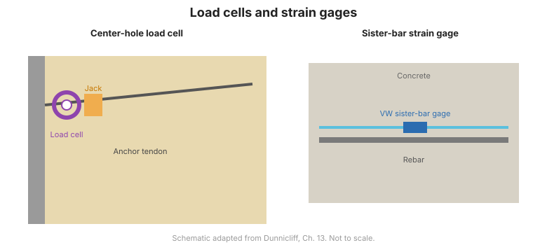

# Capítulo 5 — Carga, deformación unitaria y temperatura

## 5.1 Introducción

Este capítulo cubre los instrumentos que miden la **carga** soportada por un
miembro estructural, la **deformación unitaria** (y por tanto el esfuerzo) en él, y la
**temperatura** que afecta a ambos. Estas mediciones son centrales en los ensayos de carga de
cimentaciones profundas ([Capítulo 8](chapter-08-deep-foundations.md)) y en el monitoreo de
arriostrantes, anclas y ataduras en estructuras de contención de tierra ([Capítulo 9](chapter-09-earth-retaining.md)).

## 5.2 Celdas de carga

Una **celda de carga** mide la fuerza en un miembro en el que se inserta o se coloca debajo:

- **Celdas de carga hidráulicas** — una almohadilla llena de fluido; la carga aplicada eleva la
  presión del fluido, que se lee en un manómetro o transductor. Robustas y simples.
- **Celdas de carga de resistencia eléctrica** — galgas de deformación unidas a un miembro convierten
  la carga en una señal eléctrica.
- **Gatos hidráulicos calibrados con agujero central** — usados para aplicar y medir
  carga en operaciones de tensionado (por ejemplo, anclas y pernos de roca). Una precaución:
  la carga determinada por la presión de fluido en un gato puede llevar un **error sistemático**
  por fricción, por lo que los gatos deben **calibrarse**.

**Figura.** Celdas de carga y galgas de deformación: las celdas hidráulicas y eléctricas miden la fuerza del miembro, mientras las galgas de alambre vibrante y unidas miden la deformación unitaria (según FHWA-HI-98-034, Cap. 5).

## 5.3 Galgas de deformación unitaria superficiales

- **Galgas de deformación mecánicas** — p. ej., la galga **Demec**, que mide el cambio
  en la distancia entre dos discos de referencia en una superficie.
- **Galgas de deformación de alambre vibrante superficiales** — soldadas o unidas a un miembro de
  acero; robustas y adecuadas para monitoreo a largo plazo.
- **Galgas de deformación de resistencia eléctrica superficiales** — galgas de lámina unidas para
  mediciones de corto plazo y alta resolución.

**Relación entre deformación unitaria y esfuerzo:** convertir la deformación medida a esfuerzo
requiere el **módulo elástico** del miembro ($\sigma = E\varepsilon$). Esta conversión
es una fuente común de error y debe manejarse explícitamente.

## 5.4 Galgas de deformación unitaria empotradas

- **Galgas de deformación de alambre vibrante empotradas** — fundidas en concreto para medir la
  deformación interna a largo plazo.
- **Galgas de resistencia empotradas** — para mediciones de corto plazo.
- **Relación entre deformación unitaria y esfuerzo** — como arriba, pero para concreto el
  módulo, la fluencia y los efectos térmicos requieren cuidado.

## 5.5 Barras hermanas (sister bars)

Una **barra hermana (sister bar)** es un corto tramo de barra de refuerzo instrumentado con
galgas de alambre vibrante, atado junto a la armadura principal. Mide la deformación
en la varilla en esa ubicación, que se usa para estimar la carga que soporta la sección de concreto —una
técnica estándar para ensayos de carga y para monitorear secciones instrumentadas.

## 5.6 Múltiples testigos para determinación de esfuerzo

Los **múltiples testigos** — anclas a varias profundidades referidas a una cabeza estable—
resuelven el movimiento relativo entre puntos, a partir del cual se determina la **deformación
unitaria** en cada intervalo (y por tanto la distribución de carga).

## 5.7 Medición de temperatura

La temperatura afecta a los instrumentos de alambre vibrante y de deformación, y el movimiento térmico puede
dominar la deformación medida. La temperatura se mide con:

- **Termistores y detectores de temperatura de resistencia (RTD)** — precisos, fáciles de
  registrar.
- **Termopares** — amplio rango, menor precisión absoluta.
- **Sensores de temperatura de alambre vibrante** — convenientes cuando comparten el mismo registrador
  que los instrumentos de deformación.

Los instrumentos y registradores deben registrar la temperatura junto con la deformación para que puedan
aplicarse **correcciones térmicas**.

## 5.8 Puntos clave

- Las **celdas de carga** miden la fuerza del miembro; las **galgas de deformación** miden la deformación unitaria, que
  se convierte a esfuerzo vía el **módulo elástico**.
- **Calibre los gatos hidráulicos** — las lecturas de presión de fluido llevan error por fricción.
- Las **barras hermanas** y los **múltiples testigos** son la forma práctica de instrumentar
  el refuerzo y resolver la distribución de carga.
- Siempre registre la **temperatura** con los datos de carga/deformación para poder corregir.
