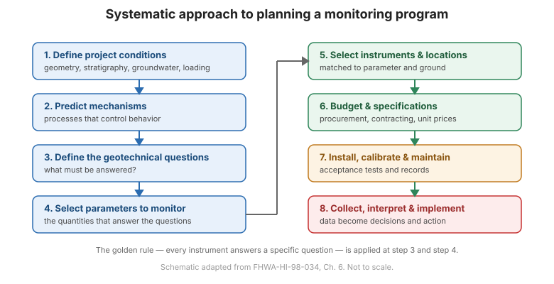

# Capítulo 6 — Enfoque sistemático para planificar programas de monitoreo

## 6.1 Introducción

La planificación es el **eje** de un programa de monitoreo exitoso. El manual de FHWA
lo organiza como una secuencia disciplinada de pasos, cada uno de los cuales es un eslabón de la
cadena de 31 (21 de planificación + 10 de ejecución). Saltarse un paso debilita la cadena. El
proceso comienza con una definición del objetivo y termina solo cuando los datos son
**implementados** — es decir, usados para tomar una decisión.

Los pasos de planificación de abajo corresponden a la **Tabla 1-1** del manual.

## 6.2 Los 21 pasos de planificación (Fase I)

1. **Definir las condiciones del proyecto** — geometría, estratigrafía, agua subterránea, carga,
   y secuencia de construcción.
2. **Predecir los mecanismos que controlan el comportamiento** — qué procesos físicos
   gobernarán la respuesta (p. ej., consolidación, corte, filtración).
3. **Definir las preguntas geotécnicas que deben responderse** — las preguntas
   guían todo lo que sigue.
4. **Definir el propósito de la instrumentación** — qué decisión informarán los datos.
5. **Seleccionar los parámetros a monitorear** — las cantidades que responden las
   preguntas.
6. **Predecir las magnitudes de cambio** — los valores esperados fijan el rango,
   la resolución y la precisión requeridos.
7. **Prever la acción correctiva** — decidir por anticipado qué se hará si se exceden los umbrales.
8. **Asignar tareas** — para las fases de diseño, construcción y operación; usar una
   tabla de asignación de tareas.
9. **Seleccionar instrumentos** — igualados al parámetro, rango y condiciones del terreno.
10. **Seleccionar las ubicaciones de los instrumentos** — donde la medición mejor responde la
    pregunta.
11. **Planear el registro de factores que puedan influir en los datos medidos** — clima,
    actividad de construcción, carga, temperatura.
12. **Establecer procedimientos para asegurar la corrección de las lecturas** — calibración, verificaciones
    y contraverificaciones.
13. **Listar el propósito específico de cada instrumento** — la regla de oro, por escrito.
14. **Preparar un presupuesto.**
15. **Preparar el informe de diseño del sistema de instrumentación.**
16. **Escribir las especificaciones de adquisición de instrumentos.**
17. **Planear la instalación.**
18. **Planear la calibración y mantenimiento regulares.**
19. **Planear la recolección, procesamiento, presentación, interpretación, informe e
    implementación de datos.**
20. **Escribir las especificaciones para los servicios de instrumentación de campo.**
21. **Actualizar el presupuesto.**

## 6.3 Los 10 pasos de ejecución (Fase II)

1. Adquirir los instrumentos.
2. Realizar pruebas de aceptación previas a la instalación.
3. Instalar los instrumentos.
4. Realizar pruebas de aceptación posteriores a la instalación.
5. Calibrar y mantener los instrumentos.
6. Recolectar datos.
7. Procesar y presentar datos.
8. Interpretar datos.
9. Informar conclusiones.
10. **Implementar** — actuar según las conclusiones.

**Figura.** El flujo de trabajo de planificación sistemática: definir condiciones → predecir mecanismos → definir preguntas → seleccionar parámetros → seleccionar instrumentos y ubicaciones → presupuestar y especificar → instalar → recolectar, procesar, interpretar e implementar (según FHWA-HI-98-034, Cap. 6).

## 6.4 Especificaciones y contratación

La adquisición es parte de la planificación, no una ocurrencia tardía. El manual da contenidos para:

- **Especificaciones de baja oferta para la adquisición de materiales de instrumentación.**
- **Especificaciones de baja oferta para servicios de instrumentación de campo.**
- **Posibles partidas de pago a precio unitario.**

Especificaciones claras —que cubran calibración, pruebas de aceptación, tolerancias de instalación
y documentación— son lo que marcan la diferencia entre un sistema que
funciona y uno que falla en silencio.

## 6.5 La regla de oro, aplicada

En el **Paso 13**, cada instrumento debe tener un propósito específico por escrito. Esta es la
regla de oro del [Capítulo 1](chapter-01-introduction.md) convertida en un entregable de planificación:
si no puede escribir la pregunta que el instrumento responde, elimine el instrumento.

## 6.6 Puntos clave

- La planificación es una **secuencia de 21 pasos**; la ejecución añade 10 más.
- **Las preguntas van primero** — los parámetros, instrumentos y ubicaciones siguen todos.
- **Predecir las magnitudes** para fijar el rango y la resolución requeridos.
- **Decidir la acción correctiva** antes de necesitarla.
- **Las especificaciones y los presupuestos son parte de la planificación.**
- Escriba el **propósito de cada instrumento** — sin pregunta, sin instrumento.
