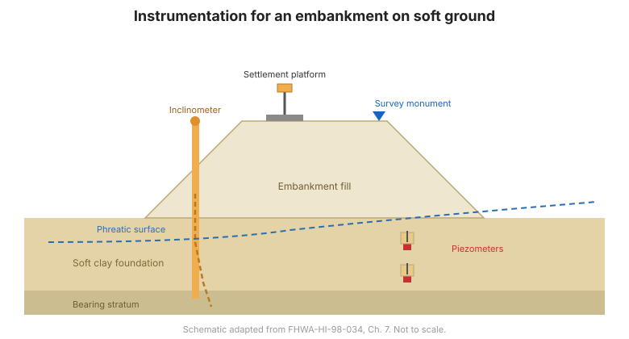

# Capítulo 7 — Instrumentación para taludes de suelo y terraplenes

## 7.1 Introducción

Para cada tipo de construcción, el manual de FHWA presenta dos cosas: el **papel general**
de la instrumentación geotécnica, y las **principales preguntas geotécnicas**
que pueden surgir junto con los instrumentos que pueden ayudar a responderlas. Este
capítulo cubre taludes de suelo y terraplenes.

## 7.2 Terraplenes sobre terreno blando

**Papel general.** La instrumentación monitorea la consolidación, la estabilidad y la
efectividad de la construcción por etapas. La respuesta de presión de poro controla la tasa segura
de colocación del relleno; el asentamiento y el movimiento horizontal muestran si la fundación
se comporta como se predijo.

**Principales preguntas geotécnicas:**

- ¿Es estable el terraplén, o se está desarrollando una falla por capacidad de carga / talud?
- ¿Qué tan rápido se consolida la fundación blanda, y avanza la construcción por etapas con seguridad?
- ¿Cuánto asentamiento ha ocurrido, y dónde?

**Instrumentos adecuados** (Tabla 7-1) típicamente incluyen: **piezómetros** (presión de poro),
**plataformas de asentamiento** y **puntos de asentamiento subsuperficiales** (asentamiento),
**inclinómetros** (movimiento lateral), y **medidores de nivel de líquido** (perfil de
asentamiento).

## 7.3 Taludes de corte en suelo

**Papel general.** La instrumentación detecta el inicio de la inestabilidad y mide la
tasa de movimiento, para que la construcción o el tráfico puedan ajustarse.

**Principales preguntas geotécnicas:**

- ¿Es estable el talud de corte, y cuál es la tasa de movimiento?
- ¿Dónde está la zona de corte activa?
- ¿Se eleva la presión de poro hacia una condición crítica?

**Instrumentos adecuados** (Tabla 7-2) típicamente incluyen: **inclinómetros** (zona de
corte y movimiento), **piezómetros** (presión de poro), **medidores de grietas** (grietas de
tracción), y **monolitos de topografía**.

## 7.4 Deslizamientos en suelo

**Papel general.** La instrumentación caracteriza un deslizamiento existente o reactivado
—su geometría, tasa y presiones de poro controlantes— para guiar la estabilización y
monitorear su efectividad.

**Principales preguntas geotécnicas:**

- ¿Qué tan profundo y qué tan rápido se mueve el deslizamiento?
- ¿Qué presiones de poro lo impulsan, y cómo responden a la lluvia?
- ¿Está funcionando la estabilización?

**Instrumentos adecuados** (Tabla 7-3) típicamente incluyen: **inclinómetros** y
**TDR** (zona de corte y tasa), **piezómetros** (presión de poro), **topografía superficial**
y **extensómetros** (movimiento), y **pluviómetros** (desencadenantes).

**Figura.** Instrumentación típica para un talud / terraplén de suelo: inclinómetro y piezómetro en el talud, plataformas de asentamiento sobre el terraplén, y monolitos de topografía (según FHWA-HI-98-034, Cap. 7).

## 7.5 Ejercicio de estudiante — planificar un programa de talud de suelo

El manual incluye un **ejercicio de estudiante** resuelto para planificar un programa de monitoreo
para un talud de suelo. Recorre el proceso de planificación:

- **Paso 1** — definición de las condiciones del proyecto.
- **Paso 3** — predecir los mecanismos que controlan el comportamiento.
- **Paso 4** — definir las preguntas geotécnicas que deben responderse.
- **Paso 6** — seleccionar los parámetros a monitorear.
- **Paso 7** — predecir las magnitudes de cambio.
- **Paso 10** — seleccionar los instrumentos.
- **Paso 12** — planear el registro de factores que puedan influir en los datos medidos.

Los resultados del ejemplo resuelto se dan en el **Apéndice C** (ver
[Capítulo 14](chapter-14-references-appendices.md)).

## 7.6 Puntos clave

- Para terraplenes sobre terreno blando, **la presión de poro controla la tasa segura de
  relleno** — instrúmentelo primero.
- Para taludes de corte y deslizamientos, el **inclinómetro** localiza la zona de corte y
  mide la tasa; los **piezómetros** explican las presiones impulsoras.
- Combine la **topografía superficial** con **instrumentos subsuperficiales** para una imagen completa.
- El **ejercicio de estudiante** es el proceso de planificación ([Capítulo 6](chapter-06-planning.md))
  aplicado de principio a fin — practíquelo.
