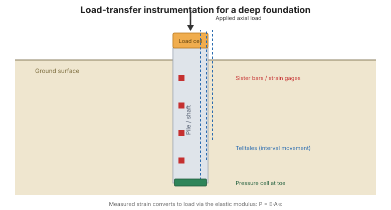

# Capítulo 8 — Instrumentación para cimentaciones profundas

## 8.1 Introducción

Las cimentaciones profundas — **pilotes hincados** y **bulbos perforados** — llevan carga de una
estructura al terreno en profundidad. La instrumentación durante los **ensayos de carga** y durante
la construcción responde la pregunta central: *¿cómo se distribuye la carga entre el
frotamiento del fuste y el apoyo en la punta, y cómo se comporta la cimentación bajo carga?*

## 8.2 Pilotes hincados

**Papel general.** La instrumentación durante un ensayo de carga axial estático mide el
comportamiento de **transferencia de carga** del pilote: cómo pasa la carga del pilote al suelo
a lo largo de su longitud y en su punta.

**Principales preguntas geotécnicas:**

- ¿Cómo se distribuye la carga axial entre el fuste y la punta?
- ¿Cuál es el frotamiento del fuste y el apoyo en la punta movilizados a carga de trabajo?
- ¿Se comporta el pilote elásticamente, y es la carga medida consistente con la
  carga aplicada?

**Instrumentos adecuados** (Tabla 8-1) típicamente incluyen: **galgas de deformación** o
**barras hermanas** (deformación axial → carga), **testigos / múltiples testigos**
(desplazamiento), **celdas de carga** en cabeza y punta del pilote, y **extensómetros**
(asentamiento interno).

## 8.3 Bulbos perforados

**Papel general.** Como con los pilotes hincados, la instrumentación resuelve la transferencia de carga y
define la respuesta carga–asentamiento. Los bulbos perforados permiten instalar la instrumentación en el
concreto fresco o la jaula de refuerzo.

**Principales preguntas geotécnicas:**

- ¿Cuál es la respuesta carga–asentamiento del bulbo?
- ¿Cómo se comparte la carga entre la resistencia lateral y la resistencia de base?
- ¿Está limpia la base y se comporta como se asumió?

**Instrumentos adecuados** (Tabla 8-2) típicamente incluyen: **barras hermanas** (deformación →
carga en la jaula), **celdas de presión de tierra de contacto** en la base, **múltiples
testigos** (movimiento por intervalo), y **celdas de carga**.

**Figura.** Instrumentación de transferencia de carga para un ensayo de carga de cimentación profunda: galgas de deformación / barras hermanas a lo largo del fuste, testigos para movimiento por intervalo, y una celda de carga y celda de presión en la punta (según FHWA-HI-98-034, Cap. 8).

## 8.4 Interpretar datos de transferencia de carga

Convertir la deformación medida a carga usa el **módulo elástico** del miembro
($P = E A \varepsilon$). Una verificación útil es una gráfica de **causa y efecto**: la carga
medida en un nivel debe ser consistente con la carga aplicada menos la carga del fuste
por encima. Cuando hay disponibles "datos completos de transferencia de carga", la distribución
del frotamiento del fuste y el apoyo en la punta pueden separarse directamente; cuando no, solo
puede inferirse la respuesta total. Los ejemplos resueltos aparecen en el **Apéndice D** (ver
[Capítulo 14](chapter-14-references-appendices.md)).

## 8.5 Puntos clave

- Instrúmente los ensayos de carga de cimentaciones profundas para resolver la carga **fuste vs. punta**.
- Las **barras hermanas** y las **galgas de deformación** convierten deformación a carga vía el **módulo
  elástico**.
- Los **testigos** y **extensómetros** dan el perfil de desplazamiento.
- Use una **verificación de causa y efecto** para confirmar que los datos son físicamente consistentes.
- Los ejemplos resueltos de transferencia de carga están en el **Apéndice D**.
