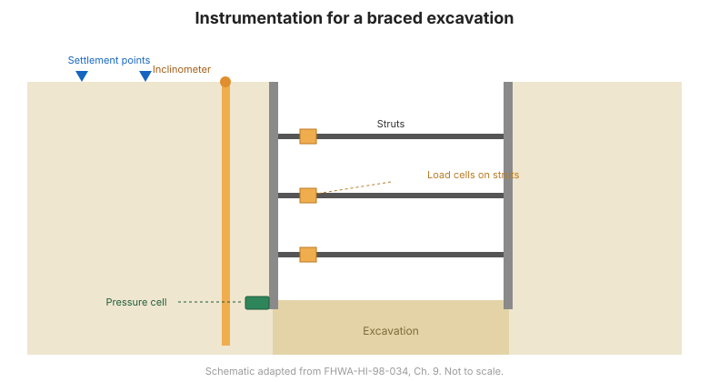

# Capítulo 9 — Instrumentación para estructuras de contención de tierra

## 9.1 Introducción

Las estructuras de contención de tierra retienen suelo o roca y transfieren las cargas resultantes
al terreno o al refuerzo interno. La instrumentación confirma que la
estructura se comporta como diseñada —que los movimientos son pequeños, las cargas son como
se predijo, y el terreno detrás del muro es estable. Este capítulo cubre excavaciones
arriostradas, pantallas de lodo, muros de tierra mecánicamente estabilizada (MSE) y muros de
clavado de suelo.

## 9.2 Excavaciones arriostradas internamente

**Papel general.** La instrumentación monitorea el movimiento del muro, el movimiento del terreno, las cargas de los
arriostrantes y las presiones de poro alrededor de una excavación, para que el arriostramiento pueda ajustarse y
las estructuras adyacentes protegerse.

**Principales preguntas geotécnicas:**

- ¿Cuánto se mueven el muro y el terreno circundante?
- ¿Qué cargas soportan los arriostrantes?
- ¿Está hinchándose la base o se está acumulando presión de poro?

**Instrumentos adecuados** (Tabla 9-1) típicamente incluyen: **inclinómetros** (movimiento del muro y
del terreno), **celdas de carga** (cargas de arriostrantes), **piezómetros** (presión de poro),
**puntos de asentamiento**, y **topografía**.

## 9.3 Excavaciones arriostradas externamente

**Papel general.** Para sistemas anclados o de contrafuerte (tie-back), la instrumentación mide las cargas de los anclas
y el movimiento del terreno.

**Instrumentos adecuados** (Tabla 9-2) típicamente incluyen: **celdas de carga** (cargas de
anclas), **inclinómetros**, **piezómetros**, y **puntos de topografía**.

## 9.4 Pantallas de lodo

**Papel general.** La instrumentación confirma la estabilidad de la zanja durante la
construcción y el desempeño del muro terminado.

**Instrumentos adecuados** (Tabla 9-3) típicamente incluyen: **medidores de convergencia**
(estabilidad de la zanja), **inclinómetros** (movimiento del muro), e instrumentos de
**esfuerzo/deformación** y **presión**.

## 9.5 Muros de tierra mecánicamente estabilizada (MSE)

**Papel general.** La instrumentación mide los esfuerzos y deformaciones en el
refuerzo y el movimiento de la cara y del suelo retenido.

**Principales preguntas geotécnicas:**

- ¿Qué tensión se moviliza en el refuerzo?
- ¿Cuánto se mueven la cara del muro y el suelo retenido?
- ¿Qué esfuerzos actúan en la base?

**Instrumentos adecuados** (Tabla 9-4) típicamente incluyen: **galgas de deformación / celdas de
carga** en el refuerzo, **inclinómetros** y **topografía** para el movimiento, y
**celdas de presión** en la base.

## 9.6 Muros de clavado de suelo

**Papel general.** La instrumentación mide las cargas de los clavos, el movimiento de la cara y la
deformación del terreno.

**Instrumentos adecuados** (Tabla 9-5) típicamente incluyen: **celdas de carga** en los clavos,
**inclinómetros**, y **puntos de topografía**.

**Figura.** Instrumentación para una estructura de contención de tierra: inclinómetros detrás del muro, celdas de carga en arriostrantes/anclas, celdas de presión en la base, y puntos de asentamiento en el terreno adyacente (según FHWA-HI-98-034, Cap. 9).

## 9.7 Ejercicio de estudiante — muro MSE

El manual incluye un **ejercicio de estudiante** sobre un muro de tierra mecánicamente estabilizada,
que cubre el monitoreo integral de estabilidad y la determinación de la magnitud
y distribución del esfuerzo en el muro. Los resultados de ejemplo están en el **Apéndice E** (ver
[Capítulo 14](chapter-14-references-appendices.md)).

## 9.8 Puntos clave

- Iguale el instrumento a la ruta de carga: **arriostrantes/anclas → celdas de carga**;
  **muro/terreno → inclinómetros y topografía**; **terreno → piezómetros**.
- Para los **muros MSE**, instrúmente el **refuerzo** para ver la tensión movilizada.
- Proteja las estructuras adyacentes monitoreando el **movimiento del terreno fuera de la
  excavación**.
- Los ejemplos resueltos de muros MSE están en el **Apéndice E**.
