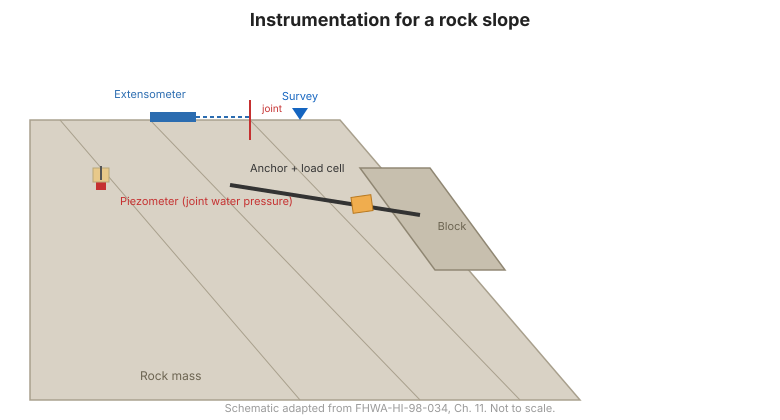

# Capítulo 11 — Instrumentación para taludes en roca

## 11.1 Introducción

Los taludes en roca fallan a lo largo de **discontinuidades** —juntas, planos de estratificación y
fallas— más que a través de la roca intacta. La instrumentación para taludes en roca por tanto se enfoca
en el movimiento de bloques discretos y en las presiones de agua que actúan sobre las
discontinuidades que podrían desencadenar el deslizamiento.

## 11.2 Taludes de corte en roca

**Papel general.** La instrumentación detecta el movimiento de bloques y las presiones de agua
que lo impulsan, para que el soporte o drenaje puedan ajustarse.

**Principales preguntas geotécnicas:**

- ¿Se mueven bloques individuales, y qué tan rápido?
- ¿Qué presiones de agua actúan sobre las discontinuidades?
- ¿Está el soporte (pernos, anclas, malla) funcionando como se pretendía?

**Instrumentos adecuados** (Tabla 11-1) típicamente incluyen: **inclinómetros y
extensómetros** (movimiento de bloques), **medidores de grietas/bloques** (movimiento relativo de
bloques), **piezómetros** (presión de agua en juntas), **celdas de carga** (cargas de anclas/pernos),
y **topografía**.

## 11.3 Deslizamientos en roca

**Papel general.** La instrumentación caracteriza la geometría y tasa de un
deslizamiento de roca y las presiones de poro que lo controlan, para guiar la estabilización y verificar su
efectividad.

**Principales preguntas geotécnicas:**

- ¿Qué tan profundo y qué tan rápido es el deslizamiento?
- ¿Qué presiones de agua en juntas lo impulsan?
- ¿Está funcionando la estabilización (anclas, drenaje)?

**Instrumentos adecuados** (Tabla 11-2) típicamente incluyen: **inclinómetros y TDR**
(zona de corte y tasa), **piezómetros** (presión de agua en juntas), **extensómetros**,
**celdas de carga** en anclas, y **pluviómetros**.

**Figura.** Instrumentación para un talud en roca: extensómetros e inclinómetros para detectar el movimiento de bloques, piezómetros para medir la presión de agua en juntas, celdas de carga en anclas, y topografía superficial (según FHWA-HI-98-034, Cap. 11).

## 11.4 Puntos clave

- Los taludes en roca fallan a lo largo de **discontinuidades** — instrúmente los **bloques**, no la
  roca intacta.
- La **presión de agua en juntas** es la variable impulsora clave; mida con piezómetros.
- Los **extensómetros, medidores de grietas y topografía** capturan el movimiento de bloques.
- Las **celdas de carga en anclas y pernos** confirman que el soporte está soportando carga.
