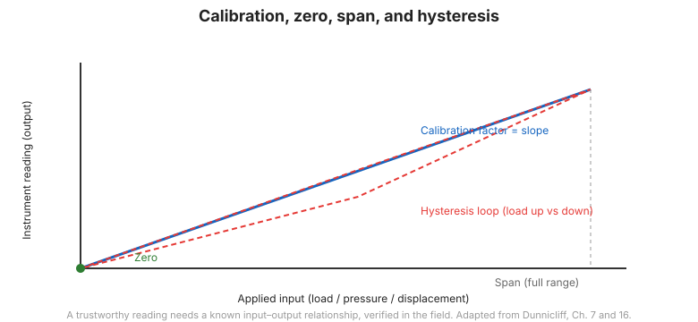

# Capítulo 12 — Calibración, mantenimiento e instalación

## 12.1 Introducción

El programa mejor planeado falla si los instrumentos no se instalan y mantienen
correctamente. Este capítulo cubre las tareas de campo que mantienen la confiabilidad de los instrumentos:
**pruebas de aceptación, calibración, mantenimiento e instalación**, y los registros
que los documentan.

## 12.2 Pruebas de aceptación

- **Pruebas de aceptación previas a la instalación** (Tabla 12-1) — realizadas en los instrumentos
  antes de la instalación para confirmar que están dentro de especificación (por ejemplo, estabilidad del cero,
  verificación de calibración, y continuidad eléctrica). Un instrumento que
  falla aquí no debe instalarse.
- **Pruebas de aceptación posteriores a la instalación** — realizadas después de la instalación para confirmar
  que el instrumento sobrevivió la instalación y lee sensiblemente contra una
  condición conocida.

## 12.3 Calibración

La calibración establece la relación entre la señal en bruto del instrumento y la
cantidad de ingeniería que mide. Puntos clave:

- Calibre **antes de la instalación** y **periódicamente** después, como parte del
  proceso de planificación ([Capítulo 6](chapter-06-planning.md)).
- Registre el **factor de calibración, el cero y el rango (span)** y llévelos a través de cada
  lectura.
- Vigile la **deriva** — un cambio lento en el cero o el rango a lo largo del tiempo.

**Figura.** La calibración convierte una señal en bruto del instrumento a un valor de ingeniería; registrar el cero y el rango es esencial para datos confiables (según FHWA-HI-98-034, Cap. 12).

## 12.4 Mantenimiento

Los instrumentos se degradan. El mantenimiento planificado incluye:

- proteger **tubos y cables** donde emergen de un sondeo;
- verificar el **desecante** en los gabinetes y la **protección contra rayos**;
- verificar **energía y comunicaciones** para sistemas automatizados; y
- reemplazar consumibles antes de que fallen.

## 12.5 Instalación

La instalación determina si el instrumento mide lo que se supone que debe medir:

- La **perforación** no debe embadurnar ni perturbar el terreno alrededor de un piezómetro o
  la carcasa de un inclinómetro.
- La **inyección y el sellado** deben aislar la zona de medición.
- Los **tubos y cables** deben protegerse contra el tráfico de construcción y el
  asentamiento (la Figura 12-1 muestra arreglos típicos de protección).
- Las **hojas de registro de instalación** (Tabla 12-2) documentan la posición, profundidad,
  sello y los valores de calibración vigentes tal como se construyó —el registro permanente que hace
  los datos interpretables años después.

## 12.6 Puntos clave

- **Pruebe de aceptación cada instrumento** antes y después de la instalación.
- La calibración define el **cero y el rango** — regístrelos y llévelos a través de todo.
- **Mantenga** los instrumentos en un cronograma planificado; no espere a la falla.
- Los **registros de instalación** son tan importantes como las lecturas — hacen los datos
  interpretables más tarde.
- Proteja los **tubos y cables**: la causa más común de falla de sistemas automatizados.
