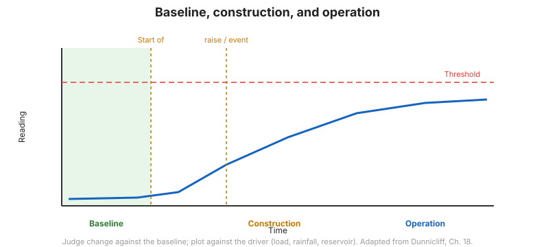

# Capítulo 13 — Recolección, procesamiento, interpretación e informe de datos

## 13.1 Introducción

Los datos solo tienen valor cuando se recolectan confiablemente, se procesan consistentemente,
se interpretan correctamente, y se **informan a las personas que pueden actuar**. Este capítulo
cubre los últimos eslabones de ejecución de la cadena —los que convierten lecturas en
decisiones.

## 13.2 Recolección de datos

- La **frecuencia** debe igualarse a la tasa de cambio: lea con más frecuencia cuando el riesgo es
  más alto (durante etapas críticas de construcción, tras lluvias, tras
  eventos sísmicos).
- Use **hojas de datos de campo** (la Figura 12-2 muestra una hoja típica de extensómetro de sonda)
  para que las lecturas en bruto, el ID del instrumento y las condiciones se capturen consistentemente.
- Registre los **factores que puedan influir en los datos** —clima, actividad de
  construcción, carga y temperatura— junto con la lectura, para que causa y efecto puedan
  establecerse más tarde.

## 13.3 Procesamiento y presentación

- Convierta las lecturas en bruto a unidades de ingeniería usando la **calibración actual**.
- Presente los datos como **gráficas de series de tiempo** y, donde sea relevante, como **gráficas de
  perfil** (p. ej., deflexión de inclinómetro con la profundidad).
- Grafique los **factores influyentes** en el mismo eje temporal —carga, lluvia, nivel de
  estanque— para que las relaciones sean visibles.

## 13.4 Interpretación

La interpretación pregunta *qué significan los datos*, no meramente *cuáles son los números*:

- Compare contra las **magnitudes predichas** de la planificación
  ([Capítulo 6](chapter-06-planning.md)).
- Busque **relaciones de causa y efecto** —por ejemplo, asentamiento de terreno blando bajo un
  terraplén graficado contra la altura del relleno (Figura 12-3).
- Identifique **tendencias y tasas** —una tasa constante de movimiento es más alarmante que una
  sola lectura.
- Esté alerta al **error del instrumento** antes de concluir que el terreno se comporta
  anormalmente.

**Figura.** Interpretar una serie de tiempo de monitoreo: línea base, respuesta de construcción, y una tendencia en desarrollo que dispara una acción (según FHWA-HI-98-034, Cap. 12–13).

## 13.5 Informe

Los informes deben ser claros y oportunos:

- Establezca la **conclusión** y la **acción requerida**, no solo las lecturas.
- Muestre los datos contra **umbrales y valores predichos**.
- Distribuya los informes a todos los que necesitan actuar, en un cronograma que iguale el
  riesgo.

## 13.6 Ejercicio de estudiante — evaluación de datos

El manual incluye un **ejercicio de estudiante sobre la evaluación de datos**, con
evaluaciones sugeridas en el **Apéndice F** (ver
[Capítulo 14](chapter-14-references-appendices.md)). Los ejemplos incluyen interpretar
**datos de topografía óptica** e identificar **datos correctos vs. erróneos de inclinómetro**
—la habilidad práctica de separar la señal del ruido.

## 13.7 Implementación — el eslabón final

La cadena no está completa hasta que los datos son **implementados**: se toma una decisión,
se realiza una acción, y se registra el resultado. El monitoreo que nunca cambia una
decisión ha fallado, sin importar qué tan buenos fueran los instrumentos.

## 13.8 Puntos clave

- **Lea con más frecuencia cuando el riesgo es más alto.**
- Registre los **factores influyentes** con cada lectura.
- **Grafique e interprete** contra magnitudes predichas y umbrales.
- Separe la **señal del ruido** —verifique el instrumento antes de culpar al terreno.
- **Informe a los tomadores de decisiones**, e **implemente** —ese es el punto.
