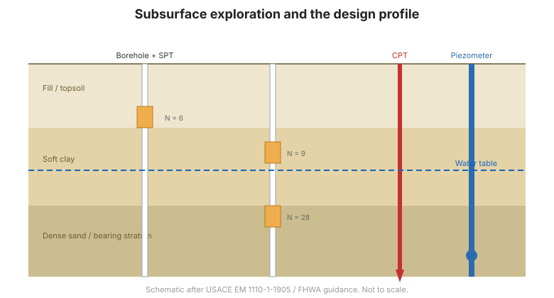

# Capítulo 2 — Exploración Subsuperficial y Caracterización de Sitio

## 2.1 Por qué explorar

Todo diseño de cimentación es tan bueno como el modelo de terreno que lo respalda. La
**exploración subsuperficial** establece la estratigrafía, las condiciones de agua
subterránea y las propiedades de ingeniería necesarias para elegir el tipo de
cimentación y calcular capacidad y asentamiento. La **exploración insuficiente** es
la causa raíz más común de los problemas de cimentación.

## 2.2 El programa de exploración

Un programa se planifica en torno a la **estructura y a las preguntas** que plantea:

- **Propósito** — ¿qué cargas, qué movimiento tolerable, qué métodos constructivos?
- **Distribución** — sondeos y perforaciones ubicados para cubrir la huella de la
  estructura y cualquier variabilidad; más próximos donde cambian las condiciones.
- **Profundidad** — suficiente para atravesar todas las capas que contribuyen
  significativamente al asentamiento, o para alcanzar estratos competentes de
  apoyo.
- **Métodos** — una combinación de **perforaciones con muestreo** y **ensayos
  in-situ**.

## 2.3 Muestreo y ensayos in-situ

- Las **perforaciones** recuperan muestras alteradas e inalteradas para ensayos de
  laboratorio.
- El **Ensayo de Penetración Estándar (SPT)** da el número de golpes $N$ —un índice
  muy usado de densidad y resistencia, y base de muchas correlaciones empíricas.
- El **Ensayo de Penetración de Cono (CPT)** da resistencia de punta y fricción de
  manguito continuas, excelente para perfilar suelos blandos y estimar resistencia y
  parámetros de consolidación.
- Los ensayos de **veleta**, **presurómetro** y **dilatómetro** aportan parámetros
  específicos in-situ.

## 2.4 Agua subterránea

El agua subterránea gobierna el esfuerzo efectivo y por tanto la resistencia y el
asentamiento. Se debe establecer:

- la **profundidad del nivel freático** y su rango estacional;
- las **presiones de poros** y cualquier condición artesiana;
- la **permeabilidad** de cada capa, para filtración y consolidación.

Las presiones de poros se miden con **piezómetros** (véanse las referencias
[Dunnicliff](../dunnicliff/index.md) y [FHWA](../fhwa/index.md)).

## 2.5 De los datos al perfil de diseño

La exploración produce un **perfil de diseño**: un modelo simplificado y conservador
de las capas, sus propiedades y el régimen de agua subterránea, expresado como
parámetros para los análisis de los capítulos siguientes. El perfil debe:

- **acotar la incertidumbre** — adoptar valores conservadores donde los datos son
  escasos;
- **identificar suelos problemáticos** — arcillas blandas, arenas sueltas, suelos
  expansivos o colapsables, orgánicos, rellenos;
- **señalar la variabilidad** — dónde cambian bruscamente las propiedades en el
  sitio.

**Figura.** Exploración subsuperficial: las perforaciones con muestreo y ensayos
in-situ, junto con piezómetros, construyen el perfil de diseño (según USACE EM
1110-1-1905 / guía FHWA).

## 2.6 Puntos clave

- **Explore antes de diseñar** — el modelo de terreno rige cada decisión.
- Combine **perforaciones** con **ensayos in-situ** (SPT, CPT) y **medición de agua
  subterránea**.
- Profundidad y espaciamiento siguen a la **estructura y sus preguntas**.
- Reduzca los datos a un **perfil de diseño** conservador y explícito.
- Vigile los **suelos problemáticos** y la **variabilidad**.
