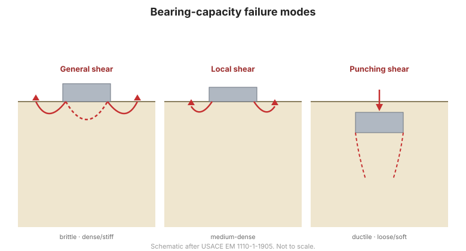

# Capítulo 3 — Cimentaciones Superficiales: Capacidad de Carga

## 3.1 El problema de la capacidad de carga

Una cimentación superficial (típicamente una zapata con profundidad $D_f$ menor que
su ancho $B$) debe transferir la carga estructural al terreno sin **falla por corte**
del suelo de apoyo. La **capacidad de carga última** $q_{ult}$ es la presión a la que
falla el suelo; la **presión de apoyo admisible** es $q_{ult}$ dividida por un factor
de seguridad, y además se verifica frente al asentamiento
([Capítulo 4](chapter-04-settlement.md)).

## 3.2 Modos de falla

La falla de apoyo ocurre de una de tres formas, según la densidad y compresibilidad
del suelo:

- **Corte general** — una cuña y superficie de deslizamiento bien definidas; falla
  súbita y frágil. Típica de arenas densas y arcillas rígidas.
- **Corte local** — superficie de deslizamiento menos desarrollada con asentamiento
  significativo antes de la falla. Típica de suelos de densidad media.
- **Corte por punzonamiento** — la zapata penetra en el suelo con poco levantamiento
  superficial. Típico de arenas sueltas y arcillas blandas.

**Figura.** Modos de falla de la capacidad de carga: corte general (frágil), corte
local y corte por punzonamiento (dúctil) (según USACE EM 1110-1-1905).

## 3.3 La ecuación de capacidad de carga

La solución clásica expresa $q_{ult}$ como suma de tres términos:

$$q_{ult} = c N_c s_c + q N_q s_q + \tfrac{1}{2} \gamma B N_\gamma s_\gamma$$

donde $c$ es la cohesión, $q$ la sobrecarga al nivel de la cimentación, $\gamma$ el
peso unitario, $B$ el ancho de la zapata, $N_c, N_q, N_\gamma$ los **factores de
capacidad de carga** (funciones del ángulo de fricción) y los términos $s$ los
**factores de forma**. Se usan varias formulaciones —**Terzaghi**, **Meyerhof**,
**Hansen** y **Vesić**— que difieren en los factores y en cómo tratan forma,
profundidad, inclinación y excentricidad.

## 3.4 El nivel freático

El agua subterránea reduce el esfuerzo efectivo en la zona de falla, disminuyendo la
capacidad. Los dos extremos son:

- nivel freático **en la base** de la zapata, y
- nivel freático **en la superficie del terreno**.

Entre ambos, los términos de peso unitario se reducen con un factor que depende de la
profundidad del nivel freático respecto a $B$. El diseño debe usar el **nivel de agua
más alto previsto** para la capacidad crítica (la menor).

## 3.5 Cargas excéntricas e inclinadas

Las zapatas reales soportan cargas **excéntricas** (momentos) y a veces cargas
**inclinadas**. El enfoque estándar sustituye la zapata real por un **área efectiva**
$B' \times L'$ (Meyerhof), centrada bajo la resultante de carga, y aplica factores de
inclinación. La excentricidad reduce tanto el área efectiva de apoyo como la
capacidad.

## 3.6 Capacidad de carga a partir de ensayos in-situ

Cuando el muestreo es difícil, la capacidad se estima con ensayos de campo:

- **SPT** — correlaciones entre $N$ y la presión admisible, ajustadas por nivel
  freático y sobrecarga.
- **CPT** — capacidad a partir de la resistencia de punta del cono.
- **Ensayo de placa de carga** — medición directa in-situ de la respuesta
  carga–asentamiento del suelo real, extrapolada a la zapata prototipo con cautela.

## 3.7 Puntos clave

- **Capacidad última ÷ factor de seguridad = presión admisible** — pero el
  asentamiento suele gobernar.
- Conozca el **modo de falla**: corte general, local o por punzonamiento.
- La ecuación de capacidad tiene **tres términos** (cohesión, sobrecarga, peso
  propio) con factores de forma/profundidad/inclinación.
- Use el **nivel freático más alto** en el diseño.
- Convierta las **cargas excéntricas** a un área efectiva.
- Los **ensayos de placa de carga** miden la respuesta real del suelo; úselos con
  criterio.
