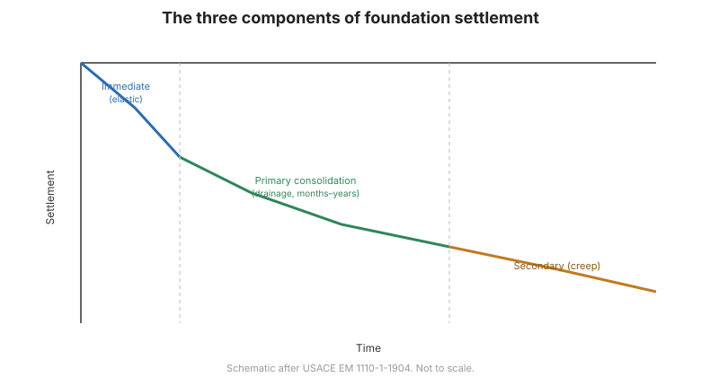

# Capítulo 4 — Cimentaciones Superficiales: Asentamiento

## 4.1 Por qué el asentamiento suele gobernar

Para la mayoría de las estructuras sobre buen terreno, **la capacidad de carga no es
el criterio de control — lo es el asentamiento**. Una zapata puede estar lejos de la
falla por corte y aun así asentar lo suficiente para agrietar acabados, deformar
pórticos o desalinear maquinaria. Por ello el diseño calcula el asentamiento y lo
compara con el **movimiento tolerable** de la estructura.

## 4.2 Las tres componentes del asentamiento

El asentamiento total tiene tres partes:

1. **Asentamiento inmediato (elástico)** — ocurre al aplicar la carga, por compresión
   elástica y deformación lateral del suelo. Significativo en arenas y suelos no
   saturados.
2. **Asentamiento por consolidación primaria** — drenaje y cambio de volumen
   dependientes del tiempo en suelos saturados de grano fino, regidos por la **teoría
   de consolidación unidimensional de Terzaghi**. Puede tardar meses o años.
3. **Asentamiento secundario (fluencia)** — cambio de volumen continuo a esfuerzo
   efectivo constante, especialmente en arcillas orgánicas y blandas.

**Figura.** Las tres componentes del asentamiento de cimentaciones —inmediato,
consolidación primaria y secundario— se acumulan con el tiempo (según USACE EM
1110-1-1904).

## 4.3 Asentamiento inmediato

El asentamiento inmediato se calcula con la **teoría elástica**:

$$S_e = q B \frac{1-\nu^2}{E} I_s$$

donde $q$ es la presión aplicada, $B$ el ancho de la zapata, $E$ y $\nu$ el módulo
elástico y la relación de Poisson del suelo, e $I_s$ un factor de influencia que
depende de la forma y rigidez de la zapata. En arenas, $E$ se estima a menudo con
correlaciones **SPT o CPT**.

## 4.4 Asentamiento por consolidación primaria

Para una arcilla normalmente consolidada:

$$S_c = \frac{C_c H}{1+e_0}\log\frac{\sigma'_{v0}+\Delta\sigma}{\sigma'_{v0}}$$

donde $C_c$ es el índice de compresión, $H$ el espesor de la capa, $e_0$ la relación
de vacíos inicial, $\sigma'_{v0}$ el esfuerzo efectivo inicial y $\Delta\sigma$ el
incremento de esfuerzo. Para arcillas sobreconsolidadas se usa el **índice de
recompresión** $C_r$ hasta la presión de preconsolidación. La **velocidad** está
gobernada por el coeficiente de consolidación $c_v$.

## 4.5 Asentamiento de suelos granulares

En arenas, la consolidación es esencialmente inmediata y el asentamiento se estima
con **correlaciones empíricas** con el $N$ del SPT, la resistencia de punta del CPT o
**ensayos de placa de carga**, con correcciones por ancho de zapata y nivel freático.
Como las arenas son notoriamente variables, estas estimaciones conllevan amplia
incertidumbre.

## 4.6 Movimiento tolerable y asentamiento diferencial

El diseño no lo gobierna el asentamiento absoluto, sino:

- el **asentamiento total** — no debe perjudicar la función de la estructura;
- el **asentamiento diferencial** — la *diferencia* entre puntos adyacentes, que
  causa distorsión, suele ser la medida crítica;
- la **distorsión angular** — asentamiento diferencial dividido por la luz entre
  puntos.

Los límites dependen del tipo de estructura (edificios, puentes, maquinaria) y se
dan en los manuales de diseño y normas.

## 4.7 Puntos clave

- **El asentamiento, no la capacidad de carga, suele gobernar** el diseño de
  cimentaciones superficiales.
- Asentamiento total = **inmediato + consolidación primaria + secundario**.
- Use **teoría elástica** para el inmediato, **teoría de consolidación** para
  arcillas y **correlaciones empíricas** para arenas.
- El **asentamiento diferencial y la distorsión angular** son los verdaderos
  criterios de serviciabilidad.
- Monitoree el asentamiento real con **plataformas de asentamiento y
  extensómetros** (véase la referencia [FHWA](../fhwa/index.md)).
