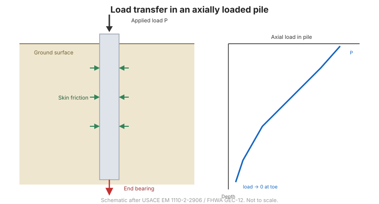

# Capítulo 6 — Cimentaciones Profundas: Tipos y Transferencia de Carga

## 6.1 Cuándo se usan cimentaciones profundas

Las **cimentaciones profundas** llevan la carga a estratos competentes muy por debajo
de la superficie, o desarrollan capacidad a lo largo de su longitud por fricción. Se
usan cuando:

- los suelos superficiales son demasiado débiles o compresibles para cimentaciones
  superficiales;
- las cargas son muy grandes;
- deben resistirse socavación, subpresión o cargas laterales;
- el asentamiento debe controlarse estrictamente;
- suelos expansivos o colapsables hacen poco fiables las cimentaciones
  superficiales.

## 6.2 Clasificación de pilotes

Los pilotes se clasifican por **material**, **método de instalación** y **mecanismo
de transferencia de carga**:

- **Por material:** madera, acero (perfiles H, tubulares, tablestacas), concreto
  (prefabricado o colado in-situ) y compuestos.
- **Por instalación:** **hincados** (pilotes de desplazamiento, que densifican el
  suelo), **perforados** (sin desplazamiento, que extraen suelo) y **inyectados** o
  **vibrados**.
- **Por transferencia de carga:** **apoyo en punta** (la punta descansa sobre un
  estrato duro), **fricción** (la carga la soporta el rozamiento del fuste) y
  **combinados**.

## 6.3 Cómo soporta carga un pilote

Un pilote cargado moviliza resistencia en dos lugares:

- **Apoyo en punta**, donde el pilote se apoya o penetra un estrato más resistente; y
- **Fricción de fuste**, por la resistencia al corte entre pilote y suelo.

La carga no es uniforme: disminuye con la profundidad a medida que el suelo la va
tomando. A carga de trabajo se movilizan ambas componentes, pero su proporción
relativa depende del perfil del suelo y de la rigidez del pilote.

**Figura.** Transferencia de carga en un pilote: la carga axial disminuye con la
profundidad al movilizarse la fricción de fuste y el apoyo en punta; las galgas y los
testigos revelan la distribución (según USACE EM 1110-2-2906 / FHWA GEC-12).

## 6.4 Efectos de la instalación

La instalación cambia el suelo alrededor del pilote:

- **Hincado** desplaza y densifica el suelo, aumentando el esfuerzo efectivo y la
  capacidad en arenas, pero puede causar levantamiento y daño a estructuras
  vecinas.
- **Perforación** libera esfuerzos y puede dejar una zona remoldeada que reduce la
  capacidad, pero causa menor alteración.
- **Recuperación (set-up o freeze)** — los pilotes hincados en arcilla ganan
  capacidad con el tiempo al disiparse el exceso de presión de poros.

Estos efectos significan que **la capacidad no es una propiedad pura del suelo** —
depende de cómo se instaló el pilote.

## 6.5 Puntos clave

- Las cimentaciones profundas se usan para **suelos superficiales débiles, grandes
  cargas, socavación, subpresión, cargas laterales y control de asentamiento**.
- Clasifique los pilotes por **material, instalación y transferencia de carga**.
- Un pilote moviliza **apoyo en punta + fricción de fuste**; la carga disminuye con
  la profundidad.
- **La instalación cambia el suelo** — hincar densifica, perforar libera; la
  recuperación aumenta la capacidad con el tiempo.
- **Instrumente** los ensayos de carga para ver la distribución real
  ([Capítulo 7](chapter-07-axial-capacity.md)).
