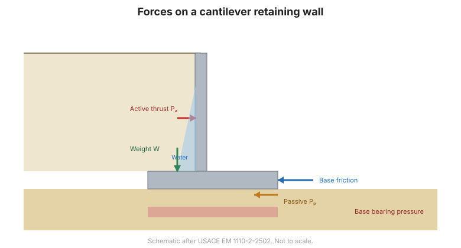

# Capítulo 11 — Muros de Contención y Muros MSE

## 11.1 Tipos de muros

- **Muros de gravedad** — concreto en masa o mampostería; resisten la presión por su
  propio peso.
- **Muros en voladizo** — un fuste de concreto reforzado sobre una base; el tipo más
  común.
- **Muros con contrafuertes y con estribos** — muros en voladizo con nervaduras
  para grandes alturas.
- **Muros de tierra estabilizada mecánicamente (MSE)** — un panel de revestimiento
  más **refuerzo del suelo** (tiras, mallas o geotextiles) en el relleno.
- **Muros pantalla y de pilotes perforados** — tratados en el
  [Capítulo 12](chapter-12-sheet-piles.md).

## 11.2 Verificaciones de estabilidad

Todo muro de contención se verifica frente a tres modos de falla:

1. **Vuelco** respecto a la puntera — el momento resistente (peso, presión pasiva)
   debe superar el momento de vuelco del empuje lateral.
2. **Deslizamiento** a lo largo de la base — la fuerza resistente (fricción de base
   más presión pasiva) debe superar la fuerza lateral actuante.
3. **Falla de capacidad de carga** del suelo de cimentación — la presión excéntrica
   de base no debe superar la presión admisible, y conviene mantener la resultante
   dentro del **tercio medio** cuando sea posible.

También se requiere una verificación global de **estabilidad de taludes**
([Capítulo 13](chapter-13-slope-stability.md)), puesto que el muro y el suelo
contenido pueden fallar como una masa.

**Figura.** Fuerzas sobre un muro de contención en voladizo: el empuje lateral de
tierras y la presión de agua empujan el muro, resistidos por su peso, la fricción de
base y la presión pasiva en la puntera (según USACE EM 1110-2-2502).

## 11.3 Drenaje y relleno

**El drenaje es el detalle más importante.** Un muro nunca debe diseñarse para
resistir presión hidrostática plena salvo que realmente no pueda drenar:

- aporte un sistema de **barbacanas** y/o un **manto drenante** tras el muro;
- use **relleno granular de libre drenaje**;
- **filtre** el drenaje para evitar obstrucciones.

El relleno se coloca y compacta por capas, con la compactación controlada para no
fijar presión lateral excesiva
([Capítulo 10](chapter-10-lateral-earth-pressure.md)).

## 11.4 Muros de tierra estabilizada mecánicamente (MSE)

Los muros MSE llevan el empuje lateral al **refuerzo del suelo** que se extiende
dentro del relleno contenido. Aspectos clave de diseño:

- **Estabilidad interna** — el refuerzo no debe romperse ni arrancarse; la tracción
  es máxima en el revestimiento y disminuye con la profundidad.
- **Estabilidad externa** — la masa de suelo reforzado en su conjunto no debe
  deslizar, volcar ni sobrecargar la cimentación.
- **Revestimiento** — paneles, bloques o geotextil envuelto.
- **Corrosión y durabilidad** — el refuerzo metálico debe protegerse contra la
  corrosión; la vida de diseño gobierna el espesor.

Los muros MSE son económicos, toleran asentamiento y se tratan ampliamente en el
manual FHWA GEC-11.

## 11.5 Puntos clave

- Verifique todo muro frente a **vuelco, deslizamiento y capacidad de carga** — más
  la **estabilidad global**.
- El **drenaje** es el detalle de diseño más importante — nunca atrape agua tras un
  muro.
- Los **muros MSE** transfieren el empuje al refuerzo del suelo; verifique
  estabilidad **interna y externa** y **durabilidad**.
- Mantenga la resultante de base dentro del **tercio medio** cuando sea posible.
