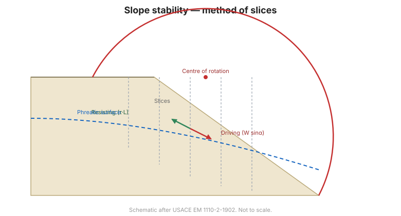

# Capítulo 13 — Estabilidad de Taludes

## 13.1 Por qué fallan los taludes

Un talud falla cuando el **esfuerzo cortante** a lo largo de una superficie de
deslizamiento potencial supera la **resistencia al corte** del suelo. El **factor de
seguridad** es la razón entre la resistencia disponible y el esfuerzo movilizado:

$$F = \frac{\tau_{disponible}}{\tau_{movilizado}}$$

La falla puede ser **súbita** (frágil, en suelos densos o roca) o **progresiva**
(arcillas blandas, roca meteorizada), y puede desencadenarla la lluvia, la
excavación, la carga o la acción sísmica.

## 13.2 Taludes infinitos

Para un talud largo y uniforme cuya superficie de deslizamiento es paralela a la
superficie, el factor de seguridad tiene solución cerrada. Importan dos casos:

- **Talud seco o drenado** — gobernado por el ángulo de fricción y el ángulo del
  talud.
- **Con filtración** — las presiones de poros reducen el esfuerzo efectivo y el
  factor de seguridad, a menudo drásticamente. Por esta razón el **drenaje** es la
  medida de estabilización principal.

## 13.3 Taludes finitos y método de rebanadas

Los taludes reales se analizan con **métodos de equilibrio límite** que dividen la
masa potencialmente deslizante en **rebanadas verticales**:

- **Método ordinario de rebanadas (Fellenius)** — simple, conservador.
- **Método simplificado de Bishop** — considera las fuerzas entre rebanadas y es el
  caballo de batalla de la práctica.
- **Spencer** y **Morgenstern–Price** — rigurosos, satisfacen todas las condiciones
  de equilibrio.

El análisis busca la **superficie de deslizamiento crítica** —la que da el factor de
seguridad menor. Los métodos computacionales (p. ej., **STABL**, **SLOPE/W**)
automatizan la búsqueda.

**Figura.** Estabilidad de taludes por el método de rebanadas: fuerzas actuantes y
resistentes en cada rebanada, y búsqueda de la superficie de deslizamiento crítica
(según USACE EM 1110-2-1902).

## 13.4 Condiciones a corto y largo plazo

- **Corto plazo (no drenado)** — inmediatamente tras la construcción o excavación,
  usando la **resistencia al corte no drenada** $c_u$; crítico en arcillas blandas.
- **Largo plazo (drenado)** — tras equilibrarse las presiones de poros, usando
  parámetros de **esfuerzo efectivo** $c', \phi'$; a menudo crítico en arcillas
  rígidas y en taludes con filtración.

Ambas condiciones deben verificarse, y gobierna el **factor de seguridad menor**.

## 13.5 Métodos de estabilización

Cuando un talud es inestable, las opciones incluyen:

- **Drenaje** — superficial y subterráneo; el más eficaz y económico.
- **Reperfilado** — suavizar el talud o añadir un berma de pie.
- **Estructuras de contención** — muros, tablestacas o suelo reforzado al pie.
- **Mejoramiento del suelo** — clavos de suelo, anclajes o refuerzo
  ([Capítulo 14](chapter-14-ground-improvement.md)).
- **Refuerzo** — clavos de suelo, anclajes de retención o geosintéticos.

## 13.6 Puntos clave

- Los taludes fallan cuando el **esfuerzo cortante supera la resistencia al corte**;
  el factor de seguridad es esa razón.
- La **filtración** reduce el factor de seguridad — el **drenaje** es la solución
  principal.
- Use el **método de rebanadas** (Bishop en la práctica) y busque la **superficie
  de deslizamiento crítica**.
- Verifique condiciones **a corto y largo plazo**; gobierna el $F$ menor.
- Estabilice con **drenaje, reperfilado, estructuras de contención o refuerzo**.
