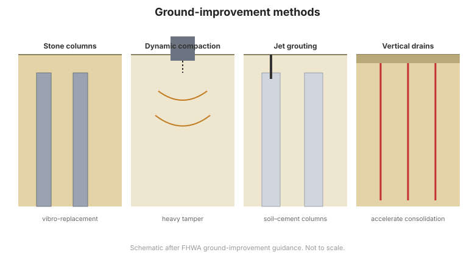

# Capítulo 14 — Mejoramiento de Suelos e Instrumentación de Cimentación

## 14.1 Por qué mejorar el terreno

Cuando el terreno no puede soportar la cimentación propuesta de forma económica,
puede **mejorarse in-situ** en lugar de sortearlo con cimentaciones profundas. El
mejoramiento de suelos aumenta la resistencia, reduce la compresibilidad, controla
el agua subterránea o mitiga la licuefacción. A menudo es la solución más económica
para suelos débiles, sueltos o compresibles.

## 14.2 Métodos de densificación

- **Vibrocompactación y vibrosustitución (columnas de grava)** — sondas vibratorias
  densifican arenas sueltas y forman columnas de grava compactada en arcillas
  blandas.
- **Compactación dinámica** — un peso pesado dejado caer en retícula densifica
  rellenos granulares y suelos sueltos.
- **Sustitución dinámica profunda** — columnas de grava o escollera formadas por
  caída de peso.
- **Inyección de compactación** — lechada rígida inyectada para densificar y
  levantar.

## 14.3 Refuerzo e inclusiones

- **Columnas de grava** — aumentan la capacidad de carga y reducen el asentamiento;
  también actúan como drenes.
- **Clavado de suelo** — clavos de acero instalados en un talud o frente de
  excavación para reforzarlo (FHWA GEC-7).
- **Suelo reforzado (MSE)** — refuerzo geosintético o metálico en el relleno
  ([Capítulo 11](chapter-11-retaining-walls.md)).
- **Micropilotes** — pilotes perforados e inyectados de pequeño diámetro para
  accesos restringidos o recalces.

## 14.4 Inyecciones y drenaje

- **Inyección de impregnación** — rellena vacíos en suelos granulares para reducir
  permeabilidad y aumentar resistencia.
- **Jet grouting** — lechada a alta presión crea columnas de suelo–cemento.
- **Drenaje** — drenes verticales, drenes de mecha y drenes horizontales aceleran la
  consolidación y reducen las presiones de poros.

**Figura.** Métodos comunes de mejoramiento de suelos: vibrosustitución / columnas
de grava, compactación dinámica, jet grouting y drenes verticales prefabricados
(según la guía de mejoramiento de suelos de FHWA).

## 14.5 Instrumentación para cimentaciones

Como el mejoramiento de suelos y las cimentaciones profundas son costosos y difíciles
de verificar, la **instrumentación** es esencial para confirmar el desempeño:

- **Plataformas de asentamiento y extensómetros** — miden el asentamiento y su
  distribución.
- **Piezómetros** — siguen las presiones de poros durante consolidación y carga.
- **Inclinómetros** — detectan movimiento lateral en taludes y tras excavaciones.
- **Celdas de carga y galgas extensométricas** — miden la carga en pilotes,
  anclajes y puntales.
- **Puntos de asentamiento y levantamiento** — verifican el mejoramiento y las
  estructuras vecinas.

Estos instrumentos, y la práctica de usarlos, se tratan en profundidad en las
referencias [Dunnicliff](../dunnicliff/index.md) y [FHWA](../fhwa/index.md).

## 14.6 Puntos clave

- El **mejoramiento de suelos** suele ser más barato que las cimentaciones profundas
  en terrenos débiles.
- La **densificación** (vibro, compactación dinámica) trata suelos sueltos y
  compresibles.
- Las **inclusiones y el refuerzo** (columnas de grava, clavos, MSE, micropilotes)
  aportan resistencia y rigidez.
- Las **inyecciones y el drenaje** controlan permeabilidad y presión de poros.
- **Instrumente** todo mejoramiento y cimentación — la verificación es esencial
  porque el terreno está oculto.
