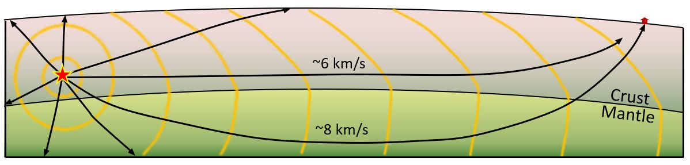
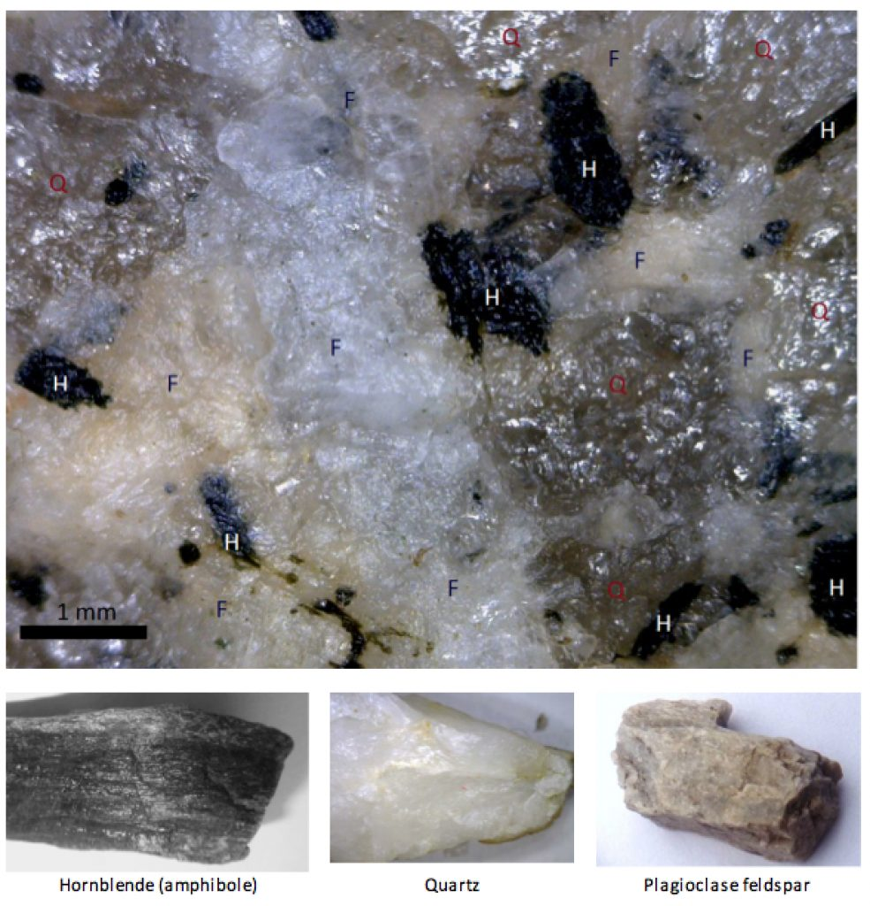
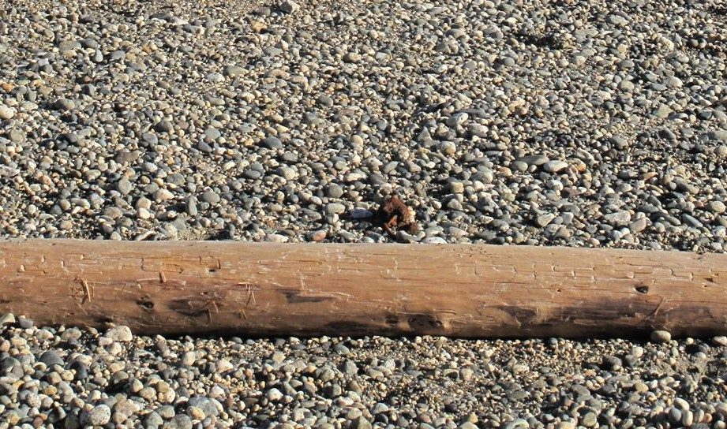
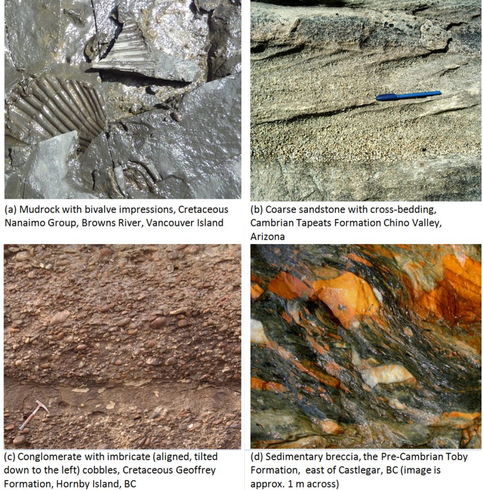
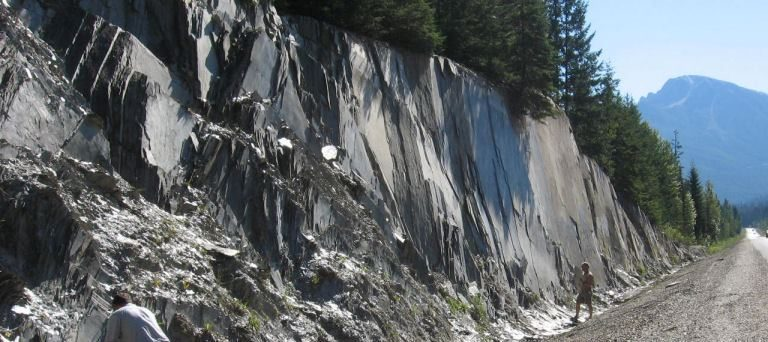
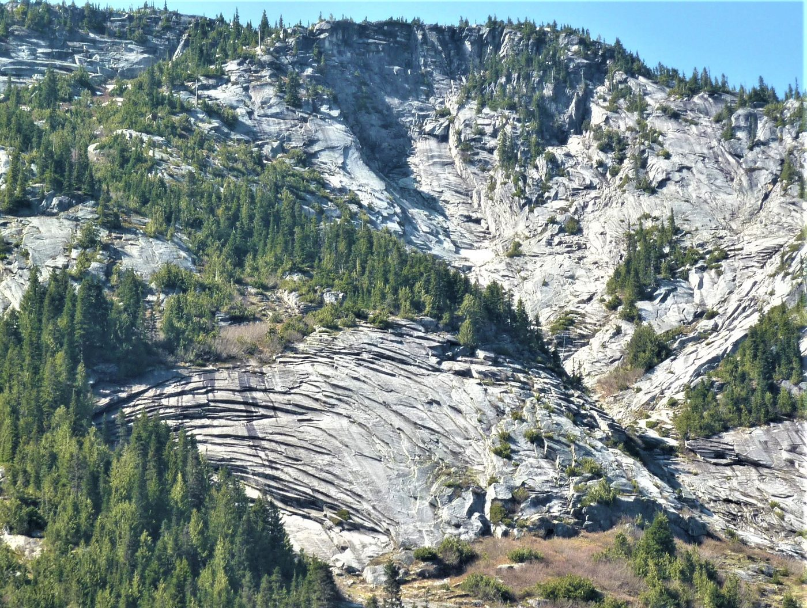
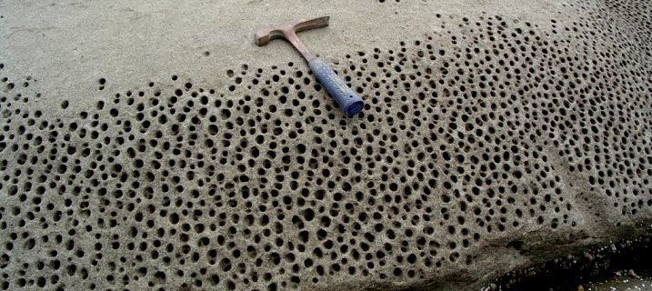
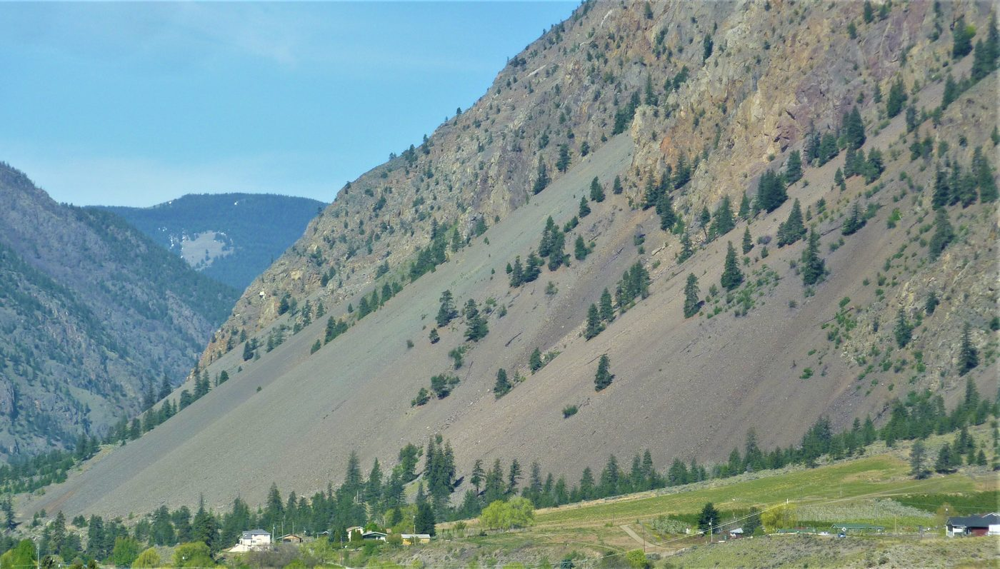
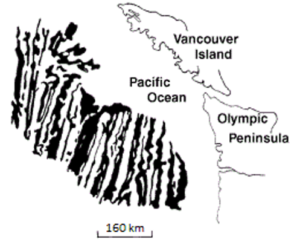
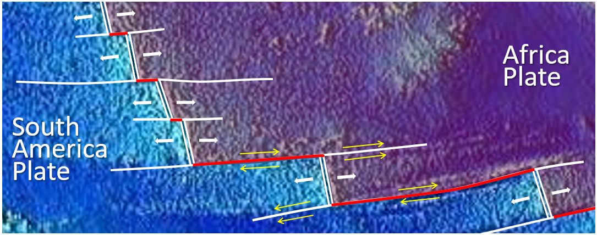

# Capítulo 1 — Geología: Suelo y Roca

El Capítulo I prepara el escenario geológico. Antes de diseñar cualquier cimentación, el
ingeniero debe entender **de qué está hecho el terreno y cómo se formó**.

!!! info "Ilustraciones de este capítulo"
    Las fotografías de este capítulo provienen del libro de texto con licencia abierta
    *Physical Geology – 2nd Edition* de Steven Earle (BCcampus, **CC BY 4.0**), usadas con
    atribución. Consulte los [créditos de las figuras de
    geología](../../../assets/figures/geology/CREDITS.txt) para la lista completa. Solo se
    emplean figuras CC BY o de dominio público.

## 1.1 Dónde se sitúa la geotecnia

El manual distingue tres disciplinas emparentadas:

- **Geología (địa chất học)** — la ciencia de la Tierra: su composición, estructura,
  formación, movimientos, evolución tectónica y cambios.
- **Geología de ingeniería / geología aplicada (địa chất công trình, ĐCCT)** — la rama de
  la geología que estudia el medio geológico **para la construcción**: caracteriza el
  terreno, selecciona el emplazamiento y aporta los datos geológicos al diseño de las
  cimentaciones.
- **Geotecnia (địa kỹ thuật)** — la disciplina aplicada que une la ĐCCT con la
  **mecánica de suelos y las cimentaciones** (cơ đất & nền móng). Su cometido es
  convertir la descripción geológica en números que el proyectista pueda utilizar.

La observación práctica del manual: la ĐCCT por sí sola sigue siendo demasiado
cualitativa, mientras que la mecánica de suelos por sí sola da por supuesto un terreno
demasiado uniforme. La geotecnia es el punto de encuentro de ambas, y sus conclusiones
deciden el tipo de cimentación, sus dimensiones, el tratamiento del terreno y el método
constructivo.

## 1.2 Estructura de la Tierra

La Tierra está estratificada: capas concéntricas de propiedades físicas bien distintas,
separadas por **superficies o zonas de discontinuidad** (bề mặt hoặc vùng không liên
tục). La geofísica detecta estos límites porque la velocidad de las ondas sísmicas cambia
bruscamente al atravesarlos; una desviación local respecto de la velocidad esperada es una
**anomalía** (dị thường).

**Figura.** Cómo se detecta un límite sísmico. Las ondas que descienden hasta el manto se
desvían hacia arriba y llegan a la estación *antes* que las que solo han atravesado la
corteza: esta observación reveló el límite corteza–manto (la discontinuidad de
Mohorovičić o Moho).
*© Steven Earle, CC BY 4.0 — Physical Geology, 2nd ed., Fig. 9.1.5.*

Para el ingeniero las consecuencias son concretas: tipo de roca, grado de meteorización,
profundidad de la roca sana y presencia de zonas débiles o fracturadas.

## 1.3 Las tres grandes familias de rocas

### 1.3.1 Rocas ígneas (đá magma)

Se forman por enfriamiento y cristalización de material fundido. Las rocas
**intrusivas** (xâm nhập), como el granito, se enfrían lentamente en profundidad y son de
grano grueso; las **extrusivas** (phun trào), como el basalto y la andesita, se enfrían
rápido en superficie y son de grano fino. En Vietnam, las mesetas basálticas del Altiplano
Central y del Sureste se meteorizan hasta convertirse en laterita: un suelo, no una roca,
cuando el ingeniero la encuentra.

**Figura.** Detalle de granito y algunos de los minerales que contiene: H = hornblenda,
Q = cuarzo, F = feldespato. Los cristales miden entre 0,1 y 3 mm. La **textura de
cristales imbricados** de una roca ígnea intrusiva explica que sea resistente cuando está
intacta, pero pueda comportarse como un conjunto de bloques sueltos una vez diaclasada.
*© Steven Earle, CC BY 4.0 — Physical Geology, 2nd ed., Fig. 1.4.2.*

### 1.3.2 Rocas sedimentarias (đá trầm tích)

Se forman por deposición, enterramiento y consolidación. Las rocas **clásticas**
(mảnh vụn) —arenisca, limolita, lutita— se clasifican por tamaño de grano; las rocas
**químicas y orgánicas** incluyen la caliza y la dolomía. Dos rasgos dominan su
comportamiento de ingeniería: los **planos de estratificación** (mặt phân lớp), que son
planos de debilidad, y, en las calizas, el **karst** —cuevas, dolinas y conductos de
disolución que vuelven imprevisibles cimentaciones y túneles. Las sierras calizas del
norte de Vietnam son terreno kárstico clásico.

**Figura.** Cantos en una playa oceánica: la materia prima del sedimento clástico. El
**tamaño de grano, la selección y la redondez** visibles aquí son las mismas propiedades
que el ingeniero lee en un sondeo para nombrar y clasificar el depósito.
*© Steven Earle, CC BY 4.0 — Physical Geology, 2nd ed., Fig. 6.1.1.*

**Figura.** Ejemplos de rocas sedimentarias clásticas. Nótese cuánto varían la textura y
la cementación: es el factor que más controla la resistencia y deformabilidad de una
cimentación sobre roca sedimentaria.
*© Steven Earle, CC BY 4.0 — Physical Geology, 2nd ed., Fig. 6.1.8.*

### 1.3.3 Rocas metamórficas (đá biến chất)

Se forman a partir de rocas preexistentes sometidas a calor y presión: gneis (gơnai),
esquisto (đá phiến), mármol (đá hoa), cuarcita (quaczit), pizarra (đá phiến sét). El
metamorfismo produce **foliación** (cấu tạo phiến), una fábrica direccional marcada que
vuelve la resistencia y la deformabilidad fuertemente **anisotropas**: la roca es mucho
más débil perpendicularmente a la foliación que en dirección paralela.

**Figura.** Pizarra en un desmonte de carretera en las montañas Columbia (Columbia
Británica), desprendiéndose según sus **planos de foliación**. Esta fábrica direccional —
no la resistencia de la roca intacta— gobierna la estabilidad del talud y su forma de
romper.
*© Steven Earle, CC BY 4.0 — Physical Geology, 2nd ed., Fig. 5.1.2.*

## 1.4 Meteorización y estado del terreno

La meteorización es el proceso que convierte **la roca en suelo**, y el que con más
frecuencia decide si una cimentación apoya sobre material sano o sobre una masa debilitada
y estructurada. El manual insiste en que el *estado de meteorización* importa más que el
nombre de la roca. Cuatro mecanismos hacen casi todo el trabajo:

- **Descarga / exfoliación** — al retirar la sobrecarga, la roca se expande y se fisura
  *paralelamente a la superficie del terreno*.
- **Ciclos de hielo-deshielo (cuñamiento por hielo)** — el agua de las fisuras se congela,
  se expande y separa la roca; es el mecanismo más eficaz en climas como el de las
  montañas del norte de Vietnam.
- **Cristalización de sales** — las sales crecen en los poros y empujan los granos,
  produciendo superficies alveolares.
- **Acción de raíces y biológica** — las raíces ensanchan cada fisura que penetran.

**Figura.** Fracturas de exfoliación en roca granítica puestas al descubierto por un
desmonte (autopista Coquihalla, Columbia Británica). La roca se desprende en láminas
**paralelas a la nueva superficie del terreno** porque desapareció la presión de
confinamiento.
*© Steven Earle, CC BY 4.0 — Physical Geology, 2nd ed., Fig. 5.1.1.*

**Figura.** Meteorización alveolar de una arenisca (isla de Gabriola, Columbia
Británica). La sal cristalizada en los poros ha separado los granos, dejando una
superficie picada con resistencia casi nula.
*© Steven Earle, CC BY 4.0 — Physical Geology, 2nd ed., Fig. 5.1.5.*

**Figura.** Depósito de talus al pie de un acantilado fracturado por el hielo (Keremeos,
Columbia Británica). Los detritos meteorizados que aquí se acumulan son **coluvión**: un
material suelto, mal graduado y a menudo metaestable que el ingeniero debe reconocer en
campo.
*© Steven Earle, CC BY 4.0 — Physical Geology, 2nd ed., Fig. 5.1.4.*

## 1.5 Estructura: estratificación, foliación y fallas

Dos macizos rocosos con la misma resistencia intacta pueden comportarse de forma
completamente distinta una vez que se tiene en cuenta la **estructura**. Los rasgos que
controlan son los planos de estratificación, la foliación, las diaclasas y las fallas y,
sobre todo, su **orientación relativa respecto de la carga o del desmonte**.

**Figura.** Una falla (línea discontinua blanca) en roca intrusiva en la isla de Quadra
(Columbia Británica). Un dique rosado ha sido desplazado unos 10 cm por un movimiento
dextral. Una **falla** es un plano de roca ya rota: una discontinuidad en el modelo del
terreno, no una línea sobre un plano.
*© Steven Earle, CC BY 4.0 — Physical Geology, 2nd ed., Fig. 12.3.4.*

**Figura.** El cabalgamiento McConnell en el monte Yamnuska (Alberta). Caliza cámbrica ha
sido empujada **sobre** lutita cretácica: una lámina de 800 m de espesor desplazada unos
40 km. Cuando un cabalgamiento coloca roca resistente sobre roca débil, es la unidad débil
la que gobierna el diseño.
*© Steven Earle, CC BY 4.0 — Physical Geology, 2nd ed., Fig. 12.3.9.*

## 1.6 Qué se lleva el ingeniero de aquí

El **tipo** de roca por sí solo no determina el comportamiento. Los factores decisivos son
el **estado de meteorización**, el **grado de diaclasamiento/fracturación** y la
**orientación de la estratificación o la foliación** respecto de la carga. Un granito
"resistente" cortado por diaclasas muy próximas puede comportarse peor que una arenisca
bien estratificada.

## 1.7 Terminología

| Español | Inglés | Vietnamita (libro) |
| --- | --- | --- |
| geología | geology | địa chất học |
| geología de ingeniería | engineering geology | địa chất công trình (ĐCCT) |
| geotecnia | geotechnique | địa kỹ thuật |
| mecánica de suelos y cimentaciones | soil mechanics and foundations | cơ đất & nền móng |
| discontinuidad | discontinuity | bề mặt / vùng không liên tục |
| anomalía | anomaly | dị thường |
| roca ígnea | igneous rock | đá magma |
| intrusiva / extrusiva | intrusive / extrusive | xâm nhập / phun trào |
| roca sedimentaria | sedimentary rock | đá trầm tích |
| clástica | clastic | mảnh vụn |
| roca metamórfica | metamorphic rock | đá biến chất |
| plano de estratificación | bedding plane | mặt phân lớp |
| foliación | foliation | cấu tạo phiến |
| karst | karst | các-tơ (karst) |
| meteorización | weathering | phong hoá |
| exfoliación (descarga) | exfoliation | bong tróc (unloading) |
| cuñamiento por hielo | frost wedging | nêm băng (nứt do băng) |
| talus / coluvión | talus / colluvium | tích tụ sườn (taluy) |
| falla | fault | đứt gãy |
| diaclasa | joint | khe nứt |

## 1.8 Puntos clave

- **Geotecnia = ĐCCT + mecánica de suelos y cimentaciones.** Ninguna de las dos mitades
  basta por sí sola.
- La Tierra está estratificada; la geofísica localiza los límites por su efecto en la
  velocidad de las ondas.
- El comportamiento de la roca lo gobiernan la **meteorización, el diaclasamiento y la
  orientación de la fábrica**, no solo el tipo de roca.
- **La meteorización convierte la roca en suelo**: exfoliación, hielo, crecimiento de
  sales y raíces fracturan la masa antes de que el ingeniero llegue a perforarla.
- La **caliza kárstica** y la **roca metamórfica foliada** son los dos terrenos más
  imprevisibles de Vietnam.
