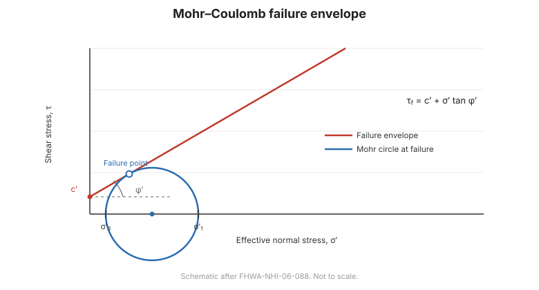
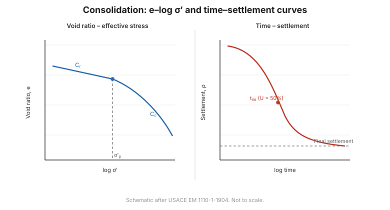

# Capítulo 2 — Propiedades de Ingeniería de los Suelos de Cimentación

El Capítulo II es el núcleo de mecánica de suelos del manual. Define qué significa
"suelo de cimentación", construye a partir de las tres fases del suelo hasta los índices
físicos y llega finalmente a las teorías mecánicas que necesita el proyectista.

## 2.1 Qué significa "suelo de construcción"

El suelo (đất xây dựng) es un **sistema trifásico**: partículas sólidas (hạt rắn), agua
(nước) y gas/aire (khí).

- Si el agua llena todos los vacíos, el suelo está **saturado** (bão hoà).
- Si los vacíos solo contienen aire, el suelo está **seco** (khô).
- Si un vacío contiene aire pero está aislado de la atmósfera, ese aire está **ocluido**
  (khí bị nhốt).

Las partículas sólidas forman el **esqueleto** (khung cốt liệu) del suelo. Los suelos
especiales —suelos orgánicos, turba, lodos— contienen materia orgánica que se descompone
con el tiempo, lo que les confiere compresibilidad muy alta y resistencia muy baja.

## 2.2 Estructura del suelo

### 2.2.1 Clasificación de las partículas sólidas

El manual emplea la clasificación granulométrica de la **norma británica (BS)**:

| Fracción | Tamaño de grano $D$ |
| --- | --- |
| Bloques / cantos (tảng, hòn) | $D > 200$ mm |
| Grava (cuội sỏi) | $20 < D < 200$ mm |
| Grava gruesa / guijarros (dăm sạn) | $2 < D < 20$ mm |
| Arena (cát) | $0.06 < D < 2$ mm |
| Limo (bụi) | $0.002 < D < 0.06$ mm |
| Arcilla (sét) | $D < 0.002$ mm |

Otros sistemas sitúan el límite arcilla/limo en 0,005 mm o 0,002 mm, y el límite
limo/arena en 0,075 mm o 0,06 mm: los límites son convencionales. Además del tamaño
importan otros dos factores: la **forma del grano** (redondeada, angular, subredondeada)
y la **composición mineralógica** de las partículas.

### 2.2.2 Agua intersticial y fábrica del suelo

El agua de los vacíos y la forma en que las partículas se disponen en una fábrica
controlan la compresibilidad, la permeabilidad y la resistencia.

## 2.3 Propiedades físicas

### 2.3.1 Los índices físicos

Contenido de agua $w$, relación de vacíos $e$, porosidad $n$, pesos unitarios $\gamma$,
$\gamma_d$, $\gamma_{sat}$, peso específico de los sólidos $G_s$: el conjunto de índices
habitual.

### 2.3.2 Relaciones entre los índices

Los índices no son independientes: el manual establece el conjunto cerrado de relaciones
(relaciones de fase) que permite deducir cualquier índice a partir de unos pocos medidos.
Son las mismas identidades tabuladas en la referencia de
[Mecánica de Suelos](../soil-mechanics/chapter-02-composition-index.md) de este sitio.

## 2.4 Propiedades mecánicas en esquema

### 2.4.1 Teoría elástica aplicada al suelo

El suelo se trata como un semiespacio elástico para obtener las distribuciones de
tensiones.

### 2.4.2 Tensiones en un punto: el círculo de Mohr

El estado tensional en un punto se representa mediante el **círculo de Mohr** (vòng tròn
Mohr), que da la tensión normal y la tensión cortante sobre cualquier plano que pase por
el punto. Es la base del criterio de resistencia usado en todo el libro.

**Figura.** Envolvente de rotura de Mohr–Coulomb y círculo de Mohr (según
FHWA-NHI-06-088).

### 2.4.3 Teoría de la deformación plástica del suelo

Más allá del dominio elástico, el suelo se deforma plásticamente; el manual esboza el
marco de plasticidad empleado para describir el inicio del flujo plástico y la rotura.

### 2.4.4 El suelo y la teoría de consolidación de Terzaghi

La **consolidación** (cố kết) es la compresión dependiente del tiempo de un suelo
saturado a medida que se disipa el exceso de presión intersticial y aumenta la tensión
efectiva. La teoría unidimensional de Terzaghi es la base de la predicción
asentamiento–tiempo.

**Figura.** Consolidación: curva $e$–$\log\sigma'$ y curva tiempo–asentamiento (según
USACE EM 1110-1-1904).

### 2.4.5 Teoría de Menard para el ensayo presurométrico

El **presurómetro** (nén ngang) expande una sonda cilíndrica en el sondeo y mide la
respuesta presión–volumen; la teoría de Menard convierte esa respuesta en un **módulo
presurométrico** $E_p$ y una presión límite $P_l$, datos que se usan después en el análisis
de cimentaciones y asentamientos (Capítulos 5–6).

## 2.5 Terminología

| Español | Inglés | Vietnamita (libro) |
| --- | --- | --- |
| sistema trifásico | three-phase system | hệ ba thành phần (hạt rắn, nước, khí) |
| suelo saturado / seco | saturated / dry soil | đất bão hoà / đất khô |
| aire ocluido | occluded air | khí bị nhốt |
| esqueleto del suelo | soil skeleton | khung cốt liệu |
| distribución granulométrica | grain-size distribution | phân loại hạt (theo cỡ hạt) |
| contenido de agua | water content | độ ẩm |
| relación de vacíos | void ratio | hệ số rỗng |
| porosidad | porosity | độ rỗng |
| peso unitario (natural / seco / saturado) | unit weight (bulk / dry / saturated) | dung trọng (tự nhiên / khô / bão hoà) |
| peso específico de sólidos | specific gravity | tỷ trọng |
| círculo de Mohr | Mohr circle | vòng tròn Mohr |
| consolidación | consolidation | cố kết |
| tensión efectiva | effective stress | ứng suất hữu hiệu |
| módulo presurométrico | pressuremeter modulus | mô đun nén ngang |

## 2.6 Puntos clave

- El suelo es un **sistema trifásico**; el esqueleto sólido soporta la carga y el agua
  intersticial soporta la presión.
- Los límites granulométricos son **convencionales**: aquí se usa el conjunto BS.
- Los índices físicos forman un **conjunto cerrado de relaciones**; unas pocas medidas dan
  el resto.
- El **círculo de Mohr** expresa la tensión en un punto; la envolvente de **Mohr–Coulomb**
  da la resistencia.
- La **consolidación de Terzaghi** explica el asentamiento en el tiempo; la **teoría de
  Menard** convierte la curva presurométrica en parámetros de diseño.
