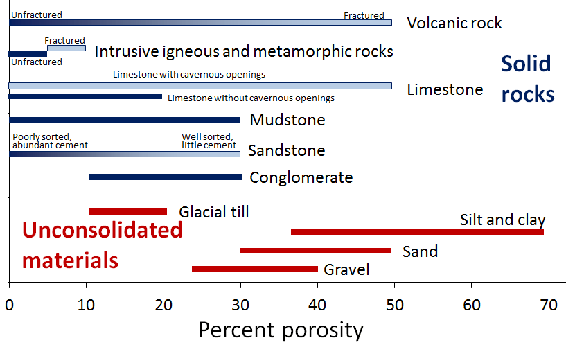
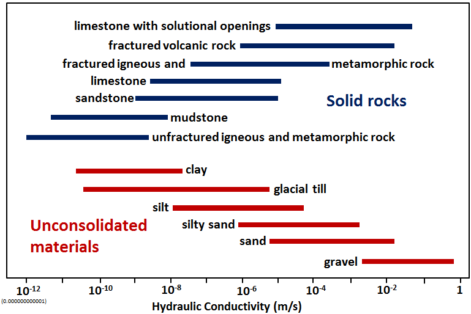
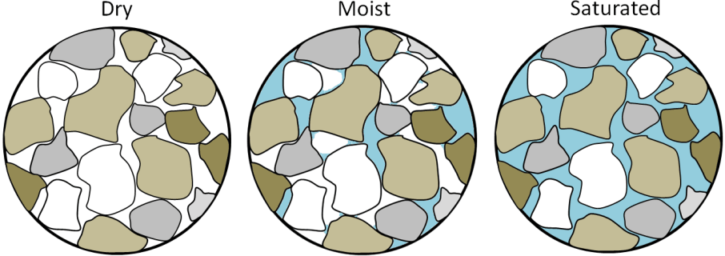
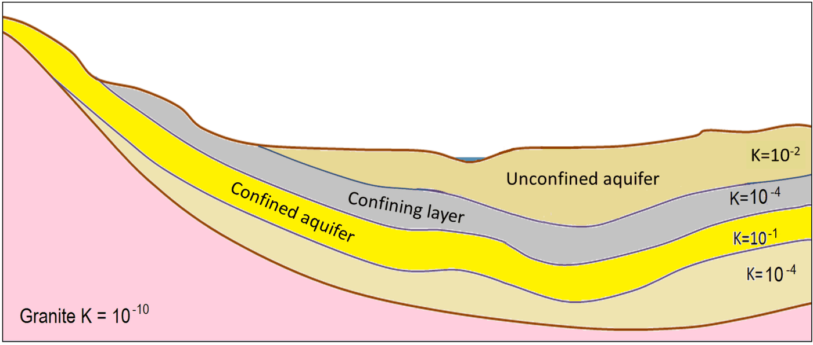

# Capítulo 3 — Agua Subterránea

El agua subterránea no puede separarse de la investigación geotécnica. El Capítulo III
expone la teoría mínima del agua subterránea que necesita un ingeniero geotécnico y
describe a continuación los principales tipos de aguas subterráneas.

## 3.1 Conceptos básicos

### 3.1.1 El medio poroso

Para hablar del agua subterránea hay que hablar antes del **medio poroso** (môi trường
rỗng), es decir, el suelo o la roca en que se mueve el agua. Todo suelo y toda roca
contienen vacíos, y estos se originan de dos maneras distintas:

- **Vacíos intersticiales** (khe rỗng giữa hạt) — los espacios entre granos individuales,
  creados cuando se depositó el material.
- **Vacíos estructurales** (khoáng rỗng kiến tạo) — vacíos creados después por procesos
  geológicos: fisuras, grietas, fracturas, cavidades de raíces, madrigueras, disolución.

La distinción importa porque los dos sistemas de vacíos se comportan de forma distinta y
deben describirse por separado.

### 3.1.2 Tortuosidad

La **tortuosidad** (độ uốn lượn) describe cuán sinuoso es el recorrido real del flujo
frente a la distancia en línea recta, y reduce el flujo efectivo a través del medio.

### 3.1.3 Relación de vacíos y características asociadas

El **grado de vacíos** (mức độ rỗng) y los parámetros asociados (relación de vacíos $e$,
porosidad $n$) cuantifican qué fracción del medio es vacío.

**Figura.** Rangos típicos de porosidad para materiales no consolidados (rojo) y rocas
(azul). Nótese que el limo y la arcilla son los *más* porosos y, como muestra la figura
siguiente, los *menos* permeables.
*© Steven Earle, CC BY 4.0 — Physical Geology, 2nd ed., Fig. 14.1.1.*

### 3.1.4 Grado de permeabilidad

La **permeabilidad** (mức độ thấm) es la capacidad del medio para transmitir agua. Es la
propiedad más importante en problemas de filtración, drenaje y consolidación.

**Figura.** Conductividad hidráulica $K$ (m/s) para materiales no consolidados (rojo) y
rocas (azul): un rango de unos doce órdenes de magnitud. **La arcilla es porosa pero
casi impermeable**, porque casi toda su agua está retenida como agua adsorbida sobre la
superficie de los granos y no puede fluir.
*© Steven Earle, CC BY 4.0 — Physical Geology, 2nd ed., Fig. 14.1.2.*

### 3.1.5 Contenido de humedad y grado de saturación

El **contenido de humedad** (độ ẩm) y el **grado de saturación** (độ bão hoà) describen
qué parte del volumen de vacíos está llena de agua.

**Figura.** Arena seca, húmeda y saturada. La tensión superficial entre granos hace que la
arena **húmeda** sea la más resistente de las tres; la arena **saturada** es la más débil,
porque el agua a presión separa los granos y reduce la fricción. Este es el mecanismo que
hay detrás de la licuefacción (Capítulo 11).
*© Steven Earle, CC BY 4.0 — Physical Geology, 2nd ed., Fig. 15.1.4.*

### 3.1.6 Tensión superficial

La **tensión superficial** (sức căng bề mặt) es la fuerza que permite al agua sostenerse
en vacíos estrechos y es la causa física de la capilaridad.

### 3.1.7 Capilaridad

La **ascensión capilar** (hiện tượng mao dẫn) eleva el agua por encima del nivel freático
libre en suelos finos. La zona capilar *no* está saturada en el sentido habitual, pero su
presión intersticial negativa modifica la tensión efectiva y, por tanto, la resistencia:
un tema recurrente en problemas de taludes y muros de contención.

## 3.2 Principales tipos de agua subterránea

### 3.2.1 Agua subterránea en sedimentos granulares

Agua retenida en el sistema poroso de arenas, gravas y limos. Es el tipo de acuífero más
predecible y aquel en que la ley de Darcy (Capítulo 10) se aplica con mayor claridad.

### 3.2.2 Agua kárstica

Agua en conductos de disolución y cuevas dentro de la caliza. Los acuíferos kársticos son
**muy poco uniformes**: el flujo se concentra en conductos y una misma formación puede
ser impermeable a un metro de distancia de un conducto principal. El agua kárstica es un
peligro de primer orden para cimentaciones, túneles y estribos de presas en las regiones
calizas de Vietnam.

### 3.2.3 Distribución cuando la permeabilidad es uniforme

Cuando el medio es uniformemente permeable, la distribución del agua subterránea puede
describirse analíticamente: es la base de los cálculos de redes de flujo y filtración del
Capítulo 10.

### 3.2.4 Acuíferos, acuitardos y capas confinantes

Un cuerpo de terreno que transmite agua de forma aprovechable es un **acuífero** (tầng
chứa nước); el que no lo hace es un **acuitardo** o **capa confinante** (tầng cách nước).
Un acuífero abierto a la superficie es **libre / no confinado** (không áp); el que está
cubierto por una capa de menor permeabilidad es **confinado** (có áp), y la presión
intersticial en un acuífero confinado es lo que hace que los piezómetros lean por encima
del propio nivel del acuífero.

**Figura.** Corte de acuíferos y capas confinantes, con permeabilidades relativas dadas
como conductividad hidráulica $K$ (m/s). La capa gris ($K = 10^{-4}$) confina el acuífero
amarillo ($K = 10^{-1}$) situado debajo; el granito de la base ($K = 10^{-10}$) es el
acuitardo regional.
*© Steven Earle, CC BY 4.0 — Physical Geology, 2nd ed., Fig. 14.1.4.*

## 3.3 Terminología

| Español | Inglés | Vietnamita (libro) |
| --- | --- | --- |
| medio poroso | porous medium | môi trường rỗng |
| vacío intersticial | interstitial void | khe rỗng giữa hạt |
| vacío estructural | structural void | khoáng rỗng kiến tạo |
| tortuosidad | tortuosity | độ uốn lượn |
| relación de vacíos / porosidad | void ratio / porosity | hệ số rỗng / độ rỗng |
| permeabilidad | permeability | mức độ thấm (tính thấm) |
| contenido de humedad | moisture content | độ ẩm |
| grado de saturación | degree of saturation | độ bão hoà |
| tensión superficial | surface tension | sức căng bề mặt |
| capilaridad | capillary action | hiện tượng mao dẫn |
| agua subterránea | groundwater | nước dưới đất |
| agua kárstica | karst water | nước các-tơ |

## 3.4 Puntos clave

- Los vacíos **intersticiales** y **estructurales** son sistemas distintos y deben
  describirse por separado.
- La **permeabilidad** es la propiedad que gobierna filtración, drenaje y consolidación.
- La **zona capilar** modifica la tensión efectiva aunque no esté saturada.
- El **agua kárstica** es muy poco uniforme y constituye un peligro mayor en terreno
  calizo.
