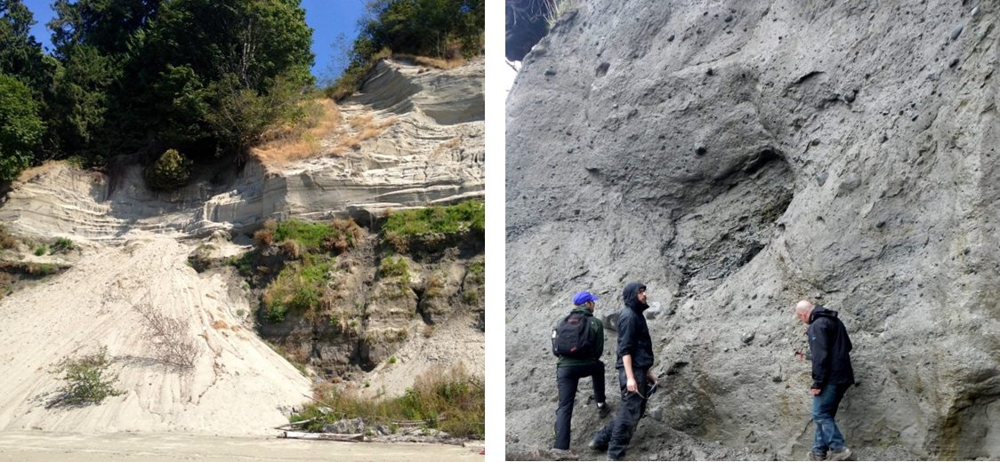
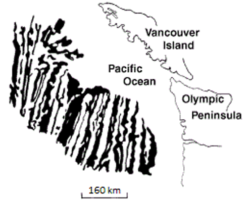
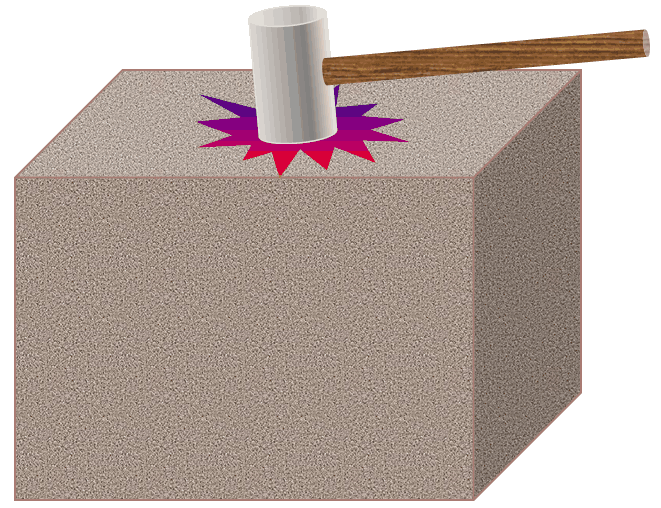
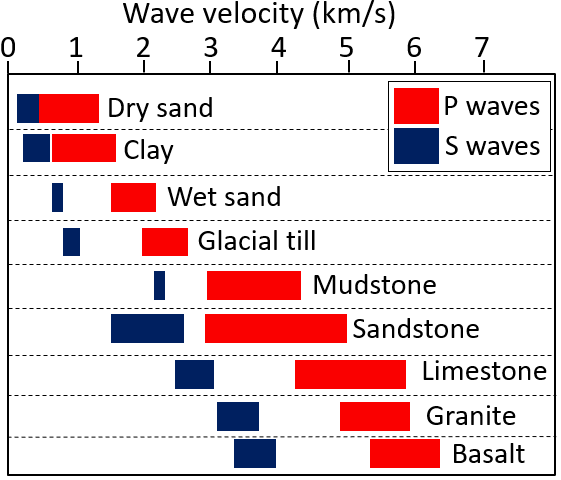

# Capítulo 4 — Investigación, Exploración y Ensayos

El Capítulo IV es el más extenso del manual y el más cercano al enfoque de este sitio.
Recorre desde *clasificar y describir* un suelo o una roca en campo, pasando por las
etapas de una campaña de investigación, hasta la perforación, el muestreo, la geofísica y
el conjunto completo de ensayos in situ y de laboratorio que producen los parámetros de
diseño.

## 4.1 Clasificación y descripción de suelos y rocas

### 4.1.1 Clasificación de suelos para construcción

En construcción, el suelo se trata como un **material de construcción** formado por una
mezcla de fracciones granulares que puede excavarse y transportarse sin voladuras. El
objetivo de la clasificación es **cuantificar** las propiedades de cada tipo de suelo para
que las decisiones de diseño y construcción puedan tomarse de forma coherente.

Un sistema de clasificación se usa **junto con métodos empíricos de diseño**: el ingeniero
clasifica el suelo y luego aplica las correlaciones empíricas acumuladas por otros
ingenieros, en lugar de apoyarse solo en su experiencia limitada. Una buena clasificación
permite además juzgar qué ensayos son pertinentes y qué parámetros son representativos.

### 4.1.2 Reconocimiento y descripción del suelo

Identificación de campo por medios visuales y manuales: la base de cualquier columna
estratigráfica de sondeo. El ingeniero lee en la muestra y en el afloramiento el **tamaño
de grano, la selección, la redondez, el color y la consistencia**, y esa descripción es la
que después selecciona los ensayos y las correlaciones empíricas.

**Figura.** Dos depósitos que deben describirse de distinta manera. Izquierda: depósito
de lavado glacial (outwash) en Point Grey, Vancouver: una capa inferior oscura de arena,
limo y arcilla bajo una arena clara **bien seleccionada**. Derecha: **till** glacial en la
isla de Quadra (Columbia Británica): sin seleccionar, comprimido bajo el hielo y lo
bastante resistente para mantenerse en un corte casi vertical. Lo que los distingue es la
selección y la graduación, no solo el tamaño de grano.
*© Steven Earle, CC BY 4.0 — Physical Geology, 2nd ed., Fig. 15.1.3.*

### 4.1.3 Clasificación del macizo rocoso para construcción

La roca se clasifica como **macizo** (khối đá), no como muestra de mano: entran el grado
de meteorización, el espaciado y la orientación de las discontinuidades y la resistencia
de la matriz intacta.

**Figura.** Una discontinuidad que debe registrarse en la descripción del macizo: una
falla (línea discontinua blanca) en roca intrusiva en la isla de Quadra (Columbia
Británica), con unos 10 cm de desplazamiento dextral en un dique. **Las fallas, las
diaclasas y la estratificación son rasgos estructurales del macizo**, no propiedades de
la roca intacta.
*© Steven Earle, CC BY 4.0 — Physical Geology, 2nd ed., Fig. 12.3.4.*

### 4.1.4 Reconocimiento y descripción de la roca

Descripción de campo de testigos de sondeo y afloramientos.

## 4.2 La campaña de investigación y sus etapas

### 4.2.1 Objeto y alcance

El objeto y el objetivo de la investigación deben definirse antes de perforar ningún
sondeo.

### 4.2.2 Etapas de la investigación

La investigación avanza por **etapas** acompasadas con las del diseño: anteproyecto,
diseño de detalle y construcción, aumentando en cada una el alcance, el espaciado y la
profundidad de los sondeos.

## 4.3 Métodos de exploración y muestreo

### 4.3.1 Perforación y excavación

Sondeos, calicatas y zanjas de reconocimiento.

### 4.3.2 Muestreo y obtención de testigos

Muestreo alterado e inalterado; recuperación y calidad del testigo.

### 4.3.3 Métodos geofísicos

Geofísica de superficie y dentro de sondeo para interpolar entre sondeos. Los **métodos
sísmicos** (refracción sísmica, down-hole y cross-hole) descansan en una idea simple:
enviar una onda elástica al terreno y medir su tiempo de llegada.

**Figura.** El principio de todo método sísmico: un golpe de martillo (o una fuente en
sondeo) envía ondas elásticas al terreno; los tiempos de llegada de las ondas P y S a un
receptor dan la velocidad de propagación del material situado entre ellos.
*© Steven Earle, CC BY 4.0 — Physical Geology, 2nd ed., Fig. 9.1.1.*

**Figura.** Velocidades típicas de ondas P (rojo) y S (azul) en sedimentos y en roca
cortical sólida. El fuerte contraste entre **sedimento blando** y **roca** es lo que hace
de la refracción sísmica un método fiable para encontrar la profundidad del sustrato
rocoso, y la velocidad de onda S es la que alimenta las propiedades dinámicas del suelo
usadas en diseño sísmico.
*© Steven Earle, CC BY 4.0, a partir de la US Environmental Protection Agency (dominio
público) — Physical Geology, 2nd ed., Fig. 9.1.3.*

## 4.4 Métodos de ensayo

### 4.4.1 Ensayos in situ

El manual presenta los ensayos in situ habituales: **SPT** (xuyên tiêu chuẩn), **CPT**
(xuyên tĩnh), **PMT / presurómetro Menard** (nén ngang), **molinete o veleta de corte**
(cắt cánh) y placa de carga, con sus equipos, procedimiento e interpretación.

### 4.4.2 Ensayos de laboratorio

Ensayos índice, consolidación, resistencia al corte (corte directo, triaxial),
compactación (Proctor), CBR y ensayos químicos.

## 4.5 Corrosión y agresividad del medio

### 4.5.1 Corrosión de metales

Evaluación de la agresividad del terreno y del agua subterránea frente al acero,
importante para la instrumentación enterrada y para los pilotes.

### 4.5.2 Agresividad frente al hormigón

Evaluación del ataque por sulfatos/cloruros al hormigón y de las medidas de protección
necesarias.

## 4.6 Tablas de consulta

### 4.6.1 Correlaciones entre tipos de ensayo
### 4.6.2 Capacidad de carga admisible orientativa de cimentaciones superficiales
### 4.6.3 Unidades y conversiones

## 4.7 Terminología

| Español | Inglés | Vietnamita (libro) |
| --- | --- | --- |
| investigación del terreno | site investigation | khảo sát đất nền |
| exploración / prospección | exploration | thăm dò |
| muestreo | sampling | lấy mẫu |
| muestra inalterada | undisturbed sample | mẫu nguyên dạng |
| recuperación de testigo | core recovery | tỷ lệ lấy được lõi |
| prospección geofísica | geophysical prospecting | thăm dò địa vật lý |
| ensayo de penetración estándar (SPT) | standard penetration test (SPT) | thí nghiệm xuyên tiêu chuẩn |
| ensayo de penetración de cono (CPT) | cone penetration test (CPT) | thí nghiệm xuyên tĩnh |
| presurómetro (Menard) | pressuremeter (Menard) | thí nghiệm nén ngang (Menard) |
| ensayo de molinete / veleta | vane shear test | thí nghiệm cắt cánh |
| ensayo de placa de carga | plate load test | thí nghiệm bàn nén |
| ensayo de laboratorio | laboratory test | thí nghiệm trong phòng |
| corrosión / agresividad | corrosion / aggressivity | độ ăn mòn / độ xâm thực |

## 4.8 Puntos clave

- La clasificación se usa **con métodos empíricos de diseño**, no de forma aislada.
- La roca se clasifica como **macizo**, no como muestra de mano.
- La investigación avanza por **etapas** acompasadas con las del diseño.
- La familia de ensayos in situ —**SPT, CPT, PMT, veleta, placa de carga**— aporta los
  parámetros que se usan en los Capítulos 5–6.
- La **corrosividad** del terreno importa tanto para los instrumentos enterrados como
  para las obras permanentes.
