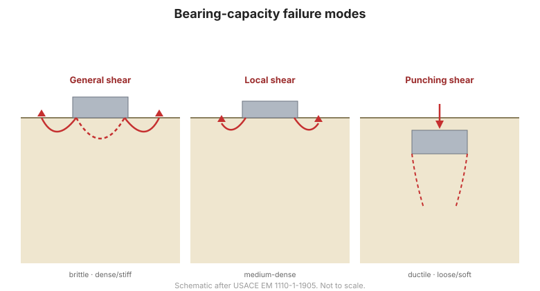
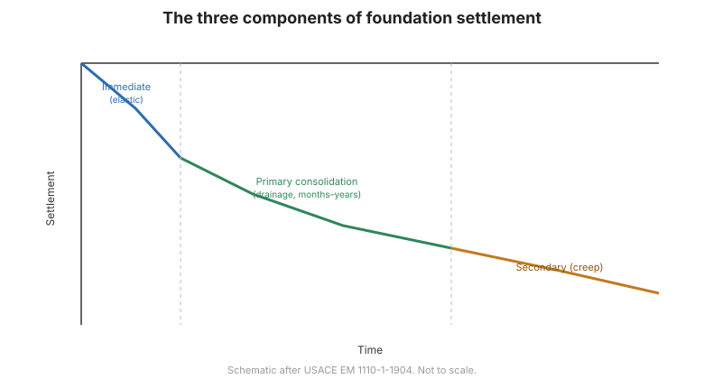

# Capítulo 5 — Análisis de Cimentaciones Superficiales

El Capítulo V abre los capítulos de análisis. Define qué es una cimentación superficial y
trata a continuación la capacidad de carga por varios métodos independientes y el
asentamiento por varios métodos independientes: las dos comprobaciones que toda
cimentación superficial debe superar.

## 5.1 Conceptos básicos

### 5.1.1 Definición de cimentación superficial

El manual se apoya en la geometría de la propia cimentación:

- **Ancho de la zapata** $B$, **longitud** $L$, **profundidad de empotramiento** $D$
  (medida desde la base hasta la superficie del terreno).
- Una cimentación es **superficial** cuando $\dfrac{D}{B} < 4$.
- Una **zapata corrida** (móng băng) tiene $\dfrac{L}{B} > 5$.
- Una **zapata aislada** (móng đơn) tiene $\dfrac{L}{B} < 5$.
- Formas especiales: circular $B = 2R$; cuadrada $B = L$; rectangular $B < L < 5B$.
- Una **losa / placa de cimentación** (móng bè) es una cimentación de gran tamaño que
  soporta toda una estructura o parte de ella.

El manual advierte que estos límites son **relativos**, no absolutos.

### 5.1.2 Comportamiento de una cimentación superficial bajo carga

El desplazamiento de la cimentación depende del nivel de carga. La **curva
carga–asentamiento** (đường quan hệ tải trọng – chuyển vị) permite identificar:

- la **carga última** $Q_L$, carga máxima que la cimentación puede soportar antes de que
  el suelo rompa;
- la **carga admisible**, la que produce un asentamiento aceptable y un factor de
  seguridad adecuado frente a $Q_L$.

### 5.1.3 Rotura del suelo de cimentación

El mecanismo de rotura bajo una cimentación superficial —rotura general, rotura local,
punzonamiento— y la forma en que se desarrolla la superficie de rotura.

### 5.1.4 Carga última sobre una zapata corrida horizontal en terreno uniforme

Fórmula general de carga última para una carga vertical centrada sobre una zapata
corrida horizontal en suelo homogéneo, de la que se derivan las ecuaciones clásicas de
capacidad de carga.

**Figura.** Mecanismos de rotura por capacidad de carga bajo una cimentación superficial.

## 5.2 Capacidad de carga de cimentaciones superficiales

El manual da deliberadamente **varias vías independientes** para llegar a la misma
respuesta, de modo que los resultados puedan contrastarse:

### 5.2.1 A partir de la teoría de la mecánica de suelos
La solución teórica clásica de capacidad de carga.

### 5.2.2 A partir del ensayo de penetración de cono (CPT)
Correlaciones empíricas entre la resistencia de cono $q_c$ y la capacidad de carga.

### 5.2.3 A partir del presurómetro Menard (PMT)
Usando la presión límite $P_l$ y el módulo presurométrico $E_p$.

### 5.2.4 A partir del SPT
Usando el número de golpes $N$: la vía más habitual en la práctica vietnamita.

### 5.2.5 Sobre roca
Capacidad de carga de una zapata apoyada sobre roca.

## 5.3 Asentamiento de cimentaciones superficiales

### 5.3.1 Distribución de tensiones bajo la cimentación: Boussinesq
Distribución elástica de tensiones (Boussinesq) usada para obtener el incremento de
tensión vertical con la profundidad.

### 5.3.2 Asentamiento por consolidación por el método de suma de capas
División del estrato compresible en subcapas y suma de sus contribuciones.

**Figura.** Componentes del asentamiento bajo una zapata.

### 5.3.3 Asentamiento elástico por el método general
### 5.3.4 Asentamiento a partir del presurómetro Menard
### 5.3.5 Método rápido de estimación del asentamiento
### 5.3.6 Asentamiento admisible

## 5.4 Terminología

| Español | Inglés | Vietnamita (libro) |
| --- | --- | --- |
| cimentación superficial | shallow foundation | móng nông |
| zapata corrida | strip footing | móng băng |
| zapata aislada | isolated / pad footing | móng đơn |
| losa / placa de cimentación | mat / raft | móng bè |
| profundidad de empotramiento | embedment depth | chiều sâu chôn móng |
| carga última | ultimate load | tải trọng giới hạn |
| presión admisible | allowable bearing pressure | áp lực cho phép |
| capacidad de carga | bearing capacity | sức chịu tải |
| curva carga–asentamiento | load–settlement curve | đường quan hệ tải trọng – chuyển vị |
| asentamiento | settlement | độ lún |
| método de suma de capas | layer-summation method | phương pháp phân tầng |
| asentamiento admisible | allowable settlement | độ lún cho phép |

## 5.5 Puntos clave

- Superficial frente a profunda se define por **$D/B < 4$**; corrida frente a aislada por
  **$L/B$**.
- El diseño exige **dos comprobaciones independientes**: capacidad de carga y
  asentamiento.
- El manual da **múltiples métodos para cada una** para poder contrastar resultados:
  teoría, **CPT**, **PMT**, **SPT**, roca.
- El **SPT** es la vía más usada en la práctica vietnamita.
- La predicción del asentamiento descansa sobre la distribución de tensiones de
  **Boussinesq** más la **suma de capas** (o el método presurométrico).
