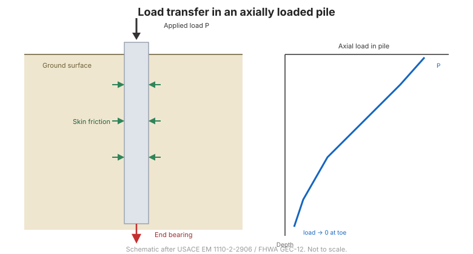

# Capítulo 6 — Análisis de Cimentaciones Profundas

El Capítulo VI trata del pilote: cómo se clasifican los pilotes, cómo soporta carga un
pilote aislado, qué ocurre cuando el terreno se mueve contra el pilote, cómo se comportan
los pilotes ante carga lateral y en grupo, y cómo asienta el grupo.

## 6.1 Conceptos básicos

### 6.1.1 Definición de cimentación profunda / pilote

Una **cimentación profunda** (móng sâu) transmite la carga a estratos más profundos y
resistentes. El **pilote** (móng cọc / cọc) es el tipo dominante.

### 6.1.2 Clasificación de los pilotes

El manual sigue el código francés **DTU 13-2**, que agrupa los pilotes según su forma de
ejecución y su forma de transmitir la carga:

| Grupo | Tipo |
| --- | --- |
| 1 | Pilotes prefabricados: hincados de madera, acero, hormigón pretensado, tubulares hincados |
| 2 | Pilotes moldeados in situ por hinca: tubo hincado y luego rellenado y extraído, o rellenado y dejado en sitio |
| 3 | Pilotes perforados: simples, entubados, con lodo, con barrena, helicoidales |
| 4 | Cajones / pozos de cimentación (cọc giếng) |
| 5 | Pilotes hincados por presión (cọc ép), de hormigón y metálicos |
| 6 | Micropilotes (cọc mini) |

Los **grupos 1, 2 y 5** son pilotes *hincados*: desplazan y compactan el suelo a su
alrededor, por lo que movilizan bien el **rozamiento lateral**. Pero en suelos muy blandos
y estructurados, la hinca puede remoldear el suelo y *reducir* el rozamiento. Los
**grupos 3 y 4** son pilotes *perforados / de sustitución*: la perforación alivia la
tensión lateral, de modo que el rozamiento que movilizan es menor para la misma superficie
nominal.

## 6.2 Principios del análisis de pilotes

### 6.2.1 Pilote bajo carga vertical
### 6.2.2 Pilote sometido a otras fuerzas externas

## 6.3 Comportamiento frente a carga vertical en terreno homogéneo

### 6.3.1 Por qué el análisis es complejo
### 6.3.2 Conceptos básicos
### 6.3.3 Síntesis de resultados experimentales

## 6.4 Movilización de la resistencia a medida que el pilote se desplaza

### 6.4.1 Pilote cargado verticalmente empotrado en dos capas
### 6.4.2 Movilización progresiva de la resistencia con el desplazamiento

## 6.5 Cálculo práctico de la capacidad de un pilote aislado

La forma general es la suma de las dos componentes:

$$Q_L = Q_p + Q_f$$

donde $Q_p$ es la resistencia de punta y $Q_f$ el rozamiento lateral.

### 6.5.1 La fórmula general
### 6.5.2 A partir de la teoría de la mecánica de suelos
### 6.5.3 A partir del SPT
### 6.5.4 A partir del CPT
### 6.5.5 A partir del presurómetro Menard
### 6.5.6 A partir de la fórmula de hinca (PDT)
### 6.5.7 Pilote aislado empotrado en roca

**Figura.** Transferencia de carga en un pilote: resistencia de punta más rozamiento
lateral.

## 6.6 Rozamiento negativo y empuje lateral

### 6.6.1 El fenómeno del rozamiento negativo

Cuando el suelo que rodea al pilote asienta **más** que el pilote, el arrastre se invierte:
el suelo carga ahora el pilote hacia abajo en lugar de sostenerlo. Este **rozamiento
negativo** (ma sát âm) añade carga y debe sumarse a la carga aplicada, no restarse de la
capacidad.

### 6.6.2 Métodos de cálculo del rozamiento negativo
### 6.6.3 Empuje lateral del suelo blando sobre el fuste del pilote

## 6.7 Pilotes sometidos a carga lateral

### 6.7.1 Suelo granular
### 6.7.2 Suelo cohesivo
### 6.7.3 Módulo de reacción lateral a partir del presurómetro Menard

## 6.8 Grupos de pilotes

### 6.8.1 El efecto de grupo
### 6.8.2 Método de Terzaghi & Peck con el bloque ficticio
### 6.8.3 Factor de eficiencia de grupo $C_e$
### 6.8.4 Distribución de la carga dentro del grupo

## 6.9 Asentamiento de las cimentaciones por pilotes

### 6.9.1 Asentamiento del pilote aislado
### 6.9.2 Asentamiento del grupo

## 6.10 Terminología

| Español | Inglés | Vietnamita (libro) |
| --- | --- | --- |
| cimentación profunda | deep foundation | móng sâu |
| pilote | pile | cọc / móng cọc |
| resistencia de punta | end bearing | sức kháng mũi cọc |
| rozamiento lateral | skin friction | ma sát thành (hông) cọc |
| pilote hincado | driven pile | cọc đóng |
| pilote perforado / moldeado in situ | bored pile | cọc khoan nhồi |
| pilote hincado por presión | pressed pile | cọc ép |
| rozamiento negativo | negative skin friction | ma sát âm |
| empuje lateral | lateral squeeze | lực xệ ngang |
| grupo de pilotes / efecto de grupo | pile group / group effect | nhóm cọc / hiệu ứng nhóm |
| eficiencia de grupo | group efficiency | hệ số hiệu dụng nhóm cọc |
| módulo de reacción lateral | lateral reaction modulus | mô đun phản lực ngang |

## 6.11 Puntos clave

- La capacidad de un pilote es la **suma de resistencia de punta y rozamiento lateral**:
  $Q_L = Q_p + Q_f$.
- Los pilotes **hincados** movilizan mejor el rozamiento que los **perforados** en el
  mismo suelo.
- El **rozamiento negativo** *añade* carga: nunca se resta de la capacidad.
- La capacidad lateral exige un **módulo de reacción lateral**, obtenible del presurómetro
  Menard.
- Los pilotes trabajan en **grupo**: hay que considerar el **efecto de grupo** y el
  **asentamiento del grupo**.
