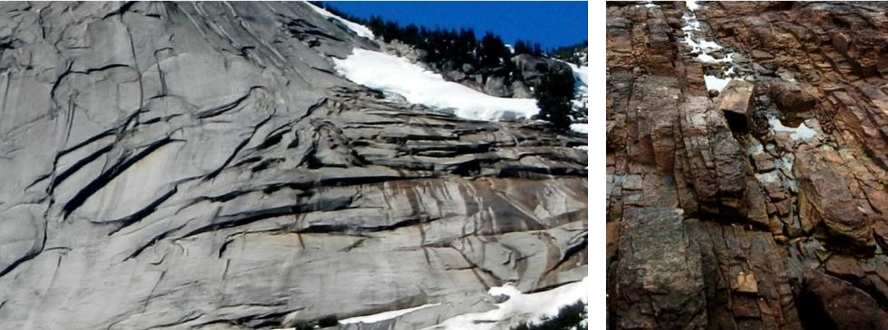
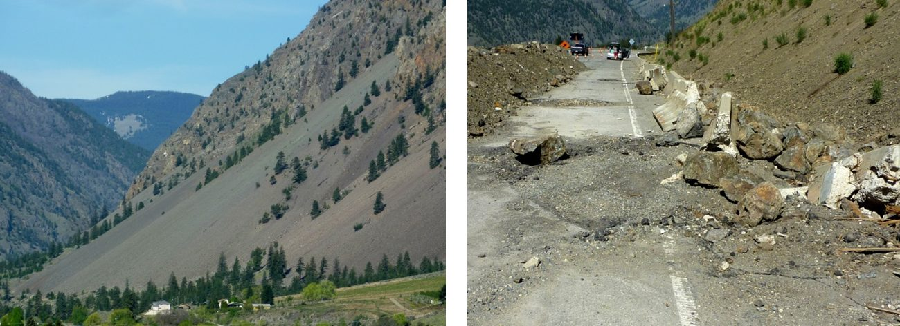
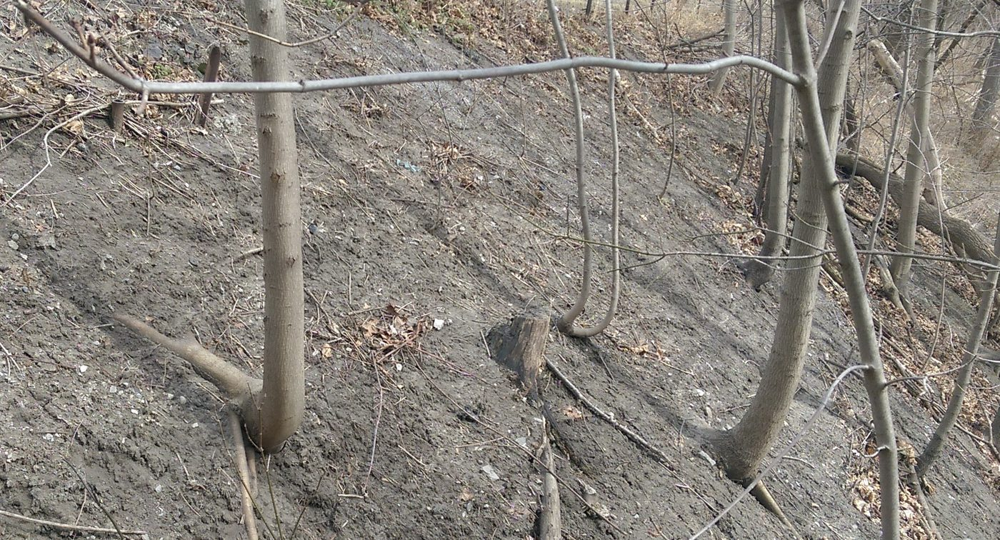
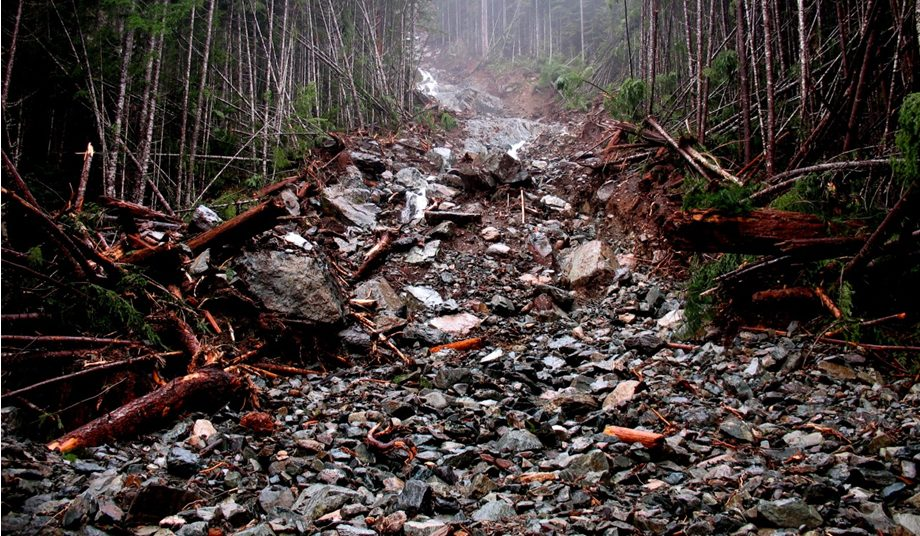
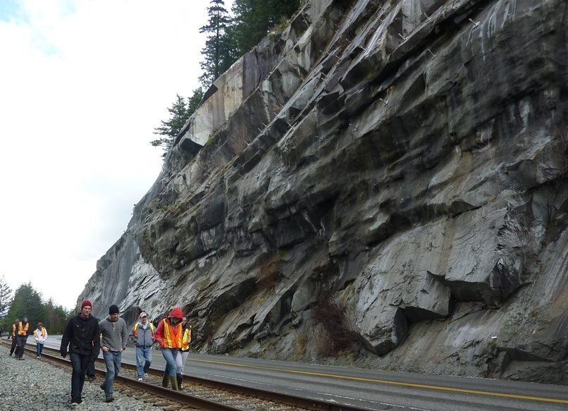
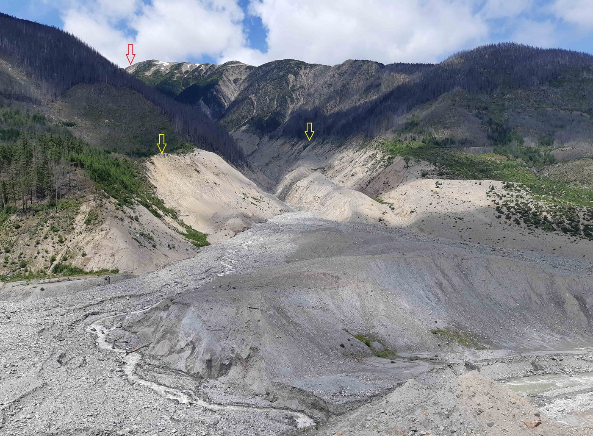
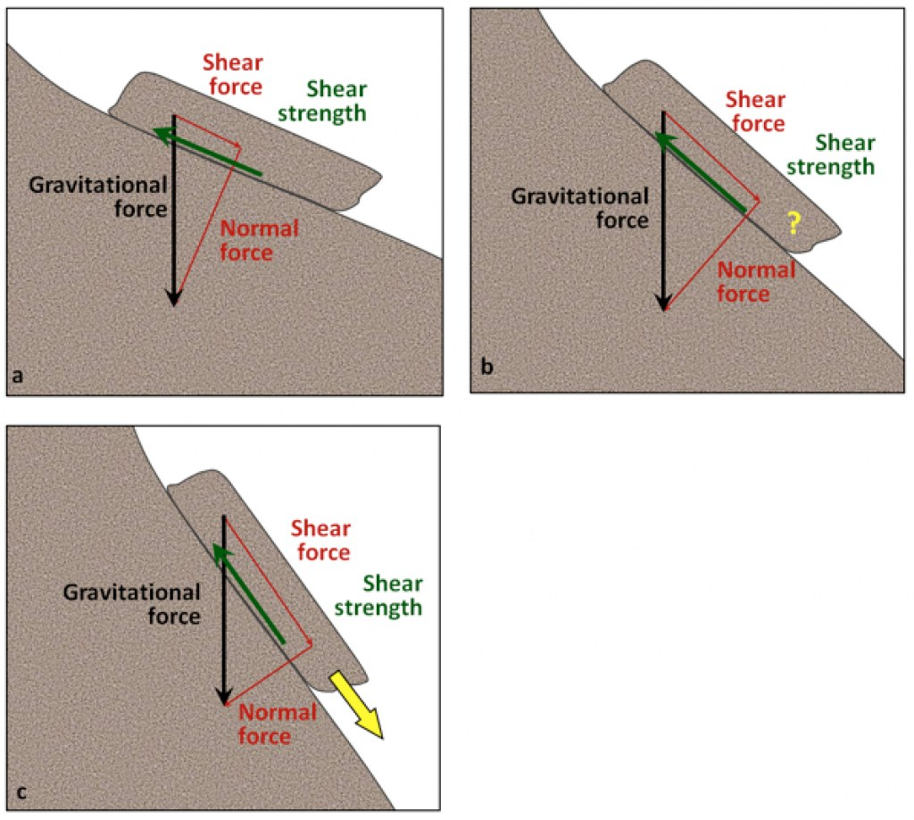
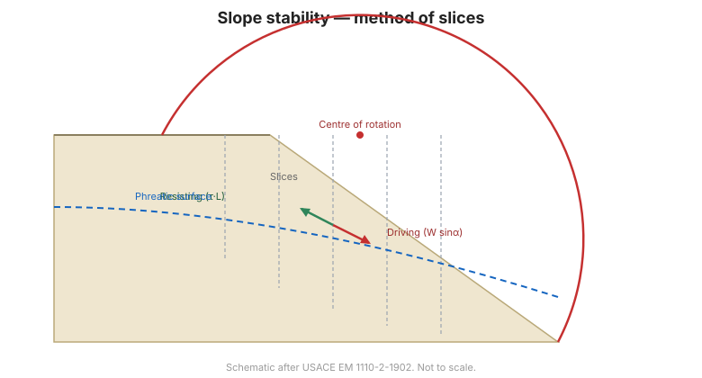

# Capítulo 7 — Análisis de Estabilidad de Taludes

El Capítulo VII se ocupa de la estabilidad de taludes, tanto **naturales** como
**artificiales**. La rotura de un talud puede tener consecuencias muy graves para los
bienes, las obras y las personas, por lo que el capítulo clasifica primero las formas en
que un talud puede moverse y presenta después los métodos para juzgar si es estable.

El manual es explícito sobre una limitación: **determinar con precisión el factor de
seguridad de un talud es difícil.** Exige un estudio cuidadoso y completo de las
condiciones del suelo, la mecánica y la topografía para identificar las causas y
condiciones gobernantes, seleccionar parámetros representativos y elegir un factor de
seguridad defendible.

## 7.1 Clasificación de los movimientos de talud

Dos factores deciden si un talud se mantiene: el **ángulo del talud** y la **resistencia
del material** que lo forma. Ambos quedan luego modificados por el agua y por la
orientación de los planos de debilidad —estratificación, foliación o diaclasas— respecto
de la cara del talud. Cuando esos planos son **paralelos** al talud, este alcanza su
máxima inestabilidad; cuando son **perpendiculares**, su máxima estabilidad.

**Figura.** Estabilidad relativa de los taludes en función de la orientación de las
debilidades (aquí, planos de estratificación) respecto del talud. A y B, con
estratificación casi perpendicular al talud, son estables; D, con estratificación casi
paralela, es inestable; C es un caso intermedio.
*© Steven Earle, CC BY 4.0 — Physical Geology, 2nd ed., Fig. 15.1.2.*

### 7.1.1 Movimiento de taludes naturales
### 7.1.2 Movimiento de taludes artificiales

## 7.2 Principales tipos de movimiento

### 7.2.1 Desprendimiento de rocas: rodadura y caída de bloques

El desprendimiento lo provocan el **cuñamiento por hielo y la descarga** en roca
empinada y diaclasada. Los detritos meteorizados se acumulan en un cono de **talus** al
pie: un depósito suelto, mal graduado y a menudo metaestable, que a su vez es un peligro
si más adelante se corta o se carga.

**Figura.** Izquierda: talud de talus cerca de Keremeos (Columbia Británica). Derecha:
resultado de una caída de rocas sobre una carretera al oeste de Keremeos en diciembre de
2014: el peligro que el monitoreo de desprendimientos pretende detectar.
*© Steven Earle, CC BY 4.0 — Physical Geology, 2nd ed., Fig. 15.2.2.*

### 7.2.2 Deslizamiento

El deslizamiento se subdivide según la forma de la superficie de rotura:

- **Deslizamiento plano** (trượt mặt phẳng)
- **Deslizamiento circular simple** (trượt vòng cung đơn giản)
- **Deslizamiento circular complejo** (trượt vòng cung phức hợp)

### 7.2.3 Levantamiento / expulsión lateral (trồi xệ) bajo carga
### 7.2.4 Erosión y transporte por agua corriente
### 7.2.5 Taludes de desmonte y de terraplén sobre terreno incompresible
### 7.2.6 Taludes de terraplén sobre suelo blando compresible
### 7.2.7 Estabilidad bajo un muro de contención

### 7.2.8 Fluencia lenta y flujos de detritos

La **fluencia lenta o creep** (trượt từ từ) es el movimiento lento e imperceptible
ladera abajo del suelo y los detritos rocosos. No rompe de golpe, pero es acumulativa y
**se lee en la vegetación**: los troncos inclinados que vuelven a enderezarse hacia arriba
(árboles en "culata de pistola", *pistol-butt*) registran años de fluencia en el talud.

Un **flujo de detritos** (dòng bùn đá) es lo contrario: rápido, cargado de agua y
destructivo. Avanza por un cauce empinado como una suspensión de agua, lodo, roca y
vegetación, y es el mecanismo que convierte una rotura modesta de talud en un peligro
para todo lo que hay ladera abajo.

**Figura.** Árboles con forma de culata de pistola en un talud afectado por fluencia: un
inclinómetro natural. La inclinación de la vegetación es uno de los indicadores más
baratos que puede leer una inspección visual de campo.
*© Steven Earle, CC BY 4.0 — Physical Geology, 2nd ed., Fig. 15.2.7.*

**Figura.** Parte baja de un flujo de detritos en un cauce empinado cerca del lago Buttle
(Columbia Británica), noviembre de 2006.
*© Steven Earle, CC BY 4.0 — Physical Geology, 2nd ed., Fig. 15.2.11.*

### 7.2.9 Dos casos de estudio

**Figura.** Lugar del deslizamiento de roca de 2008 en Porteau Cove (Columbia
Británica): un talud rocoso en un corredor de transporte, donde la consecuencia de la
rotura es directa e inmediata.
*© Steven Earle, CC BY 4.0 — Physical Geology, 2nd ed., Fig. 15.2.4.*

**Figura.** La avalancha de roca del monte Meager en agosto de 2010. Un flanco del volcán
colapsó y recorrió un valle estrecho y empinado: el extremo del espectro de roturas de
talud y un recordatorio de que la estabilidad de taludes no es solo un problema de
mecánica de suelos.
*"2010 Mt. Meager rock avalanche" © Isaac Earle, CC BY 4.0 — Physical Geology, 2nd ed.,
Fig. 15.2.5.*

## 7.3 Análisis de estabilidad de taludes

Todo análisis de estabilidad se reduce a la misma comparación. La gravedad tira de un
bloque verticalmente hacia abajo; esa fuerza se descompone en una **fuerza cortante** que
empuja el bloque *ladera abajo* y una **fuerza normal** que lo empuja *contra el talud*.
El talud se mantiene si la **resistencia al corte** disponible a lo largo de la superficie
de rotura supera la fuerza cortante.

**Figura.** Componentes cortante y normal de la gravedad en taludes de pendiente
creciente. La fuerza gravitatoria es la misma en los tres casos; solo cambia su
descomposición. (a) fuerza cortante $\ll$ resistencia al corte: estable; (b) ambas
aproximadamente iguales: situación límite; (c) fuerza cortante $\gg$ resistencia al
corte: rotura.
*© Steven Earle, CC BY 4.0 — Physical Geology, 2nd ed., Fig. 15.1.1.*

### 7.3.1 Análisis del deslizamiento plano
### 7.3.2 Soluciones simples

Una familia de **soluciones simples** (en ábacos o de forma cerrada) para casos
rutinarios.

### 7.3.3 Análisis del deslizamiento por arco circular

El enfoque de arco circular (sueco / Fellenius), en que el factor de seguridad es la
razón entre los momentos resistente y motor respecto del centro del círculo de prueba. Es
el método que Bishop amplía en el Capítulo 9 para la construcción por etapas.

**Figura.** Análisis de estabilidad de taludes por arco circular.

## 7.4 Terminología

| Español | Inglés | Vietnamita (libro) |
| --- | --- | --- |
| talud natural / artificial | natural / man-made slope | mái dốc tự nhiên / nhân tạo |
| estabilidad de taludes | slope stability | ổn định mái dốc |
| desprendimiento / caída de rocas | rockfall | lăn rơi khối đá |
| deslizamiento | sliding | trượt |
| deslizamiento plano | plane sliding | trượt mặt phẳng |
| deslizamiento por arco circular | circular-arc sliding | trượt cung tròn |
| levantamiento / expulsión lateral | heave / lateral squeeze | trồi xệ |
| talud de desmonte | cut slope | mái dốc đào |
| talud de terraplén | fill slope | mái dốc đắp |
| factor de seguridad | factor of safety | hệ số an toàn |
| superficie de rotura | failure surface | mặt trượt |

## 7.5 Puntos clave

- Los taludes son **naturales** o **artificiales**; los mecanismos de rotura difieren.
- Los movimientos se agrupan en **desprendimiento, deslizamiento, levantamiento/expulsión
  y erosión por agua**.
- El deslizamiento se clasifica por la forma de la **superficie de rotura**: plana o
  circular.
- Determinar **con exactitud** el factor de seguridad es difícil; el trabajo está en la
  caracterización del suelo y la elección de parámetros, no solo en la aritmética.
- El método de **arco circular** es el caballo de batalla y conduce al método de Bishop
  usado para terraplenes construidos por etapas en el Capítulo 9.
