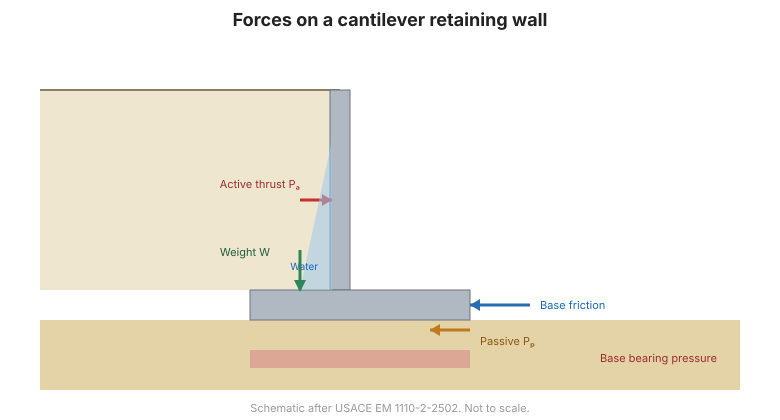

# Capítulo 8 — Análisis de Muros de Contención

El Capítulo VIII trata los empujes de tierras y las estructuras que los resisten. Abre con
la teoría clásica de la presión activa y pasiva, para pasar después a los muros **rígidos**
(de gravedad y en voladizo) y a los muros **flexibles** (tablestacas y muros pantalla),
incluidos los muros anclados y las excavaciones apuntaladas.

## 8.1 Presión activa y pasiva

### 8.1.1 Suelo cohesivo ($\varphi = 0$, $c \neq 0$)

Para un muro vertical con superficie de relleno horizontal, despreciando el rozamiento
muro–suelo, la **presión activa** (áp lực chủ động) es la presión lateral *mínima* que el
suelo ejerce sobre el muro: la condición en que el muro se ha separado lo suficiente para
que el suelo movilice su resistencia al corte a lo largo del plano de rotura:

$$\sigma_a = K_a\,\sigma'_z - 2c\sqrt{K_a}$$

donde $\sigma'_z$ es la tensión vertical efectiva, $c$ la cohesión y $K_a$ el
**coeficiente de empuje activo**.

**1. El coeficiente $K_a$** se obtiene de:

$$K_a = \tan^2\!\left(45^\circ - \frac{\varphi}{2}\right) = \frac{1 - \sin\varphi}{1 + \sin\varphi}$$

**2. El empuje activo $Q_a$** para un muro de altura $H$ es:

$$Q_a = \tfrac{1}{2}H\,\sigma_a = \tfrac{1}{2}K_a\,\gamma\,H^2$$

y su punto de aplicación está a $\tfrac{1}{3}H$ desde la base del muro.

### 8.1.2 Suelo granular

El mismo marco con $c = 0$, más el efecto del rozamiento muro–suelo y del relleno
inclinado.

**Figura.** Empujes de tierras que actúan sobre un muro de contención.

## 8.2 Análisis de muros rígidos

### 8.2.1 Definición y clasificación
Muros de gravedad, semigravedad y en voladizo (muros ménsula).

### 8.2.2 Análisis de un muro rígido
Estabilidad frente a **vuelco**, **deslizamiento** y **rotura por capacidad de carga**,
además del dimensionamiento estructural interno.

### 8.2.3 Algunos tipos de muro rígido de poca altura

## 8.3 Análisis de muros flexibles

### 8.3.1 Definición y clasificación
Tablestacas y muros pantalla (muros de lodo bentonítico).

### 8.3.2 Análisis de un muro en voladizo (base empotrada)
### 8.3.3 Análisis de un muro anclado
### 8.3.4 Análisis de una excavación apuntalada

Las excavaciones apuntaladas (hố đào với tường chống xà) son el caso más pertinente para
la excavación profunda urbana y para la instrumentación descrita en la página
[Cimentaciones y Excavaciones](../../../applications/foundations.md) de este sitio.

### 8.3.5 Estabilidad de la base y deformación del muro en una excavación

## 8.4 Terminología

| Español | Inglés | Vietnamita (libro) |
| --- | --- | --- |
| muro de contención | retaining wall | tường chắn |
| empuje activo | active earth pressure | áp lực chủ động |
| empuje pasivo | passive earth pressure | áp lực bị động |
| empuje en reposo | earth pressure at rest | áp lực tĩnh (nghỉ) |
| coeficiente de empuje activo | coefficient of active earth pressure | hệ số áp lực chủ động |
| empuje activo resultante | active thrust | lực chủ động |
| muro rígido | rigid wall | tường chắn cứng |
| muro flexible | flexible wall | tường chắn mềm |
| muro en voladizo / ménsula | cantilever wall | tường công-xôn |
| tablestaca | sheet pile | tường cừ |
| muro anclado | anchored wall | tường chắn có neo |
| excavación apuntalada | braced excavation | hố đào chống xà |

## 8.5 Puntos clave

- La presión **activa** es la mínima; la **pasiva**, la máxima; la de **reposo** queda
  entre ambas.
- Para suelo cohesivo, $\sigma_a = K_a\sigma'_z - 2c\sqrt{K_a}$ y
  $K_a = \tan^2(45^\circ - \varphi/2)$.
- El empuje activo sobre un muro de altura $H$ vale $Q_a = \tfrac{1}{2}K_a\gamma H^2$ y
  actúa a $\tfrac{1}{3}H$ sobre la base.
- Los muros rígidos se comprueban frente a **vuelco, deslizamiento y capacidad de carga**.
- Los muros flexibles (tablestaca, pantalla) y las **excavaciones apuntaladas** son el
  caso crítico del monitoreo de excavaciones profundas urbanas.
