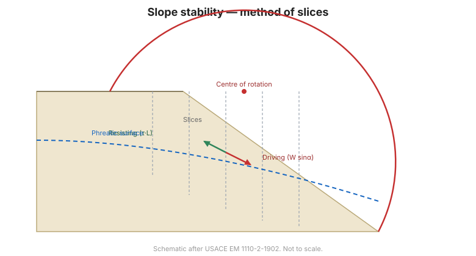
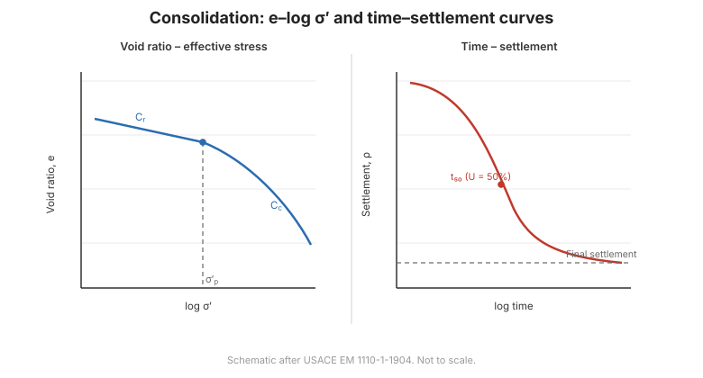
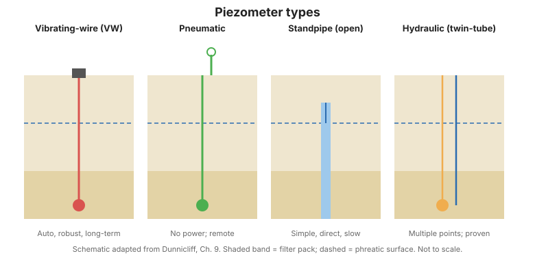
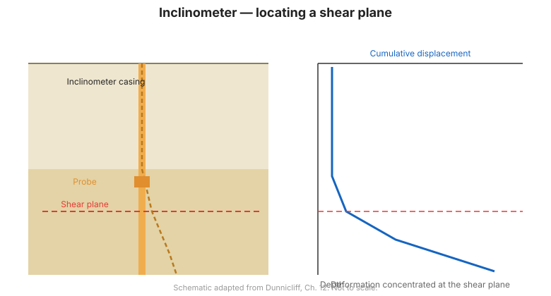
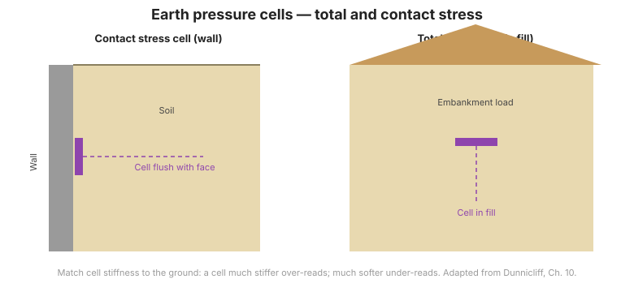

# Capítulo 9 — Terraplenes sobre Suelo Blando

El Capítulo IX es el más cercano al tema de este sitio de todo el manual. Aborda las dos
preguntas que gobiernan todo terraplén construido sobre arcilla blanda —**¿será estable y
cuánto asentará?**— y, algo decisivo, **cómo monitorearlo** para poder controlar con
seguridad la construcción por etapas.

## 9.1 Generalidades

**Terraplén** (đất đắp) es el suelo seleccionado como relleno, colocado y compactado
según una especificación de diseño. Un terraplén puede cumplir dos funciones: como
**estructura** (presa, dique, terraplén de carretera) y como **subrasante / explanada**
(nền đất nền) de una calzada, un patio o una cimentación.

El **suelo blando** (nền đất yếu) es el terreno situado bajo el relleno, formado por
arcillas y limos blandos compresibles, suelos orgánicos y turba, de alta compresibilidad
y baja resistencia.

La estabilidad y la deformación de un terraplén sobre suelo blando no dependen solo del
relleno, sino, de forma decisiva, de la **cimentación blanda**. Por eso el capítulo cubre:
la investigación para obtener parámetros; la **estabilidad de taludes**; el **asentamiento
por consolidación**; el **monitoreo y la verificación**; los materiales de relleno y la
construcción; y el diseño de pavimentos flexibles.

## 9.2 Estabilidad de taludes de terraplenes

### 9.2.1 Método combinado de rebanadas de Bishop–Fellenius

### 9.2.2 Método de estabilidad para construcción por etapas

Los terraplenes sobre arcilla blanda se construyen **por etapas** (đắp theo giai đoạn):
se coloca una tongada y se deja que el suelo consolide y gane resistencia antes de la
siguiente. La comprobación de estabilidad en cada etapa decide si puede avanzarse a la
tongada siguiente.

### 9.2.3 Bermas de contrapeso para elevar el factor de seguridad

Una **berma de contrapeso** (bệ phản áp) al pie del talud eleva el factor de seguridad
sin retirar relleno.

**Figura.** Análisis de estabilidad por arco circular usado en la construcción de
terraplenes por etapas.

## 9.3 Asentamiento por consolidación

### 9.3.1 Naturaleza del asentamiento por consolidación y sus limitaciones
### 9.3.2 Asentamiento por consolidación según el método de Terzaghi
### 9.3.3 Métodos de aceleración de la consolidación

Los **drenes verticales** (bấc thấm / PVD), los **drenes de arena** (giếng cát) y la
**sobrecarga / precarga** se usan para acelerar la consolidación y poder continuar la obra
antes.

**Figura.** Consolidación: curva $e$–$\log\sigma'$ y curva tiempo–asentamiento.

## 9.4 Monitoreo y verificación

Esta es la sección que más importa a este sitio. En un terraplén sobre suelo blando la
instrumentación no es opcional: es el medio de controlar la construcción por etapas y de
verificar las hipótesis de diseño. El manual define cinco mediciones:

### 9.4.1 Monitoreo del asentamiento (quan trắc độ lún)

El asentamiento del relleno y de la cimentación blanda se mide con **placas de
asentamiento** e **hitos de asentamiento** (bàn đo lún / mốc đo lún): la base para
confirmar la velocidad de consolidación y decidir cuándo es segura la tongada siguiente.

### 9.4.2 Medición de la presión de agua de poros (đo áp lực nước lỗ rỗng)

La **presión de agua de poros** se mide con **piezómetros** (término canónico **áp kế**).
Es el indicador directo de la consolidación: a medida que se disipa el exceso de presión
intersticial, aumentan la tensión efectiva y la resistencia. Véanse
[Dunnicliff, Cap. 6](../dunnicliff/chapter-06-piezometers.md) y
[FHWA, Cap. 2](../fhwa/chapter-02-groundwater-pressure.md).

**Figura.** Comparación de los tipos habituales de piezómetros.

### 9.4.3 Desplazamiento lateral bajo el terraplén (đo chuyển vị ngang)

El **desplazamiento lateral** del suelo blando bajo el relleno y a su lado se mide con un
**inclinómetro** alojado en una **camisa de inclinómetro** (término canónico **ống đo
nghiêng**). Es el indicador más temprano de inestabilidad incipiente en el pie. Véase
[Dunnicliff, Cap. 8](../dunnicliff/chapter-08-deformation.md).

**Figura.** Camisa y sonda de inclinómetro para medir el desplazamiento lateral.

### 9.4.4 Tensión vertical total en la base del relleno (đo ứng suất tổng phương đứng)

Las **células de presión de tierras total** (término canónico **hộp đo áp lực đất**)
colocadas en la base del relleno miden la tensión vertical total transmitida a la
cimentación: el dato de entrada de carga de los cálculos de asentamiento y estabilidad.
Véase [Dunnicliff, Cap. 7](../dunnicliff/chapter-07-stress.md).

**Figura.** Célula de presión de tierras embebida en la base del relleno.

### 9.4.5 Medición directa de la ganancia de resistencia al corte (đo mức độ gia cường sức kháng cắt)

El **ensayo de molinete / veleta de campo** (thí nghiệm cắt cánh) repetido en la arcilla
blanda mide directamente cuánta resistencia al corte ha ganado el suelo al consolidar: la
comprobación en campo de que se está cumpliendo la hipótesis de construcción por etapas.

### 9.4.6 Recomendaciones generales

Un programa de monitoreo sobre suelo blando debe combinar: asentamiento, presión de
poros, desplazamiento lateral y, cuando el diseño dependa de la ganancia de resistencia,
ensayos de veleta de campo, con **valores umbral de activación** que detengan la obra si
se superan.

## 9.5 Materiales de relleno y construcción
### 9.5.1 Métodos de construcción y tratamiento
### 9.5.2 Materiales de relleno
### 9.5.3 Investigación y ensayos de los materiales de relleno
### 9.5.4 Método constructivo y control de compactación

## 9.6 Diseño de pavimentos flexibles
### 9.6.1 Estructura del pavimento
### 9.6.2 Carga de tráfico
### 9.6.3 Resistencia de la subrasante
### 9.6.4 Diseño según Road Note 31
### 9.6.5 Diseño por el método AASHTO
### 9.6.6 Materiales de la capa base

## 9.7 Terminología

| Español | Inglés | Vietnamita (libro) |
| --- | --- | --- |
| terraplén / relleno | embankment / fill | đất đắp |
| suelo blando | soft ground | nền đất yếu |
| subrasante | subgrade | nền đất nền (kết cấu áo đường) |
| construcción por etapas | staged construction | đắp theo giai đoạn |
| berma de contrapeso | counterweight berm | bệ phản áp |
| asentamiento por consolidación | consolidation settlement | lún cố kết |
| dren vertical (PVD) | vertical drain (PVD) | bấc thấm |
| dren de arena | sand drain | giếng cát |
| monitoreo de asentamiento | settlement monitoring | quan trắc độ lún |
| presión de agua de poros | pore-water pressure | áp lực nước lỗ rỗng |
| desplazamiento lateral | lateral displacement | chuyển vị ngang |
| camisa de inclinómetro | inclinometer casing | ống đo nghiêng |
| célula de presión de tierras | earth pressure cell | hộp đo áp lực đất |
| ensayo de veleta de campo | field vane shear test | thí nghiệm cắt cánh hiện trường |
| pavimento flexible | flexible pavement | tầng phủ mềm (áo đường mềm) |

## 9.8 Puntos clave

- En suelo blando, el comportamiento lo gobierna la **cimentación blanda**, no el
  relleno.
- Construya **por etapas**, dejando que el suelo consolide y gane resistencia entre
  tongadas.
- **Acelere la consolidación** con drenes verticales, drenes de arena y sobrecarga.
- **La instrumentación controla la construcción**: cinco mediciones (asentamiento,
  presión de poros, desplazamiento lateral, tensión vertical total y ganancia de
  resistencia por veleta).
- Establezca **valores umbral** y detenga la obra cuando se superen.
