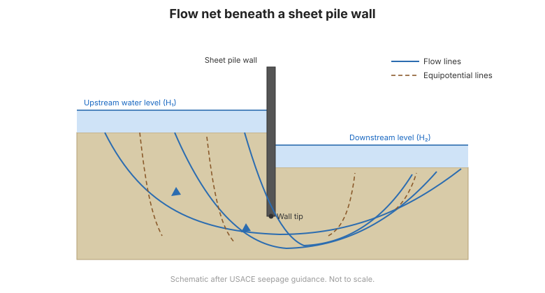

# Capítulo 10 — Hidráulica de Ingeniería

El Capítulo X trata la hidráulica del suelo: cómo se mueve el agua por el terreno y qué
efecto tiene eso en la estabilidad. Cubre los estados del agua en el suelo, la ley de
Darcy, la permeabilidad, el flujo bidimensional, las redes de flujo, las fuerzas de
filtración y su aplicación a pantallas impermeables, excavaciones y presas de tierra.

## 10.1 Movimiento del agua libre

### 10.1.1 Estados del agua en el terreno

El manual distingue tres estados:

- **Agua de formación / constitucional** (nước thành tạo) — agua integrada en la
  estructura química de las partículas minerales.
- **Agua adsorbida / ligada** (nước liên kết) — agua adsorbida como película sobre la
  superficie de las partículas.
- **Agua intersticial** (nước lỗ rỗng) — agua en los vacíos, de la que hay dos clases:
  **agua capilar** (nước mao dẫn) y **agua libre** (nước tự do).

El agua libre por debajo del nivel freático obedece las leyes del flujo de fluidos; el
agua capilar está retenida por tensión superficial y se encuentra en equilibrio entre el
peso de la columna de agua y la succión ascendente.

### 10.1.2 Flujo en línea recta: la ley de Darcy

Para flujo laminar a través del suelo, la velocidad de descarga es proporcional al
gradiente hidráulico:

$$v = k\,i$$

donde $k$ es el coeficiente de permeabilidad e $i$ el gradiente hidráulico.

### 10.1.3 Coeficiente de permeabilidad y su determinación

Métodos de laboratorio (carga constante, carga variable) y de campo (ensayo de bombeo).

## 10.2 Flujo bidimensional en un medio homogéneo e isótropo

### 10.2.1 La red de flujo

Una **red de flujo** (mạng dòng chảy) es una solución gráfica de la ecuación de Laplace:
una familia de líneas de flujo que corta en ángulo recto a una familia de líneas
equipotenciales.

**Figura.** Red de flujo para la filtración bajo una tablestaca.

### 10.2.2 Caudal de filtración a través de una masa de suelo

### 10.2.3 Fuerza de filtración (lực đẩy của dòng chảy)

El agua que fluye por el suelo ejerce una **fuerza de filtración** sobre el esqueleto
sólido en la dirección del flujo. Cuando el flujo es ascendente, la fuerza reduce la
tensión efectiva y puede provocar **sifonamiento / erosión interna** (piping) o
**ebullición del fondo** (boiling).

### 10.2.4 Pantalla impermeable vertical en un estrato permeable
### 10.2.5 Pantalla impermeable para una excavación
### 10.2.6 Diques y presas de tierra

## 10.3 Terminología

| Español | Inglés | Vietnamita (libro) |
| --- | --- | --- |
| agua de formación | formation water | nước thành tạo |
| agua ligada / adsorbida | bound water | nước liên kết |
| agua intersticial | pore water | nước lỗ rỗng |
| agua capilar | capillary water | nước mao dẫn |
| agua libre | free water | nước tự do |
| ley de Darcy | Darcy's law | định luật Darcy |
| gradiente hidráulico | hydraulic gradient | gradient thuỷ lực |
| coeficiente de permeabilidad | coefficient of permeability | hệ số thấm |
| red de flujo | flow net | mạng dòng chảy |
| línea de flujo / línea equipotencial | flow line / equipotential line | đường dòng / đường đẳng thế |
| fuerza de filtración | seepage force | lực đẩy của dòng chảy |
| sifonamiento / ebullición del fondo | piping / boiling | xói ngầm / bùng nền |

## 10.4 Puntos clave

- El agua en el suelo existe como **agua de formación, ligada e intersticial**; esta
  última es capilar o libre.
- La **ley de Darcy** $v = ki$ gobierna la filtración laminar.
- Una **red de flujo** resuelve gráficamente el flujo 2-D.
- La **fuerza de filtración** actúa sobre el esqueleto sólido; el flujo ascendente reduce
  la tensión efectiva y puede causar **sifonamiento**.
- La misma teoría se aplica a **pantallas impermeables, excavaciones y presas de
  tierra**.
