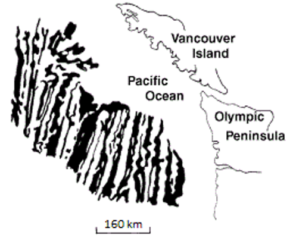
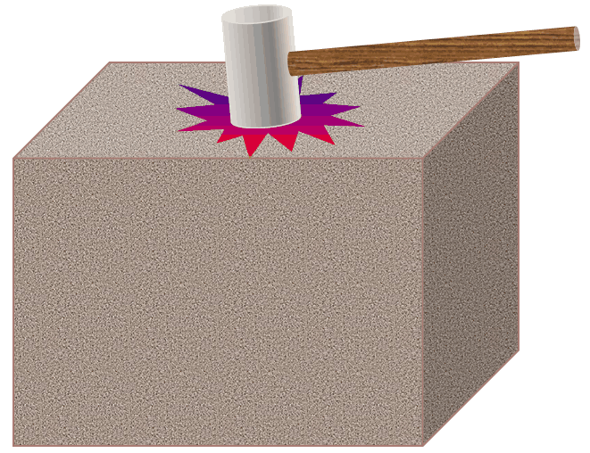
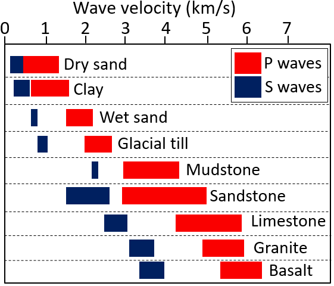
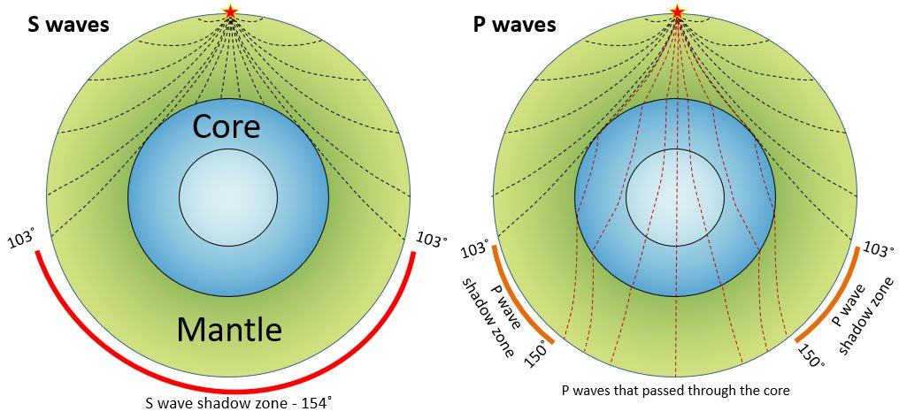
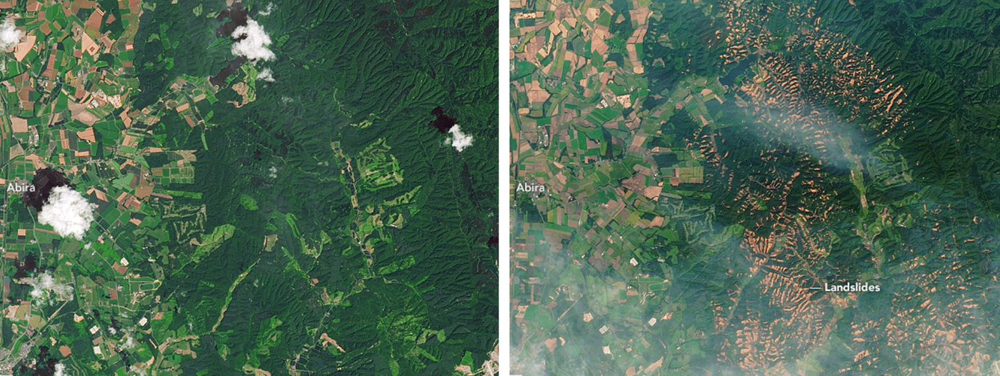
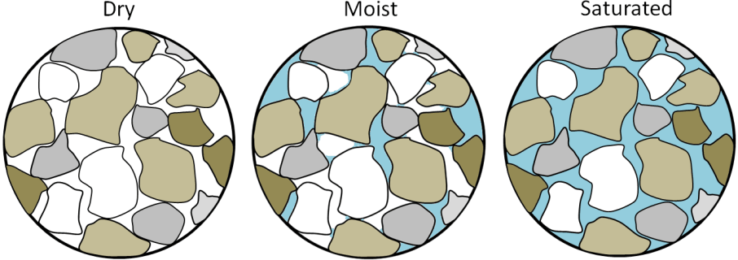

# Capítulo 11 — Sismos y Obras de Construcción

El Capítulo XI introduce los sismos para el ingeniero civil: qué son, cómo se describen,
cómo se cartografían en Vietnam y cómo entran en el diseño de puentes y edificios, con los
problemas de mecánica de suelos —ante todo la **licuefacción**— tratados explícitamente.

## 11.1 Panorama general de los sismos

### 11.1.1 Definición y conceptos

Un sismo es el resultado de la deformación de la corteza terrestre. La energía de
deformación se acumula hasta que, en algún punto de menor resistencia, la tensión supera
el equilibrio: la rotura se propaga entonces rápidamente radiando ondas sísmicas.

Términos clave:

- **Hipocentro / foco** (chấn tiêu) — el punto del interior de la Tierra donde comienza
  la rotura.
- **Epicentro** (chấn tâm) — el punto de la superficie situado verticalmente sobre el
  foco.
- **Falla** (đứt gãy), **falla activa** (đứt gãy hoạt động) — la fractura a lo largo de
  la cual se produce el desplazamiento.

**Figura.** Una falla (línea discontinua blanca) en roca intrusiva en la isla de Quadra
(Columbia Británica). Un dique ha sido desplazado unos 10 cm: movimiento **dextral**. La
falla misma es el plano de roca ya rota a lo largo del cual se propaga la rotura.
*© Steven Earle, CC BY 4.0 — Physical Geology, 2nd ed., Fig. 12.3.4.*

### 11.1.2 Distribución mundial de los sismos
### 11.1.3 Causas de los sismos

## 11.2 Algunas características de los sismos

### 11.2.1 Energía de un sismo
### 11.2.2 Magnitud $M$
### 11.2.3 Intensidad $I$
### 11.2.4 Características de la vibración sísmica

Dos ondas internas transportan la energía desde el foco: la **onda P** (compresión,
"empuje–tracción", la primera en llegar) y la **onda S** (cortante, más lenta). Es la onda
S la que causa la mayor parte del daño estructural y, algo decisivo para el ingeniero
geotécnico, **las ondas S no se propagan por los líquidos**. Las ondas superficiales llegan
después y son las más lentas.

**Figura.** El principio de todo método sísmico en investigación geotécnica: un golpe de
martillo (o una fuente en sondeo) envía ondas elásticas al terreno, y los tiempos de
llegada de las ondas P y S a un receptor dan las velocidades de propagación del material.
*© Steven Earle, CC BY 4.0 — Physical Geology, 2nd ed., Fig. 9.1.1.*

**Figura.** Velocidades típicas de ondas P (rojo) y S (azul) en sedimentos y en roca
cortical sólida. Las velocidades en **sedimentos blandos** son un orden de magnitud
inferiores a las de la roca: por eso un mismo sismo sacude con mucha más violencia un
emplazamiento de suelo blando que uno sobre roca.
*© Steven Earle, CC BY 4.0, a partir de la US Environmental Protection Agency (dominio
público) — Physical Geology, 2nd ed., Fig. 9.1.3.*

**Figura.** Propagación de las ondas sísmicas por el manto y el núcleo. Las ondas S se
detienen en el límite núcleo–manto, dejando una zona de sombra de ondas S en el lado
opuesto de la Tierra: la misma física que permite a la geofísica cartografiar una **capa
blanda o líquida** bajo un emplazamiento.
*© Steven Earle, CC BY 4.0 — Physical Geology, 2nd ed., Fig. 9.1.6.*

### 11.2.5 Ley de atenuación del movimiento sísmico
### 11.2.6 Consecuencias de los sismos

Además del daño directo por sacudida, un sismo **desestabiliza taludes** y puede
desencadenar deslizamientos generalizados, sobre todo donde el terreno ya estaba
saturado por la lluvia. Las roturas de Sapporo en 2018 son la secuencia de manual: un tifón
saturó los suelos volcánicos y un sismo M6,6 provocó después miles de flujos de
detritos.

**Figura.** Roturas de taludes en la zona de Sapporo (Japón) tras un tifón (4 de
septiembre de 2018) y un sismo (6 de septiembre de 2018). Imágenes Landsat 8 antes
(julio de 2017, izquierda) y después (septiembre de 2018, derecha). Saturación seguida
de sacudida es el desencadenante compuesto clásico.
*"Landslides in Hokkaido" de Lauren Dauphin, NASA Earth Observatory (dominio público) —
Physical Geology, 2nd ed., Fig. 15.1.7.*

## 11.3 Zonificación sísmica y mapas de sismos

### 11.3.1 Generalidades
### 11.3.2 Los sismos en Vietnam

Vietnam no es asísmico: el noroeste (a lo largo de las zonas de falla del río Rojo y
Lai Chau–Dien Bien) y partes del Altiplano Central han registrado sismos destructivos.

### 11.3.3 Investigación sísmica para el diseño sismorresistente

## 11.4 Panorama del diseño sismorresistente

### 11.4.1 Parámetros de diseño
### 11.4.2 Problemas de mecánica de suelos en el diseño sísmico

### 11.4.3 Licuefacción de suelos (hiện tượng hóa lỏng)

Bajo carga sísmica cíclica, las arenas sueltas saturadas pueden perder su resistencia y
comportarse como un líquido. La **licuefacción** es un peligro geotécnico de primer orden:
destruye la capacidad de carga, provoca extensión lateral y asentamientos, y ha volcado
estructuras que por lo demás estaban bien construidas. El manual presenta las
condiciones, la evaluación y la mitigación.

**Figura.** Por qué la saturación es la condición previa de la licuefacción: la arena
saturada es la **más débil** de los tres estados, porque el agua a presión separa los
granos. La sacudida cíclica elimina por completo el contacto grano a grano y el suelo se
comporta como un líquido.
*© Steven Earle, CC BY 4.0 — Physical Geology, 2nd ed., Fig. 15.1.4.*

### 11.4.4 Efectos sísmicos en el diseño de puentes
### 11.4.5 Efectos sísmicos en el diseño de edificios

## 11.5 Terminología

| Español | Inglés | Vietnamita (libro) |
| --- | --- | --- |
| sismo / terremoto | earthquake | động đất |
| hipocentro / foco | focus | chấn tiêu |
| epicentro | epicenter | chấn tâm |
| falla / falla activa | fault / active fault | đứt gãy / đứt gãy hoạt động |
| magnitud | magnitude | độ lớn (chấn cấp) $M$ |
| intensidad | intensity | cường độ $I$ |
| zonificación sísmica | seismic zoning | phân vùng địa chấn |
| atenuación | attenuation | tắt dần |
| diseño sismorresistente | seismic design | thiết kế kháng chấn (chống động đất) |
| licuefacción | liquefaction | hoá lỏng đất nền |
| extensión lateral | lateral spreading | trôi ngang |

## 11.6 Puntos clave

- La deformación se acumula en la corteza y se libera como **rotura y ondas sísmicas**.
- La **magnitud** es un número único para el evento; la **intensidad** varía con el lugar.
- Vietnam **sí** tiene sismicidad, en particular el noroeste y el Altiplano Central.
- La **licuefacción** de arenas sueltas saturadas es el peligro geotécnico característico
  y debe evaluarse allí donde pueda presentarse.
- El diseño sísmico necesita tanto el **movimiento del terreno** como la **respuesta del
  suelo**.
