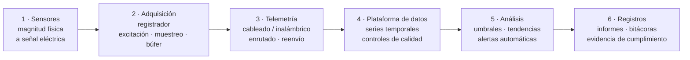

# Capítulo 12 — Geoinformática en Geotecnia

El Capítulo XII cierra el manual con el papel de las tecnologías de la información —*géo-
informatique*— en el trabajo geotécnico. Su mensaje es mesurado: la informática ha
transformado el tratamiento de datos, pero no puede sustituir al ingeniero.

!!! note "Sobre las secciones técnicas añadidas 12.3 y 12.4"
    Además del resumen del libro, este capítulo añade dos secciones editoriales que
    describen con **mayor detalle técnico la tecnología de la información** que hay detrás
    de un sistema de monitoreo automatizado y de un programa de análisis. Son contenido
    técnico general, **no vinculado a ningún fabricante, marca o producto concreto**.

## 12.1 El argumento

En las últimas décadas la informática se ha desarrollado con fuerza y ha entrado en todos
los campos, incluida la geotecnia. Pero **el suelo es un material muy complejo**: muchos
factores que interactúan, no uniforme, anisotropo. Los problemas de la geotecnia, tanto en
investigación (ensayos, recogida de datos, evaluación y selección de parámetros) como en
análisis (interacción suelo–estructura), **no pueden resolverse con un único modelo o
fórmula**. Existen programas de análisis generales, pero siempre requieren la intervención
de un especialista geotécnico.

La advertencia del manual: el ordenador hace el tratamiento de datos rápido, cómodo y
preciso, y pone muchos resultados a un clic de menú, pero **solo el conocimiento, la
experiencia y un buen dominio de la ingeniería pueden encontrar la mejor solución** y
elegir parámetros representativos. El software termina rápido una buena idea; no aporta
la idea.

## 12.2 La informática en la investigación del terreno

### 12.2.1 El proceso de investigación

Una campaña de investigación es una **cadena de transformaciones de datos**: campo →
muestra → ensayo → índice → parámetro de diseño. Cada eslabón puede informatizarse, pero
un error introducido en un eslabón no puede ser reparado por los que le siguen.

### 12.2.2 Tareas que se prestan al tratamiento informático

Cuatro grupos:

1. **Captura** — introducción de datos de campo, columnas de sondeo y resultados de
   ensayos.
2. **Gestión** — la base de datos de la investigación, que relaciona muestra ↔ sondeo ↔
   estrato ↔ ensayo.
3. **Tratamiento y presentación** — representación gráfica, corrección, interpolación,
   dibujo de cortes.
4. **Análisis** — correlación entre tipos de ensayo, caracterización estadística,
   selección de parámetros.

### 12.2.3 Aplicaciones de la informática

**a) Introducción y estandarización de datos.** Los formularios electrónicos sustituyen
al cuaderno de papel: cada campo tiene un tipo, una unidad y un rango válido, de modo que
un error de unidades (kN/m² ↔ kPa ↔ T/m²) se bloquea en la entrada en lugar de
descubrirse cuando el diseño ya está terminado.

**b) La base de datos de investigación.** La unidad básica de datos es el **sondeo**,
vinculado a **estratos**, **muestras**, **ensayos de campo** y **ensayos de laboratorio**.
Una vez organizados los datos de forma relacional, una única fuente puede exportarse
como: cortes geológicos, tablas resumen de propiedades, gráficos de distribución y el
registro de entrega, sin volver a teclear nada.

**c) Representación y análisis de gráficos.** La representación informatizada libera al
ingeniero del trabajo manual, pero crea también una nueva tentación: **dibujar mucho sin
comprobar nada**. Cuanto más vistoso es el gráfico, más fácil resulta olvidar que solo
vale lo que valen los datos que lo alimentaron.

**d) Correlación entre tipos de ensayo.** Las correlaciones empíricas (por ejemplo
$N_{SPT}$ ↔ $s_u$ ↔ $q_c$) son una herramienta potente, pero cada correlación solo es
válida dentro del **rango de suelos y condiciones a partir del cual se construyó**. El
software puede calcular una correlación para cualquier suelo; el ingeniero debe saber
cuándo esa correlación no significa nada.

**e) Digitalización de registros antiguos.** Escanear y volver a introducir registros
históricos de investigación permite reutilizar datos de archivo: a menudo el activo de
ingeniería más valioso que hereda un proyecto y, a menudo, el que se pierde con más
facilidad.

## 12.3 Tecnología de adquisición automatizada de datos: las seis capas de un sistema de monitoreo

*(Sección añadida: descripción técnica, no vinculada a un producto concreto.)*

El valor de un sistema de monitoreo automatizado **no reside en los sensores**; reside en
la capacidad de medir correctamente, transmitir lo suficiente, detectar anomalías pronto
y preservar la evidencia. El sistema puede describirse como una cadena de seis capas, cada
una de las cuales responde a su propia pregunta de ingeniería.

### 12.3.1 Capa 1 — Sensores e interfaces de señal

Es la capa que determina **la exactitud realmente alcanzable**; las capas posteriores solo
pueden conservarla o perderla. Cuatro familias habituales de interfaz de señal:

| Interfaz | Principio | Ventajas | Puntos a vigilar |
| --- | --- | --- | --- |
| **Cuerda vibrante** | La frecuencia de resonancia de un alambre tensado varía con la deformación | Señal de **frecuencia**, poca pérdida en tendidos largos; estable a largo plazo | Requiere un pulso de excitación; exige **compensación de temperatura** |
| **Galga extensométrica** | La resistencia cambia con la deformación | Alta exactitud, amplio rango | Sensible al ruido; mantener el cable corto; necesita compensación de temperatura |
| **4–20 mA** | Corriente proporcional a la magnitud medida | Estándar industrial, buena inmunidad al ruido, larga distancia | Necesita alimentación de bucle; unidireccional |
| **Digital / bus** (SDI-12, Modbus, RS-485) | Transmisión digital directa, muchos sensores en un bus | Inmune al ruido, cableado simple, direccionable | Requiere gestión de direcciones y protocolo |

Otras dos familias, menos frecuentes, merecen conocerse: la **detección por fibra óptica**
(rejilla de Bragg / dispersión: totalmente inmune a interferencias electromagnéticas y
capaz de medir de forma distribuida a lo largo de una línea, adecuada para estructuras
largas como presas y túneles) y los **MEMS** (pequeños y económicos, usados para
inclinación y aceleración, pero sujetos a **deriva del cero**, por lo que deben
recalibrarse periódicamente).

Hay un requisito que se pasa por alto con demasiada frecuencia: **todo sensor debe tener
un identificador único y un certificado de calibración**. Sin esas dos cosas, ni siquiera
un dato correcto puede utilizarse como evidencia.

### 12.3.2 Capa 2 — Adquisición: el registrador de datos

El registrador es el punto donde las decisiones de ingeniería se convierten en parámetros
de configuración:

- **Número y tipo de canales**: un solo equipo suele combinar varios tipos de canal
  (cuerda vibrante, galga, 4–20 mA, conteo de pulsos, termistor).
- **Frecuencia de muestreo**: debe ser lo bastante densa para no perder un movimiento
  rápido. En emergencia puede ser necesario llegar a **cuatro lecturas por hora**; si el
  sistema registra una sola vez al día, estuvo mal configurado desde el principio.
- **Resolución y tiempo de promediado**: promediar muchas muestras reduce el ruido pero
  **aplana los picos**; para una tarea de alerta, el pico es justamente lo que hay que ver.
- **Sincronización temporal**: sin ella no pueden compararse datos de varios equipos.
- **Protección contra sobretensiones**, **batería de respaldo** y **búfer**. El búfer es
  un detalle menor con consecuencias decisivas: los datos se pierden con más frecuencia
  **justo en el momento del incidente**, cuando fallan la alimentación o la conexión.

### 12.3.3 Capa 3 — Telemetría

| Método | Distancia | Ancho de banda | Coste | Observaciones |
| --- | --- | --- | --- | --- |
| **Cableado** (RS-485, fibra) | ~1,2 km por tramo | Medio – alto | Bajo – medio | El más estable; difícil de instalar en terreno accidentado; necesita protección contra sobretensiones |
| **Radio VHF/UHF** | 1 – 20 km (según relieve) | Bajo – medio | Medio | Dependiente del relieve; puede requerir licencia de frecuencia |
| **Red mallada (mesh)** | Crece con el número de nodos | Bajo | Medio | Se recompone sola cuando falla un nodo; configuración más compleja |
| **Celular 4G/LTE** | Donde haya cobertura | Alto | Bajo (según plan de datos) | Dependiente de la red; alto consumo, exige alimentación estable |
| **Satélite** | Cualquier punto | Bajo | Alto | Para lugares sin infraestructura terrestre; latencia alta |

Dos requisitos técnicos mínimos: un **mecanismo de reenvío** cuando falla un envío y un
**búfer local** para no perder datos cuando se interrumpe el enlace.

### 12.3.4 Capa 4 — La plataforma de datos

Los datos de monitoreo son una **serie temporal** y deben almacenarse como serie temporal,
no como una hoja de cálculo. Cuatro funciones obligatorias:

1. **Marcado de tiempo sincronizado** de cada valor.
2. **Controles automáticos de calidad**: valores fuera de rango, saltos inverosímiles,
   **huecos de datos** y **deriva del cero** a lo largo del tiempo.
3. **Almacenamiento y exportación de los datos brutos**, no solo de los valores
   corregidos. Si la serie original ha desaparecido cuando llega una auditoría periódica,
   los datos no pueden volver a analizarse.
4. **Copia de seguridad y bitácora de actividad** (quién cambió qué y cuándo), tanto para
   recuperación como para servir de evidencia.

Un principio de diseño debe fijarse desde el inicio: **los datos deben poder exportarse a
un formato abierto** (CSV, JSON) y **no deben quedar encerrados en un único programa**. Si
solo el proveedor del software puede leer los datos del propio propietario, el
propietario no es verdaderamente dueño de ellos.

### 12.3.5 Capa 5 — Análisis y alertas

- Los **umbrales** deben fijarse de tres maneras distintas, no solo de una: por **valor
  absoluto**, por **velocidad de cambio** (mm/día) y **por nivel de agua** (porque una
  misma lectura significa cosas muy distintas con el nivel bajo y con el nivel alto).
- **Análisis de tendencias**: regresión frente al tiempo y frente a la carga / nivel de
  agua para separar la fluctuación normal del cambio anómalo.
- **Comprobación de la estabilidad de la red de referencia** en cada ciclo. Si un hito de
  referencia se mueve sin ser detectado, **todo el conjunto de datos queda
  sistemáticamente mal**, y de una forma muy difícil de detectar.
- **Alertas multicanal** (SMS, correo, sirena en obra) con una **matriz de escalado**:
  quién es avisado en cada nivel y al cabo de cuánto tiempo la alerta sube al nivel
  siguiente.

### 12.3.6 Capa 6 — Registros y evidencia

La última capa es la que se descuida con más facilidad y la que determina el valor legal
de todo el sistema: informes periódicos entregados a tiempo, una **bitácora de alertas y
registro de las actuaciones realizadas** y un archivo de entrega a largo plazo. Un sistema
que mide muy bien pero no puede producir registros en el formato exigido sigue sin cumplir
el requisito de conformidad.

!!! tip "Página relacionada en esta base de conocimientos"
    Las seis capas anteriores se desarrollan con más detalle, contrastadas con cada grupo
    de obligaciones de cumplimiento, en la página [Sistema de Adquisición Automatizada
    de Datos (ADAQS)](../../../vi/adaqs/index.md) (en vietnamita).

## 12.4 La informática en el análisis geotécnico

### 12.4.1 Características del análisis geotécnico

El análisis geotécnico difiere del análisis estructural en tres aspectos, y los tres se
resisten a la "automatización total":

- **Los parámetros no son constantes de material.** El módulo elástico del suelo depende
  del **nivel de deformación**; la resistencia al corte depende de la **trayectoria de
  tensión**. Un mismo suelo da varios juegos de parámetros distintos según el problema.
- **El modelo es una elección, no un resultado.** Elegir un modelo (lineal, Mohr–Coulomb,
  estado crítico, suelo blando con consolidación) es una decisión de ingeniería, no un
  paso de introducción de datos.
- **La interacción suelo–estructura es un problema de doble sentido.** La estructura
  modifica el comportamiento del suelo y el suelo modifica los esfuerzos internos de la
  estructura; resolver un lado e ignorar el otro suele ser erróneo.

### 12.4.2 Observaciones sobre el uso de la informática en el análisis

Los programas de análisis de propósito general usados en la práctica —el propio prólogo
del manual cita **Geo-Slope** y **Plaxis** como ejemplos— son herramientas; el **modelo,
los parámetros y la interpretación** siguen siendo responsabilidad del ingeniero.

Técnicamente, estos programas se agrupan en dos familias de método numérico: **elementos
finitos (MEF/FEM)** y **diferencias finitas (MDF/FDM)**, junto a los métodos de equilibrio
límite para problemas de estabilidad de taludes. Cada familia tiene sus ventajas: MEF/MDF
pueden simular la **secuencia constructiva** y la deformación, mientras que el equilibrio
límite da un **factor de seguridad** rápido y estable. Saber qué programa responde a qué
pregunta forma parte de la competencia del ingeniero, no del software.

Conviene señalar una tentación tecnológica: la **falsa precisión**. Un resultado impreso
con cuatro decimales sugiere una exactitud que los parámetros de entrada —conocidos solo
con ±20–30 %— sencillamente no tienen.

### 12.4.3 Plantear la idea geotécnica antes del análisis

El manual cierra aquí: antes de ejecutar el programa hay que **visualizar el mecanismo de
rotura**. Si no se puede explicar con palabras hacia dónde se moverá la masa de suelo,
dónde se sitúa la superficie de deslizamiento y qué aumenta y qué disminuye al excavar o
al cargar, entonces el resultado del análisis es solo un número, no una conclusión.

## 12.5 Terminología

| Español | Inglés | Vietnamita (libro) |
| --- | --- | --- |
| geoinformática | geoinformatics | công nghệ thông tin ứng dụng địa kỹ thuật (géo-informatique) |
| proceso de investigación del terreno | site-investigation process | tiến trình khảo sát đất nền |
| base de datos | database | cơ sở dữ liệu |
| tratamiento de datos | data processing | xử lý số liệu |
| programa de análisis | analysis program | chương trình phân tích |
| interacción suelo–estructura | soil–structure interaction | tương tác đất – kết cấu |
| selección de parámetros | parameter selection | lựa chọn thông số |
| adquisición de datos | data acquisition | thu thập dữ liệu |
| registrador de datos | data logger | đầu ghi dữ liệu |
| acondicionamiento de señal | signal conditioning | điều hoà tín hiệu |
| telemetría | telemetry | truyền dẫn dữ liệu từ xa |
| serie temporal | time series | chuỗi thời gian |
| umbral / alerta | threshold / alert | ngưỡng / cảnh báo |
| método de los elementos finitos (MEF) | finite element method (FEM) | phương pháp phần tử hữu hạn |
| equilibrio límite | limit equilibrium | cân bằng giới hạn |

## 12.6 Puntos clave

- La informática ha transformado el **tratamiento de datos** en investigación y análisis.
- El suelo es complejo, no uniforme y anisotropo; **ningún modelo único sirve para todos
  los casos**.
- El software es rápido, pero necesita **conocimiento, experiencia y criterio de
  ingeniería**.
- Un sistema de monitoreo automatizado es una **cadena de seis capas**: la exactitud la
  decide la **capa de sensores** y el valor legal, la **capa de registros**.
- **Los datos deben poder exportarse en formato abierto**: de lo contrario, el
  propietario no es verdaderamente dueño de sus propios datos.
- La **sincronización temporal**, el **búfer** y la **comprobación de la red de
  referencia** son tres detalles pequeños que a menudo se omiten, y cada uno puede
  invalidar todo el sistema.
- Los programas generales de análisis son **herramientas**: el modelo y los parámetros
  son responsabilidad del ingeniero.
- El manual cierra deliberadamente con esta nota: **el criterio es la constante** a lo
  largo de los doce capítulos.
