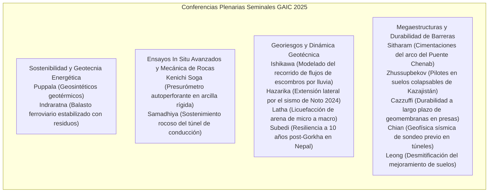
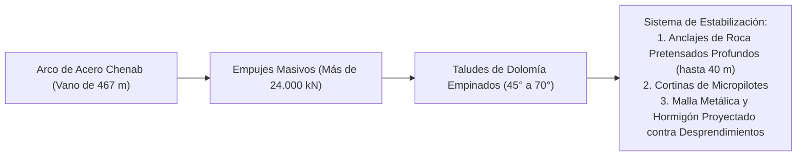

# Capítulo 1: Conferencias Plenarias y Lecciones de Estado del Arte

!!! info "Contexto del Capítulo y Artículos de Origen"
    Este capítulo sintetiza las 14 Conferencias Plenarias y Lecciones de Estado del Arte presentadas en el Primer Congreso Internacional Geotech Asia (GAIC 2025), publicadas en *GeoVadis: The Future of Geotechnical Engineering (Volume 3)*, CRC Press / Taylor & Francis (2026), DOI: [10.1201/9781003645955](https://doi.org/10.1201/9781003645955).

---

## 1. Resumen Ejecutivo y Alcance Temático

Las sesiones plenarias del GAIC 2025 reunieron a autoridades de primer nivel mundial para abordar los desafíos fundamentales y aplicados de la geotecnia moderna. Los temas clave abarcaron:

---

## 2. Infraestructura Sostenible y Geotecnia Energética

### 2.1 Soluciones Geotérmicas y Sistemas Geosintéticos (Puppala y cols.)
El Prof. Anand J. Puppala y sus coinvestigadores evaluaron la integración de la energía geotérmica en la infraestructura de transporte mediante geoestructuras energéticas y geosintéticos multifuncionales:

*   **Interacciones Termo-Hidro-Mecánicas (THM):** Los pilotes termoactivos y los intercambiadores de calor embebidos en geosintéticos extraen calor geotérmico de baja entalpía para el deshielo de pavimentos y el acondicionamiento térmico de tableros de puente.
*   **Deformaciones Térmicas Cíclicas:** Los ciclos térmicos diarios y estacionales ($\Delta T = \pm 15^\circ\text{C}$) inducen deformaciones axiales de origen térmico $\varepsilon_{\text{th}} = \alpha_c \Delta T$. El estudio mostró que la fricción en la interfaz suelo-pilote apenas sufre degradación de la resistencia al corte siempre que la tensión de confinamiento efectiva $\sigma'_c$ se mantenga por encima de la tensión de preconsolidación $\sigma'_p$.

$$\tau_{\text{mob}} = \sigma'_n \tan \delta' + c'_a$$

### 2.2 Materiales de Residuo Reciclado Avanzados en Geotecnia Ferroviaria (Indraratna y cols.)
El Prof. Buddhima Indraratna, Y. Qi, T. Ngo y C.K. Arachchige aportaron evidencia exhaustiva de campo y de laboratorio sobre el reciclaje de caucho de desecho (granulado de neumático, bandas transportadoras descartadas) combinado con rechazo de lavado de carbón (CW) y escoria de horno de acero (SFS) como subbalasto para ferrocarril de carga pesada:

*   **Mezcla Óptima de Absorción de Energía (CWB):** Una matriz de rechazo de carbón, escoria de acero y granulado de caucho (con un 10 % de caucho en peso) iguala la granulometría óptima y atenúa hasta un 35 % las vibraciones dinámicas de la vía.
*   **Índice de Rotura de Balasto ($BBI$):** La incorporación de mantas elastoméricas absorbedoras de energía bajo el balasto (UBM) redujo en más del 40 % la trituración y la rotura de partículas, prolongando notablemente los ciclos de mantenimiento bajo cargas por eje de 30 toneladas.

$$BBI = \frac{A}{A + B}$$

donde $A$ es el desplazamiento de la distribución granulométrica provocado por la degradación y $B$ es el área potencial de rotura por debajo del límite de $0.075\text{ mm}$.

---

## 3. Ensayos In Situ de Alta Precisión: Presurómetro Autoperforante (Soga y Liu)

El Prof. Kenichi Soga y L. Liu examinaron críticamente la discrepancia entre las teorías idealizadas de expansión de cavidad y las observaciones reales de campo en ensayos con **Presurómetro Autoperforante (SBPM)** en arcillas rígidas sobreconsolidadas (p. ej., London Clay, Gault Clay):

*   **Perturbación y Evacuación de Detritos:** La expansión cilíndrica idealizada supone perturbación inicial nula ($r_0 = r_{\text{cavity}}$). En la práctica, un sobrecalibre mínimo o la vibración de la herramienta de corte genera un anillo de arcilla reblandecida y desestructurada.
*   **Determinación de la Tensión Horizontal In Situ ($\sigma_{h0}$):** Método de la presión de despegue frente al análisis del punto de inflexión:

$$p_L = \sigma_{h0} + u_0$$

*   **Resistencia al Corte no Drenada ($s_u$) y Módulo de Corte No Lineal ($G$):** Derivación a partir de la relación tensión-deformación de corte mediante la formulación clásica de Gibson y Anderson:

$$\tau = \frac{1}{2} \varepsilon_c (1 + \varepsilon_c) \frac{dp}{d\varepsilon_c}$$

donde $\varepsilon_c = \frac{\Delta V / V_0}{1 + \Delta V / V_0}$ es la deformación de cavidad. Las simulaciones por elementos finitos confirmaron que no considerar la perturbación de perforación conduce a sobreestimaciones de $G_{\text{max}}$ de hasta el 30 % y a subestimaciones severas del $K_0$ in situ.

---

## 4. Geotecnia Multi-Amenaza y Dinámica Sísmica

### 4.1 Infiltración por Lluvia y Dinámica de Recorrido de Flujos de Escombros (Ishikawa y cols.)
El Prof. T. Ishikawa y su equipo presentaron un marco numérico integrado que combina la filtración no saturada (ecuación de Richards) con ecuaciones de aguas someras promediadas en profundidad para propagar el recorrido del flujo:

*   **Onda Transitoria de Presión de Poros:** Durante tormentas monzónicas intensas, el avance del frente de humedecimiento reduce la succión del suelo $\psi = (u_a - u_w)$, degradando el factor de seguridad ($F_s$) en taludes coluviales empinados.
*   **Mecánica del Recorrido del Flujo:** Una vez iniciado, una fluidificación similar a la licuefacción transforma la masa deslizada en un fluido reológico de Bingham con esfuerzo de fluencia $\tau_y$ y viscosidad plástica $\mu_p$:

$$\tau = \tau_y + \mu_p \left(\frac{du}{dz}\right)$$

### 4.2 Extensión Lateral en el Sismo de la Península de Noto de 2024 (Hazarika y cols.)
El Prof. Hemanta Hazarika presentó los hallazgos de reconocimiento tras el sismo de $M_w 7.5$ del 1 de enero de 2024 en Japón:

*   **Licuefacción Costera y Flujo Lateral:** La extensión lateral generalizada alcanzó desplazamientos del terreno de $1.5\text{ m}$ a $3.0\text{ m}$ junto a muros de muelle y riberas en Wajima, Nanao y Suzu.
*   **Comportamiento de las Cimentaciones:** Las cimentaciones superficiales de radier y las zapatas corridas sobre arenas no mejoradas sufrieron inclinaciones diferenciales $> 2.5^\circ$, mientras que los edificios apoyados sobre pilotes de hormigón centrifugado pretensado con pantallas de tablestacas perimetrales conservaron su integridad operativa.

---

## 5. Innovaciones en Cimentaciones para Megaestructuras

### 5.1 Puente Ferroviario Chenab: Cimentaciones del Arco y Estabilización de Taludes Rocosos (Sitharam y Mantrala)
El Prof. T.G. Sitharam y S. Mantrala detallaron la ingeniería geotécnica del **Puente sobre el río Chenab** (Cachemira, India), el puente ferroviario en arco más alto del mundo ($359\text{ m}$ sobre el lecho del río):

*   **Caracterización del Macizo Rocoso:** Macizo de dolomía diaclasado con $GSI = 45 - 65$. La cinemática de rotura en cuña a lo largo de las líneas de intersección de tres familias ortogonales de diaclasas exigió modelado 3D de elementos distintos (3DEC).
*   **Diseño del Anclaje:** Cables de anclaje tesados a $1200\text{ kN}$ con doble protección anticorrosiva, adheridos en roca sana por detrás de los planos de afloramiento cinemáticamente admisibles.

### 5.2 Pilotes de Megaestructuras en Suelos Problemáticos de Kazajistán (Zhussupbekov y Omarov)
El Prof. Askar Zhussupbekov documentó la construcción de cimentaciones profundas en Astaná/Nur-Sultán:

*   **Loess Colapsable y Limo Blando Saturado:** Uso de ensayos dinámicos de alta deformación bidireccionales en pilotes (celda de Osterberg, O-cell) y pruebas de carga estática de hasta $30,000\text{ kN}$ sobre pilotes perforados de gran diámetro ($d = 1.2\text{ m} - 1.5\text{ m}$).
*   **Mejora por Inyección en la Punta:** El post-grouting a alta presión en la punta del pilote incrementó la capacidad de carga por punta entre un 80 % y un 120 %, mitigando los asentamientos en estratos colapsables.

---

## 6. Durabilidad a Largo Plazo de las Geomembranas en Presas (Cazzuffi y Gioffrè)

El Prof. Daniele Cazzuffi y D. Gioffrè impartieron las conferencias plenarias sobre barreras de geomembrana en presas de escollera y de terraplén:

*   **Selección de Materiales:** PVC-P plastificado frente a polietileno de alta densidad (HDPE) frente a monómero de etileno-propileno-dieno (EPDM).
*   **Mecanismos de Envejecimiento:** Extracción de plastificantes, degradación oxidativa y resistencia a la perforación frente a roca triturada bajo cargas hidráulicas superiores a $100\text{ m}$ ($> 1\text{ MPa}$).
*   **Inspecciones de Campo:** Las autopsias por exhumación tras 40 años mostraron un alargamiento residual a rotura $> 180\%$, confirmando que las geomembranas protegidas con capas de geotextil ofrecen vidas útiles impermeables de varias décadas.
