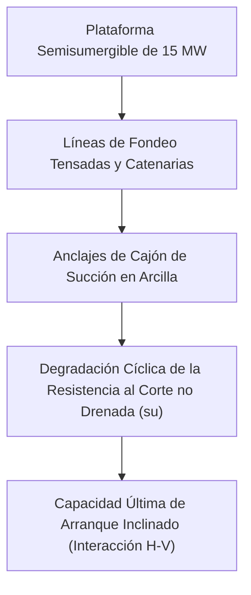

# Capítulo 2: IA, Geomecánica Computacional e Ingeniería Ambiental

!!! info "Contexto del Capítulo y Artículos de Origen"
    Este capítulo sintetiza los artículos técnicos de la **Sesión 1 (IA y Geomecánica Computacional)** y la **Sesión 2 (Ingeniería Geotécnica Ambiental, Costera y de Climas Fríos)** presentados en el GAIC 2025 y publicados en *GeoVadis: The Future of Geotechnical Engineering (Volume 3)*, CRC Press / Taylor & Francis (2026), DOI: [10.1201/9781003645955](https://doi.org/10.1201/9781003645955).

---

## 1. IA y Modelado Subrogado en Ingeniería Geotécnica

### 1.1 Zapata Corrida sobre Taludes Espacialmente Variables mediante Modelos Subrogados (Sharma y Pain)
Priyanka Sharma y Anindya Pain abordaron la incertidumbre de los factores de capacidad de carga ($N_c$, $N_q$, $N_\gamma$) para zapatas corridas contiguas a taludes de suelo cohesivo-friccional caracterizados mediante campos aleatorios espaciales:

*   **Método de Elementos Finitos Aleatorios (RFEM):** La cohesión $c$ y el ángulo de fricción $\phi$ se modelan como campos aleatorios 2D log-normal y normal con escala de fluctuación anisótropa $\theta_x, \theta_z$:

$$\rho(\Delta x, \Delta z) = \exp \left( - \sqrt{\left(\frac{2\Delta x}{\theta_x}\right)^2 + \left(\frac{2\Delta z}{\theta_z}\right)^2} \right)$$

*   **Modelo Subrogado de Aprendizaje Automático:** Mediante un marco de Gradient Boosting Extremo (XGBoost) y Regresión por Procesos Gaussianos (GPR) entrenado con 2.500 simulaciones Monte Carlo de elementos finitos, la capacidad de carga última $q_{ult}$ se evalúa en milisegundos con $R^2 > 0.96$:

$$q_{ult} = c N_c^* + q N_q^* + \frac{1}{2}\gamma B N_\gamma^*$$

donde los factores modificados $N^*$ incorporan directamente el ángulo de talud $\beta$, la distancia de retranqueo $d/B$ y el coeficiente de variación espacial $COV_{c,\phi}$.

### 1.2 Mecánica de la Fuerza de Perforación en Regolito Extraterrestre (Raghav y cols.)
V. Raghav y coautores desarrollaron un modelo analítico de interacción cortador-roca para mecanismos de obtención de testigos en regolito lunar:

*   **Mecánica de Perforación:** El empuje total $F_T$ y el par $T_Q$ constan de tres componentes desacopladas: resistencia de la cara de corte, rozamiento por frotamiento a lo largo del desgaste plano del cortador y fuerzas de evacuación de detritos.
*   **Influencia de la Baja Gravedad:** Bajo gravedad lunar ($g = 1.62\text{ m/s}^2$), la relación de compactación de detritos y la presión de confinamiento efectiva $\sigma'_3$ disminuyen, reduciendo significativamente el desgaste de la broca pero aumentando el riesgo de desprendimiento de las paredes del sondeo en regolito de baja densidad ($< 1.5\text{ g/cm}^3$).

### 1.3 Estado de la IA en la Práctica Geotécnica: Fronteras y Escollos (Samui)
El Prof. P. Samui ofreció una valoración objetiva del aprendizaje automático en geotecnia:

*   **Cuellos de Botella:** Conjuntos de entrenamiento pequeños (escasez de sondeos geotécnicos), desequilibrio de datos, desatención de la autocorrelación espacial y falta de interpretabilidad física (modelos de «caja negra»).
*   **Redes Neuronales Informadas por la Física (PINN):** Función de pérdida regularizada por las ecuaciones diferenciales gobernantes (equilibrio $\nabla \cdot \boldsymbol{\sigma} + \mathbf{b} = \mathbf{0}$ y continuidad de filtración $\nabla \cdot (k \nabla h) = 0$):

$$\mathcal{L}_{total} = \mathcal{L}_{data} + \lambda_{phys} \mathcal{L}_{PDE} + \lambda_{BC} \mathcal{L}_{BC}$$

---

## 2. Mecánica de Anclajes de Levantamiento en Macizo Rocoso (Parab y cols.)

G.S. Parab, V.V. Dandage y A.V. Sharma analizaron anclajes de roca de alta capacidad sometidos a levantamiento, embebidos en basalto fracturado:

*   **Mecanismo de Transferencia de Carga:** Los ensayos de tracción en campo instrumentados con extensómetros multipunto de sondeo (MPBX) revelaron una distribución no uniforme del esfuerzo cortante $\tau(z)$ a lo largo de la longitud de bulbo inyectado:

$$\tau(z) = \tau_{\text{peak}} \exp(-\alpha z)$$

*   **Verificación por Elementos Finitos:** El modelo numérico 3D por MEF confirmó que los ángulos de rotura por cono de arranque del anclaje se desvían del cono invertido teórico de $45^\circ$ cuando predominan las diaclasas subhorizontales, aplanándose a $30^\circ - 35^\circ$ y exigiendo profundidades mínimas de empotramiento $h_e \ge 6\text{ m}$.

---

## 3. Geotecnia Ambiental e Ingeniería de Barreras

### 3.1 Resistencia a Compresión Simple de Rellenos de Bentonita (Nayak y cols.)
B.P. Nayak, S. Kumar y R. Bag examinaron rellenos de arcilla diseñados para disposición geológica profunda y muros cortina:

*   **Dosificación de Mezclas:** Mezclas de arena, bentonita y ceniza volante. Se alcanzó una conductividad hidráulica $k < 1 \times 10^{-9}\text{ m/s}$ cuando el contenido de bentonita superó el 15 % en peso seco.
*   **Resistencia a Compresión Simple ($UCS$):** El tiempo de curado y la densidad seca $\rho_d$ controlaron la resistencia post-hinchamiento; un exceso de ceniza volante provocó fragilidad y redujo la capacidad de autocurado de fisuras frente al lixiviado químico.

### 3.2 Efectos del Lodo Rojo sobre el Potencial de Retracción de la Bentonita (Shaikh y cols.)
J. Shaikh y su equipo estabilizaron revestimientos de bentonita con residuo industrial de bauxita (lodo rojo):

*   **Modificación del Límite de Retracción:** La bentonita sufre una elevada retracción volumétrica por desecación. La adición de un 20 % a un 30 % de lodo rojo aportó óxidos férricos y alúmina no expansivos, elevando el límite de retracción del 11,2 % al 19,8 % y eliminando las redes de fisuras por desecación.

### 3.3 Mitigación con Nanomateriales del Hinchamiento Alcalino en Suelos Rojos (Kumar y cols.)
T. Aravind Kumar, P. Hari Prasada Reddy y S.K. Vindula investigaron efluentes industriales de alta alcalinidad ($\text{pH} > 12$) que afectan a suelos arcillosos rojos:

*   **Mecanismo de Hinchamiento:** El ataque de los hidróxidos disuelve los tetraedros de sílice, desencadenando un hinchamiento severo y la pérdida de integridad de la fábrica del suelo.
*   **Estabilización con Nano-Sílice y Nano-Alúmina:** La incorporación de un 1,0 % de nanoaditivos favoreció el crecimiento de gel puzolánico de silicato cálcico hidratado (C-S-H), reduciendo el índice de hinchamiento alcalino del 68 % a menos del 14 %.

---

## 4. Geotecnia Mediada Biológicamente: MICP de Bajo Coste (Rawat y Satyam)

Vikas Rawat y Neelima Satyam formularon una técnica económica de Precipitación de Calcita Inducida por Microorganismos (MICP) que sustituye el costoso caldo nutritivo comercial por melaza de caña de azúcar:

*   **Cinética Bacteriana:** La actividad ureasa de *Sporosarcina pasteurii* en caldo de melaza diluida (3 % v/v) igualó a la del caldo nutritivo estándar en 48 horas ($U \approx 18\text{ mM urea/min}$).
*   **Precipitación de Calcita y Resistencia:**

$$\text{CO(NH}_2)_2 + 2\text{H}_2\text{O} \xrightarrow{\text{Ureasa}} 2\text{NH}_4^+ + \text{CO}_3^{2-}$$

$$\text{Ca}^{2+} + \text{CO}_3^{2-} \rightarrow \text{CaCO}_3 \downarrow$$

*   **Mejora Geotécnica:** Las probetas de arena tratadas con MICP de melaza incrementaron su $UCS$ de $0\text{ kPa}$ a $1,840\text{ kPa}$ y redujeron la conductividad hidráulica en 2,5 órdenes de magnitud, recortando los costes de tratamiento en un 62 %.

---

## 5. Geotecnia Marina: Aerogeneradores Flotantes Marinos (James y Haldar)

M. James y S. Haldar simularon aerogeneradores marinos flotantes (FOWT) semisumergibles de 15 MW fondeados en estratos marinos profundos:

*   **Modelado Aero-Hidro-Servo-Elástico-Geotécnico Acoplado:** Las amplitudes de tensión en las líneas de fondeo bajo tormenta de periodo de retorno de 100 años y solicitación sísmica generaron presión de poros cíclica $\Delta u / \sigma'_{v0} > 0.45$.
*   **Envolvente de Capacidad del Cajón de Succión:** Superficie de fluencia bajo carga horizontal ($H$), vertical ($V$) y momento ($M$) combinados:

$$\left(\frac{H}{H_{\text{ult}}}\right)^a + \left(\frac{V}{V_{\text{ult}}}\right)^b \le 1.0$$

El análisis subrayó que el reblandecimiento cíclico dinámico reduce la resistencia disponible al arranque hasta en un 22 %, exigiendo relaciones de esbeltez del cajón $L/D \ge 3.5$.
