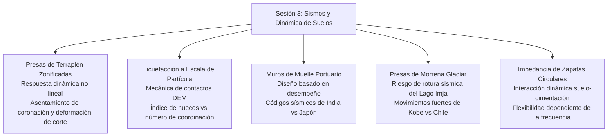
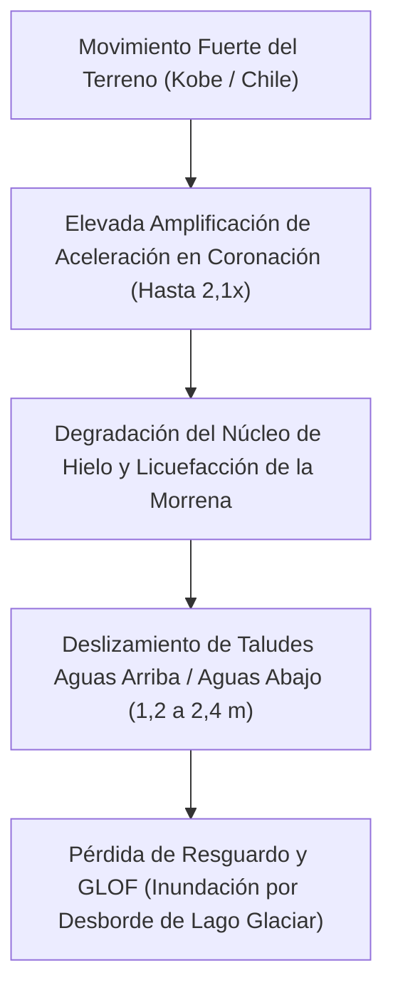

# Capítulo 3: Ingeniería Sísmica y Dinámica de Suelos

!!! info "Contexto del Capítulo y Artículos de Origen"
    Este capítulo sintetiza los artículos técnicos de la **Sesión 3 (Sismos y Dinámica de Suelos)** presentados en el GAIC 2025 y publicados en *GeoVadis: The Future of Geotechnical Engineering (Volume 3)*, CRC Press / Taylor & Francis (2026), DOI: [10.1201/9781003645955](https://doi.org/10.1201/9781003645955).

---

## 1. Resumen Ejecutivo y Enfoque Dinámico

La Sesión 3 abordó la respuesta sísmica no lineal del suelo en sistemas de infraestructura complejos:

---

## 2. Respuesta Sísmica No Lineal de Presas de Terraplén Zonificadas (Kumar y Maheshwari)

A. Kumar y el Prof. B.K. Maheshwari evaluaron la respuesta sísmica no lineal de presas altas de escollera zonificadas con núcleo central impermeable de arcilla:

*   **Formulación Constitutiva:** Modelos elastoplásticos histéricos totalmente no lineales frente a modelos equivalentes lineales, con degradación del módulo de corte dependiente de la presión $G/G_{\text{max}}$ y amortiguamiento $D$:

$$\frac{G}{G_{\text{max}}} = \frac{1}{1 + \left(\frac{\gamma}{\gamma_r}\right)^a}$$

*   **Predicción de Deformación Permanente:** Integración del bloque deslizante de Newmark frente a análisis acoplados dinámicos en tensiones efectivas por elementos finitos. Bajo una aceleración máxima del terreno ($PGA = 0.45\text{ g}$), el reblandecimiento no lineal del suelo amplificó el asentamiento permanente de coronación en un 42 % respecto a las aproximaciones equivalente-lineales.
*   **Exceso de Presión de Poros en el Núcleo:** El grado de saturación del núcleo condicionó la redistribución hidrodinámica de tensiones; omitir el acoplamiento hidromecánico subestima el abombamiento hacia aguas abajo del talud.

---

## 3. Micromecánica Basada en Partículas para la Susceptibilidad a Licuefacción (Banerjee y cols.)

S. Banerjee, R.K. Kandasami, M.U. Rehman y A. Srivastava introdujeron un marco simplificado de elementos discretos (DEM) a escala de partícula para caracterizar la susceptibilidad a licuefacción:

*   **Red de Contactos de Micro a Macro:** Número de coordinación $Z_c$ y tensor de anisotropía mecánica de contactos $a_{ij}$:

$$Z_c = \frac{2 N_c}{N_p}$$

$$a_{ij} = \frac{15}{2} \left( \Phi_{ij} - \frac{1}{3}\delta_{ij} \right)$$

donde $N_c$ es el número de contactos y $N_p$ el número de partículas.

*   **Criterio de Inicio de Licuefacción:** Durante el corte cíclico no drenado, el inicio de la licuefacción corresponde a una caída crítica del número de coordinación portante activo ($Z_c \rightarrow 3.0$), que provoca $G \rightarrow 0$ en el módulo de corte macroscópico con independencia de la densidad relativa inicial $D_r$.
*   **Índice de Evaluación Simplificado:** Se propuso una métrica adimensional a escala de grano que relaciona el coeficiente de uniformidad $C_u$, la esfericidad $S$ y el parámetro de estado inicial $\psi$, evitando los costosos ensayos triaxiales cíclicos en el cribado inicial de emplazamientos.

---

## 4. Diseño Sísmico Basado en Desempeño de Muros de Muelle Portuario (Pushpa y cols.)

K. Pushpa, P. Nanjundaswamy y S.K. Prasad realizaron una revisión comparativa rigurosa entre la norma india (IS 1893 / IS 456) y las Normas Japonesas de Diseño Portuario (OCDI - Overseas Coastal Development Institute of Japan):

*   **Comparación de Filosofías de Diseño:**
    *   *Norma India:* Método pseudostático basado en fuerzas con coeficiente sísmico $k_h = \frac{Z \cdot I \cdot S_a / g}{2 R}$.
    *   *Código Japonés (OCDI):* Diseño basado en desempeño en dos niveles:
        *   **Nivel 1 (Sismo de Serviciabilidad - periodo de retorno 75 años):** Desplazamiento residual menor ($\Delta x < 0.1\text{ m}$), recuperación operativa inmediata.
        *   **Nivel 2 (Sismo de Seguridad - periodo de retorno 475–1000 años):** Desplazamiento residual controlado ($\Delta x < 0.3 - 0.5\text{ m}$), sin colapso súbito de la estructura de cajones ni pérdida de la funcionalidad del atraque.
*   **Evaluación de Caso:** Los métodos pseudostáticos subestiman significativamente el desplazamiento lateral residual y la inclinación cuando se licua el relleno tras el muro de cajones, lo que demuestra la necesidad de análisis dinámicos en tensiones efectivas en infraestructuras marítimas.

---

## 5. Estabilidad Sísmica de Presas de Morrena Glaciar (Ojha, Tiwari y cols.)

Biraj Ojha, Aanchal Tiwari, Sandeep Sapkota, Ram Chandra Tiwari y P. Dangi Chhetri investigaron la vulnerabilidad sísmica de la **presa de morrena del lago glaciar Imja** en el Himalaya alto de Nepal:

*   **Contexto del Emplazamiento:** El lago Imja ($5,010\text{ m}$ de cota) almacena decenas de millones de metros cúbicos de agua de deshielo retenidos por una presa de morrena terminal no consolidada que contiene un núcleo de hielo.
*   **Excitación Sísmica:** Se simuló la estabilidad de la presa bajo movimientos fuertes históricos (sismo de Kobe de 1995, $M_w 6.9$, y sismo de Chile de 2010, $M_w 8.8$):

*   **Integridad del Canal de Desagüe:** El canal de aliviadero artificial resultó propenso a obstruirse por el desprendimiento sísmico de las crestas de morrena adyacentes, planteando un riesgo crítico en cascada de sobrevertido y desencadenamiento catastrófico de una inundación por desborde de lago glaciar (GLOF).

---

## 6. Interacción Dinámica Suelo-Cimentación de Zapatas Circulares (Jafarzadeh y Maleki)

Fardin Jafarzadeh y Jafar Maleki investigaron la impedancia dinámica y la respuesta vibratoria de zapatas circulares rígidas superficiales sobre lechos de arena:

*   **Ensayo Experimental:** Foso de ensayo dinámico a gran escala instrumentado con acelerómetros y sensores de presión de contacto, excitado con armónicos verticales y de balanceo de frecuencia variable ($f = 5 - 50\text{ Hz}$).
*   **Funciones de Impedancia:** Rigidez compleja $K^* = K_{dyn} + i \omega C$:

$$K_{dyn}(\omega) = k(\omega) K_s$$

$$C(\omega) = c(\omega) \frac{K_s r_0}{V_s}$$

donde $K_s = \frac{4 G r_0}{1 - \nu}$ es la rigidez vertical estática y $r_0$ el radio de la zapata.
*   **Efectos No Lineales de Deformación:** Para amplitudes de deformación de corte $\gamma > 10^{-4}$, las frecuencias de resonancia de la cimentación se desplazaron un 25 % a la baja por degradación del módulo de corte en la zona cercana, acompañadas de un incremento del 35 % en el amortiguamiento por radiación.
