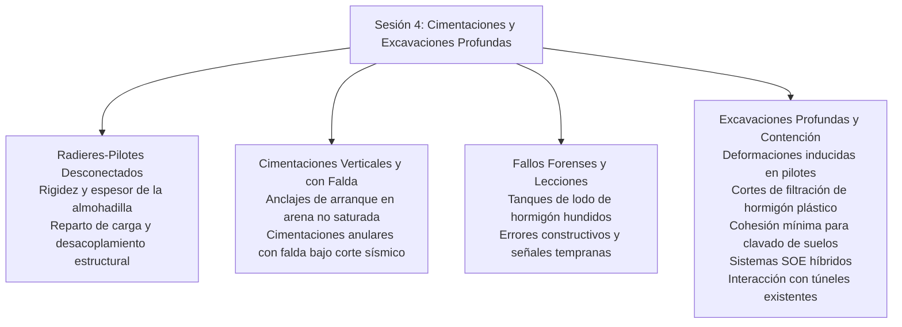
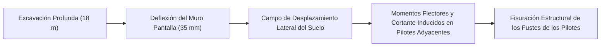

# Capítulo 4: Cimentaciones, Excavaciones Profundas y Sistemas de Contención

!!! info "Contexto del Capítulo y Artículos de Origen"
    Este capítulo sintetiza los artículos técnicos de la **Sesión 4 (Cimentaciones y Excavación Profunda)** presentados en el GAIC 2025 y publicados en *GeoVadis: The Future of Geotechnical Engineering (Volume 3)*, CRC Press / Taylor & Francis (2026), DOI: [10.1201/9781003645955](https://doi.org/10.1201/9781003645955).

---

## 1. Resumen Ejecutivo y Panorama de Diseño

La Sesión 4 examinó problemas complejos de interacción en sistemas de cimentación profunda, excavación urbana de alto riesgo, estructuras de contención y barreras de corte:

---

## 2. Sistemas Avanzados de Radier-Pilotes: Radieres-Pilotes Desconectados (Raut y cols.)

S. Raut, P. Halder, B. Manna y J.T. Shahu realizaron investigaciones numéricas exhaustivas sobre los **Sistemas de Radier-Pilote Desconectados (DPRF)**:

*   **Mecanismo de Desacoplamiento:** En los DPRF, el radier se separa estructuralmente de las cabezas de los pilotes mediante una capa granular de almohadilla (arena, grava o grava reforzada con georrejilla). Esto elimina las concentraciones de corte y los momentos flectores elevados en las uniones con la cabeza del pilote:

$$P_{\text{total}} = P_{\text{raft}} + \sum P_{\text{pile}}$$

$$\alpha_{pr} = \frac{\sum P_{\text{pile}}}{P_{\text{total}}}$$

*   **Influencia del Espesor ($t_c/d$) y la Rigidez ($E_c$) de la Almohadilla:**
    *   Almohadilla delgada ($t_c/d < 0.5$): elevada transferencia de carga a los pilotes ($\alpha_{pr} > 0.75$), pero persisten las concentraciones de tensiones.
    *   Almohadilla óptima ($t_c/d = 0.8 - 1.2$): los pilotes actúan únicamente como reductores de asentamiento movilizados a plena capacidad por fuste, mientras la presión de contacto del radier se distribuye uniformemente sobre el subsuelo.
    *   Almohadilla excesiva ($t_c/d > 2.0$): los pilotes se vuelven ineficientes y los asentamientos del radier aumentan un 45 %.

---

## 3. Cimentaciones Especializadas: Anclajes y Anillos con Falda

### 3.1 Arranque Vertical de Anclajes en Arena No Saturada (Mushtaq y Sahoo)
M. Mushtaq y J.P. Sahoo investigaron la capacidad última de levantamiento de anclajes de placa en suelos no saturados:

*   **Contribución de la Succión Mátrica:** Cohesión aparente inducida por la succión $\psi = (u_a - u_w)$ a lo largo de la superficie de rotura por arranque:

$$q_{ult} = \gamma' h_e N_\gamma + c_{\text{app}} N_c$$

$$c_{\text{app}} = c' + (u_a - u_w) \tan \phi^b$$

*   **Resistencia Máxima al Arranque:** Los ensayos de extracción de placas revelaron un incremento de 2,2 veces en la capacidad de levantamiento en estados óptimos de retención de agua ($S_r \approx 40\%$) frente a lechos de arena completamente secos o saturados.

### 3.2 Cimentaciones Anulares con Falda bajo Cargas Laterales Sísmicas (Chatterjee y cols.)
Kaustav Chatterjee, Puran, Pratik Goel y Sambit Pani analizaron cimentaciones anulares circulares con falda para tanques de almacenamiento y torres de refrigeración:

*   **Eficiencia de Confinamiento:** Las faldas que envuelven el perímetro restringen la expulsión lateral del suelo bajo momentos de vuelco sísmicos, incrementando los factores de capacidad horizontal $N_h$ entre un 35 % y un 60 %.
*   **Interacción con Estratos:** Una estratigrafía de suelo débil sobre suelo resistente concentra las deformaciones de corte plásticas en el plano de la punta de la falda, exigiendo relaciones profundidad/anchura de falda $D_s/B \ge 0.5$.

---

## 4. Análisis Geotécnico Forense de Fallos Estructurales

### 4.1 Análisis Forense de Tanques de Lodo de Hormigón Hundidos (Krishnanunni, Bishnoi, Murty)
K.T. Krishnanunni, D. Bishnoi y D.S. Murty investigaron el hundimiento y la inclinación catastróficos ($> 300\text{ mm}$) de pesados tanques industriales circulares de lodo de hormigón:

*   **Mecanismo de Fallo y Causa Raíz:**
    1.  Una investigación de sitio insuficiente no identificó lentes localizadas de arcilla marina blanda a profundidades de $6\text{ m}$ a $11\text{ m}$ bajo una capa de cantos rodados no inyectada.
    2.  La agitación dinámica operativa del lodo disparó la acumulación de exceso de presión de poros y un fallo de capacidad de carga no drenado.
    3.  El asentamiento diferencial por consolidación indujo alabeo estructural y desgarro circunferencial del muro del tanque.
*   **Esquema de Remediación:** Cortinas de recalce por jet grouting a alta presión combinadas con micropilotes perforados a través de la losa de fondo hasta el lecho rocoso.

### 4.2 Diseño contra el Fallo: Escollos Geotécnicos (Govind Raj y Annam)
B. Govind Raj y Madan Kumar Annam documentaron los principales indicadores de alerta temprana y los descuidos fatales en excavaciones urbanas:
*   Dependencia excesiva de parámetros Mohr-Coulomb por defecto sin calibrar en el software.
*   Ignorar niveles piezométricos colgados durante las estaciones lluviosas.
*   Desatender la secuencia constructiva y la sobre-excavación previa al pretensado de codales y anclajes.

---

## 5. Excavaciones Urbanas Profundas de Alto Riesgo y Sistemas de Contención

### 5.1 Deformaciones Inducidas por Excavación en Pilotes Adyacentes (Rao y Kandolkar)
R.B. Rao y S.S. Kandolkar modelaron la respuesta lateral de grupos de pilotes existentes cargados, situados tras muros pantalla de contención profundos:

*   **Relación de Proximidad:** Los pilotes situados a una distancia $x \le 1.5 H_e$ (donde $H_e$ es la profundidad de excavación) sufrieron momentos flectores inducidos superiores al 60 % de su capacidad estructural de fluencia, lo que exige zanjas de alivio de sacrificio o cortinas de barrera por jet grouting entre el muro y los pilotes.

### 5.2 Cortes de Filtración con Hormigón Plástico (Chakraborty y cols.)
S. Chakraborty, S.K. Koley y P.K. Ray detallaron los parámetros de diseño de muros cortina de hormigón plástico:

*   **Dosificación:** Agua, cemento, bentonita y áridos proporcionados para obtener una resistencia a compresión $f_c = 1.5 - 3.5\text{ MPa}$ y un módulo de deformación $E \approx 500 - 1500\text{ MPa}$.
*   **Ductilidad y Permeabilidad:** El hormigón plástico soporta deformaciones $\varepsilon > 2.5\%$ sin fisuración frágil por tracción, manteniendo una conductividad hidráulica $k \le 1 \times 10^{-10}\text{ m/s}$.

### 5.3 Sistemas SOE Híbridos en Áreas Urbanas Densas (Yasrebi y Zolqadr)
Shahab Yasrebi y Emad Zolqadr evaluaron esquemas híbridos de Sostenimiento de la Excavación (SOE) que combinan pilotes de entibación (*soldier piles*), anclajes de terreno pretensados y muros pantalla arriostrados construidos de arriba hacia abajo:

*   **Control de Asentamientos:** Los sistemas híbridos limitaron los asentamientos de edificios colindantes a $< 12\text{ mm}$ junto a una trinchera de metro de $18\text{ m}$ de profundidad, reduciendo las deflexiones laterales del muro en un 40 % frente al clavado convencional de suelos.

### 5.4 Impactos de Excavación y Sobrecarga sobre Túneles de Metro Existentes (Ayothiraman y cols.)
R. Ayothiraman, V.K. Singh y S. Mahajan evaluaron túneles perforados existentes en arena sometidos a una excavación de sótano adyacente y a la fuerte sobrecarga de una torre:

*   **Relación de Distorsión ($DR$):** La relación de cambio de diámetro $\Delta D / D$ alcanzó el 0,45 % durante las fases de descarga por levantamiento de fondo sin arriostramiento.
*   **Límites de Seguridad:** Los incrementos máximos de momento flector se produjeron en los riñones y en la clave del túnel, imponiendo un achique por etapas y límites estrictos a las vibraciones por hincado de pilotes adyacentes.
