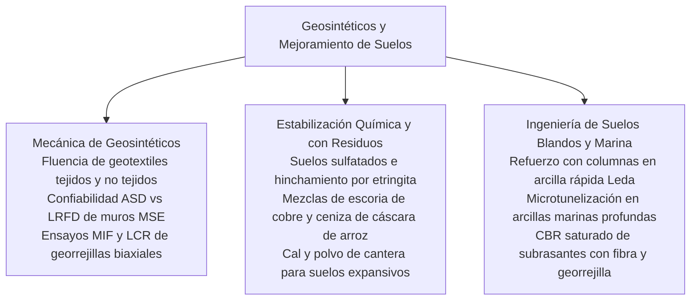

# Capítulo 5: Geosintéticos y Mejoramiento de Suelos

!!! info "Contexto del Capítulo y Artículos de Origen"
    Este capítulo sintetiza los artículos técnicos de la **Sesión 5 (Ingeniería de Geosintéticos)** y la **Sesión 6 (Mejoramiento y Estabilización de Suelos)** presentados en el GAIC 2025 y publicados en *GeoVadis: The Future of Geotechnical Engineering (Volume 3)*, CRC Press / Taylor & Francis (2026), DOI: [10.1201/9781003645955](https://doi.org/10.1201/9781003645955).

---

## 1. Resumen Ejecutivo y Alcance Tecnológico

Las Sesiones 5 y 6 sintetizaron tecnologías de vanguardia en refuerzo de suelos, polímeros geosintéticos y estabilización química y biológica:

---

## 2. Mecánica de Geosintéticos y Confiabilidad de Muros de Contención

### 2.1 Comportamiento de Fluencia de los Geotextiles (Kolekar, Dasaka y cols.)
J.Y. Kolekar, el Prof. S.M. Dasaka, S.B. Kharmale y Y.A. Kolekar revisaron la mecánica de rotura por fluencia de geotextiles de poliéster (PET) y polipropileno (PP):

*   **Factor de Reducción por Fluencia ($RF_{\text{CR}}$):**

$$T_{\text{al}} = \frac{T_{\text{ult}}}{RF_{\text{CR}} \cdot RF_{\text{ID}} \cdot RF_{\text{D}}}$$

donde $RF_{\text{CR}}$ es el factor de reducción por fluencia, $RF_{\text{ID}}$ contempla el daño por instalación y $RF_{\text{D}}$ representa la durabilidad biológica y química.
*   **Modelos Viscoelásticos:** El modelo de cuatro elementos de Burgers y las predicciones por el método isotérmico escalonado (SIM) mostraron que los geotextiles de PP presentan velocidades de deformación por fluencia hasta 3,5 veces superiores a las de las fibras de PET de alta tenacidad a temperaturas elevadas de servicio ($T > 35^\circ\text{C}$).

### 2.2 ASD frente a LRFD en Muros de Suelo Reforzado (MSE) (Mana y Vyas)
D.S.K. Mana y S.D. Vyas evaluaron el conservadurismo de diseño entre el Diseño por Tensiones Admisibles (ASD) y el Diseño por Factores de Carga y Resistencia (LRFD):

*   **Estados Límite:** Estabilidad externa (deslizamiento, vuelco, capacidad de carga) y estabilidad interna (rotura por tracción del refuerzo, resistencia al arranque).
*   **Índice de Confiabilidad ($\beta$):** El LRFD logró un índice de confiabilidad más uniforme para distintas alturas de muro ($H = 4 - 12\text{ m}$) al desacoplar los factores de carga ($\gamma_{\text{EV}} = 1.35$, $\gamma_{\text{EH}} = 1.50$) de los factores de resistencia ($\phi_t = 0.90$ para arranque de flejes), consiguiendo ahorros de material del 8 % al 15 % en rellenos viales de bajo riesgo sin comprometer los márgenes de seguridad.

### 2.3 Interacción de Georrejillas Biaxiales: MIF y LCR (Vyas y Mistry)
Saurabhh Vyas y Shivani Mistry determinaron el Factor de Interacción de Microrejilla ($MIF$) y la Relación de Confinamiento Lateral ($LCR$) mediante un equipo de ensayo de arranque a gran escala:

*   **Estabilidad de Aberturas:** Las georrejillas de polipropileno extruido presentaron valores de $LCR$ más elevados ($> 0.82$) en balasto triturado angular que las rejillas de poliéster tejido ($LCR \approx 0.65$), confirmando la superioridad de las uniones integrales rígidas para frenar la expansión lateral del balasto.

---

## 3. Estabilización Química y Tratamiento de Suelos Problemáticos

### 3.1 Contaminación por Sulfatos Solubles en Suelos Tratados con Cal (Jha y cols.)
A.K. Jha, Shivanshi, V.B. Singh y P. Akhtar exploraron el mecanismo de **levantamiento por etringita** en arcillas estabilizadas con cal contaminadas con sulfatos solubles ($\text{SO}_4^{2-} > 2,000\text{ ppm}$):

*   **Cinética de la Reacción Mineral:**

$$6\text{Ca}^{2+} + 2\text{Al(OH)}_4^- + 4\text{OH}^- + 3\text{SO}_4^{2-} + 26\text{H}_2\text{O} \rightarrow \text{Ca}_6[\text{Al(OH)}_6]_2(\text{SO}_4)_3 \cdot 26\text{H}_2\text{O} \downarrow \text{ (Ettringite)}$$

*   **Estrategia de Mitigación:** La adición de escoria granulada molida de alto horno (GGBS) y cloruro de bario inmovilizó eficazmente los iones sulfato, impidiendo la formación de cristales aciculares expansivos de etringita y manteniendo un $UCS$ a 28 días $> 1.8\text{ MPa}$.

### 3.2 Estabilización de Suelos con Alto Contenido de Sulfatos mediante Cal y Polvo de Cantera (Mukherjee y cols.)
A. Mukherjee, S. Suresh, S. Chakraborty y U. Patil emplearon polvo de cantera (QD) como suplemento puzolánico del conglomerante:

*   **Relación de Sustitución:** Una combinación de 6 % de cal hidratada y 20 % de polvo de cantera redujo el índice de plasticidad del $34\%$ al $11\%$ y contuvo la presión de hinchamiento de $210\text{ kPa}$ a menos de $18\text{ kPa}$.

### 3.3 Valorización de Residuos Industriales: Escoria de Cobre y Ceniza de Cáscara de Arroz (Agnihotri y Sharma)
A.K. Agnihotri y K. Sharma desarrollaron conglomerantes cementantes sostenibles mezclando escoria industrial de cobre (CS) y ceniza agrícola de cáscara de arroz (RHA):

*   **Incremento de la Resistencia al Corte:** Una mezcla de 15 % de CS + 10 % de RHA + 4 % de cal elevó el ángulo de fricción interna efectivo $\phi'$ de subrasantes limosas blandas de $22^\circ$ a $36^\circ$, ofreciendo una alternativa ecológica para bases de pavimento.

---

## 4. Ingeniería de Arcillas Marinas Blandas y Mejoramiento Especializado

### 4.1 Microtunelización a través de Arcilla Marina Blanda Profunda (Kulkarni y cols.)
Uday Kulkarni, Vinay Pande, Renu Kulkarni y M.B. Joshi detallaron la planificación y ejecución de un proyecto costero de microtunelización de alcantarillado en arcilla marina blanda profunda ($s_u < 15\text{ kPa}$, sensibilidad $S_t > 8$):

*   **Control de la Micro-TBM de Lodos:** El control preciso de la presión de equilibrio en el frente ($\Delta p = \pm 5\text{ kPa}$) evitó reventones hidráulicos a través de las marismas.
*   **Inyección de Lubricante de Bentonita:** La lubricación continua de la envuelta con bentonita y polímeros redujo las fuerzas de empuje de tubería en un 55 %, evitando el bloqueo de la conducción a lo largo de un tramo de $650\text{ m}$.

### 4.2 Mejora de la Rigidez de la Arcilla Rápida Sensible de Leda (Guetif)
Z. Guetif evaluó la mejora de rigidez de las arcillas rápidas sensibles canadienses de Leda mediante la instalación de columnas granulares:

*   **Relación de Concentración de Tensiones ($n = \sigma_c / \sigma_s$):** Los registros de asentamiento en campo verificaron que las columnas de grava compactada redujeron el asentamiento primario por consolidación en un 60 %, alcanzando la relación de rigidez de columna $n \approx 4.2$.

### 4.3 Mejora del CBR Saturado con Georrejillas y Fibras de Polipropileno (Rasool y cols.)
M.U. Rasool, H. Iqbal, P. Halder y R. Bhowmik evaluaron el refuerzo híbrido en subrasantes viales de alta plasticidad:

*   **Sinergia Combinada:** Las fibras discretas de polipropileno ($0.75\%$ en peso) frenaron la microfisuración, mientras una georrejilla biaxial en capa intermedia elevó el California Bearing Ratio saturado ($CBR$) del $2.8\%$ al $14.5\%$, reduciendo en un 38 % el espesor estructural de aglomerado asfáltico requerido.
