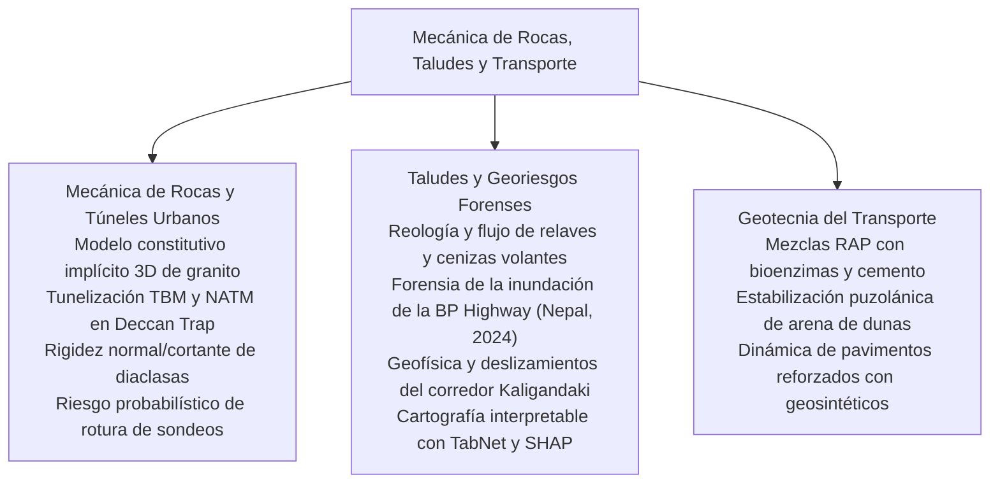
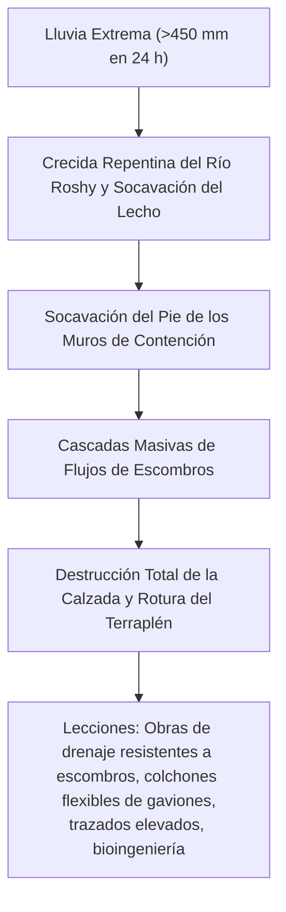

# Capítulo 6: Mecánica de Rocas, Taludes y Geotecnia del Transporte

!!! info "Contexto del Capítulo y Artículos de Origen"
    Este capítulo sintetiza los artículos técnicos de la **Sesión 7 (Práctica, Riesgo y Educación)**, la **Sesión 8 (Mecánica de Rocas e Ingeniería de Túneles)**, la **Sesión 9 (Estabilidad de Taludes y Deslizamientos)** y la **Sesión 10 (Geotecnia del Transporte)** presentados en el GAIC 2025 y publicados en *GeoVadis: The Future of Geotechnical Engineering (Volume 3)*, CRC Press / Taylor & Francis (2026), DOI: [10.1201/9781003645955](https://doi.org/10.1201/9781003645955).

---

## 1. Resumen Ejecutivo y Alcance Infraestructural

Este capítulo sintetiza los principales avances en infraestructuras de ingeniería de rocas, tunelización profunda, riesgos extremos de taludes y redes de transporte:

---

## 2. Mecánica de Rocas Avanzada e Ingeniería de Túneles

### 2.1 Modelo Constitutivo Implícito 3D para Rocas Graníticas (Naveen, Kumar, Gokulnath, Juneja)
K.J. Naveen, Ankesh Kumar, C. Gokulnath y el Prof. Ashish Juneja desarrollaron un modelo elastoplástico implícito 3D generalizado que captura el endurecimiento no lineal pre-pico y el reblandecimiento post-pico de granitos cristalinos:

*   **Criterio de Fluencia y Regla de Flujo:** Incorpora un ángulo de dilatancia dependiente de la tensión $\psi(\sigma_3, \varepsilon_p)$ y un potencial plástico no asociado $g$:

$$f(\boldsymbol{\sigma}, \kappa) = \sqrt{J_{2D}} - \alpha(\kappa) I_1 - k(\kappa) = 0$$

donde $I_1$ es el primer invariante de tensiones, $J_{2D}$ el segundo invariante desviadorio y $\kappa$ representa la progresión del daño plástico.
*   **Validación:** Capturó con precisión las curvas de transición frágil-dúctil observadas en ensayos triaxiales verdaderos bajo confinamientos de hasta $150\text{ MPa}$.

### 2.2 Rendimiento de TBM en Basaltos de Deccan Trap (Rao, Kulkarni, Kulkarni)
G.V. Rao, Uday Kulkarni y Renu Kulkarni documentaron avances con TBM de Equilibrio de Presión de Tierras (EPB) y de roca dura a través de basaltos heterogéneos de Deccan Trap (basalto vesicular, amigdaloide y compacto con resistencia a compresión $UCS = 40 - 160\text{ MPa}$):

*   **Desgaste de Discos Cortadores:** Apareció desgaste abrasivo severo en las transiciones entre basaltos zeolíticos/amigdaloides blandos y basaltos compactos duros, exigiendo discos cortadores con botones de carburo de tungsteno y monitorización en tiempo real del par de la cabeza de corte.
*   **Velocidad de Penetración ($ROP$):** El índice de penetración de campo semiempírico $FPI = F_N / p$ proporcionó previsiones robustas de avance ($ROP = 1.8 - 2.8\text{ m/h}$).

### 2.3 Tunelización NATM a través de Riesgos Geológicos de Deccan Trap (Mehta, Kulkarni, Kulkarni)
Ameya Suhas Mehta y coautores analizaron la excavación por perforación y voladura con el Nuevo Método Austriaco de Tunelización (NATM) a través de brechas de falla y diaclasas columnares:

*   **Optimización del Sostenimiento:** El empleo de paraguas de micropilotes autoperforantes, cerchas de celosía y hormigón proyectado reforzado con fibras de acero (SFRS) limitó la convergencia de la clave del túnel a $< 18\text{ mm}$.

### 2.4 Rigidez y Resistencia al Corte de Diaclasas Rocosas (Kumar y Pandey)
Rajeev Kumar y Vinay Kumar Pandey calibraron la dilatancia de corte no lineal y la resistencia al corte pico mediante el Coeficiente de Rugosidad de Diaclasa ($JRC$) de Barton y la Resistencia a Compresión de las Paredes ($JCS$):

$$\tau = \sigma_n \tan \left[ JRC \log_{10}\left(\frac{JCS}{\sigma_n}\right) + \phi_b \right]$$

Ensayos de corte directo a gran escala sobre diaclasas naturales de basalto verificaron que, al aumentar la tensión normal $\sigma_n$ por encima de $0.3 JCS$, el cizallamiento de las asperezas sustituye a la dilatancia, reduciendo la fricción efectiva.

---

## 3. Estabilidad Forense de Taludes y Alerta Temprana de Deslizamientos

### 3.1 Reología y Flujo de Licuefacción de Relaves Mineros y Cenizas Volantes (Fatema, Bhatia, Palomino)
N. Fatema, S.K. Bhatia y A.M. Palomino investigaron el flujo de licuefacción post-rotura en depósitos de relaves de cobre y cenizas volantes de carbón:

*   **Licuefacción Estática:** Los relaves limosos saturados sometidos a perturbaciones de corte menores exhiben un comportamiento contractivo rápido, colapsando en flujos de lodo de alta velocidad.
*   **Caracterización Reológica:** Las mediciones con reómetro rotacional mostraron un comportamiento pseudoplástico de reblandecimiento por corte bien descrito por el modelo de Herschel-Bulkley:

$$\tau = \tau_0 + k \dot{\gamma}^n \quad (n < 1.0)$$

El esfuerzo de fluencia $\tau_0$ cayó más del 90 % cuando el contenido de sólidos descendió solo un 6 %, lo que explica las distancias de recorrido de varios kilómetros observadas en colapsos de presas de relaves.

### 3.2 Diseño Vial Resiliente al Clima: Análisis Forense de la Inundación de la BP Highway de 2024 (KC Rajan, Subedi y cols.)
KC Rajan, Mandip Subedi y su equipo realizaron retroanálisis forenses tras la catastrófica inundación de septiembre de 2024 en Nepal, que destruyó tramos de la BP Highway:

*   **Recomendaciones de Diseño:** Los terraplenes requieren escolleras ancladas en el pie que desciendan por debajo de la profundidad de socavación prevista ($d_s > 3.5\text{ m}$) y barreras flexibles de malla metálica contra desprendimientos a lo largo de los barrancos afluentes.

### 3.3 IA Interpretable para la Susceptibilidad a Deslizamientos: TabNet y SHAP (Congress y cols.)
Surya Sarat Chandra Congress, Ambikesh Dwivedi, Raul Velasquez, Prince Kumar y Ujwalkumar Patil aplicaron aprendizaje profundo TabNet combinado con Explicaciones Aditivas de Shapley (SHAP) en los acantilados fluviales de Minnesota:

*   **Precisión del Modelo:** TabNet alcanzó un AUC-ROC de $0.94$, superando a los métodos convencionales de Bosque Aleatorio y Máquinas de Vectores de Soporte.
*   **Interpretabilidad SHAP:** La atribución de importancia de variables identificó la pendiente ($> 28^\circ$), el índice topográfico de humedad ($TWI$) y la conductividad hidráulica del suelo como desencadenantes globales principales, eliminando la incertidumbre de caja negra para las autoridades de planificación.

### 3.4 Estabilización con Micropilotes de Taludes de Ladera en Nepal (Neupane, Ghimire, Sharma)
Udaya Raj Neupane, Saurav Ghimire y Jenish Sharma documentaron la remediación del talud de Jhyaple Khola en la carretera Nagdhungha-Naubise:

*   **Red de Contención:** Una doble fila de micropilotes de acero perforados ($d = 200\text{ mm}$, longitud $12\text{ m}$) solidarizados mediante una viga de coronación continua de hormigón armado aportó una elevada resistencia por espiga a corte, elevando el factor de seguridad del talud de $0.92$ a $1.48$.

---

## 4. Geotecnia Moderna del Transporte

### 4.1 Mezclas RAP Tratadas con Cemento y Bioenzimas (Mishra, Pydi, Guzzarlapudi)
Ashish Mishra, Rakesh Pydi y S.D. Guzzarlapudi mejoraron la durabilidad de mezclas de árido 100 % Reclaimed Asphalt Pavement (RAP):

*   **Acción Bioenzimática:** Las bioenzimas Terrazyme aceleraron el intercambio catiónico y neutralizaron la pasividad de la película bituminosa, facilitando la hidratación del cemento.
*   **Ganancias de Durabilidad:** La pérdida de masa en ciclos húmedo-seco descendió del 28 % a menos del 6,5 %, cumpliendo los criterios AASHTO para bases de tráfico pesado.

### 4.2 Estabilización de Arena de Dunas con Aditivos Puzolánicos Sostenibles (Shah y Kori)
M.V. Shah y Sandipkumar Kori estabilizaron arenas de dunas eólicas desérticas:

*   **Mezcla Estabilizante:** Ceniza volante de alto contenido en calcio y escoria granulada molida de alto horno activadas con cal hidratada.
*   **Resistencia a 7 y 28 Días:** La resistencia a compresión simple superó $2.4\text{ MPa}$, haciendo viable la arena de dunas suelta para caminos rurales sin necesidad de acarrear áridos.

### 4.3 Pavimentos Reforzados con Geosintéticos bajo Cargas de Tráfico Repetidas (Saride, Ram, Jain)
El Prof. Sireesh Saride, A.K. Ram y S. Jain realizaron ensayos cíclicos acelerados de pavimento a gran escala:

*   **Mitigación del Ahuellamiento Permanente:** Una georrejilla triaxial dispuesta en la interfaz subrasante-base redujo la profundidad de ahuellamiento superficial permanente hasta en un 52 % tras 100.000 ciclos de carga ($40\text{ kN}$ de ensamblaje de rueda dual).
*   **Relación de Beneficio por Tráfico ($TBR$):**

$$TBR = \frac{N_{\text{reinforced}}}{N_{\text{unreinforced}}} = 2.4 - 3.8$$

demostrando ampliaciones sustanciales de la vida útil de pavimentos de carreteras de tráfico pesado.
