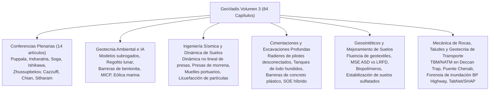

# GeoVadis: El Futuro de la Ingeniería Geotécnica (Volumen 3)

!!! info "Referencia de Acceso Abierto y Atribución"
    Este manual de referencia ofrece un digest técnico estructurado y una síntesis de
    ingeniería del volumen de acceso abierto:  
    **GeoVadis: The Future of Geotechnical Engineering (Volume 3)**  
    *Proceedings of the First Geotech Asia International Conference (GAIC 2025), Goa, India.*  
    **Editores:** Ashish Juneja, Anil Joseph y Dasaka S. Murty.  
    **Editorial:** CRC Press / Balkema, Taylor & Francis Group, Londres y Boca Raton, 2026.  
    **Licencia:** Publicado bajo [Creative Commons Attribution-NonCommercial-NoDerivatives (CC BY-NC-ND 4.0)](https://creativecommons.org/licenses/by-nc-nd/4.0/).  
    **DOI:** [10.1201/9781003645955](https://doi.org/10.1201/9781003645955) | **ISBN eBook:** 9781003645955 | **ISBN Tapa dura:** 9781041085546.

---

## Visión general y alcance del Volumen 3

Tras el **Volumen 1** (Cimientos Plenarios, Geomecánica Computacional, Ambientes Frío/Costero, Dinámica de Suelos, Excavaciones Profundas, Geosintéticos) y el **Volumen 2** (Modificación de Suelos, Riesgo y Caracterización de Sitio, Tunelización en Roca, Deslizamientos, Geotecnia de Transporte), el **Volumen 3** completa las actas del GAIC 2025 con **84 artículos técnicos revisados por pares y conferencias plenarias**.

El Volumen 3 sintetiza avances decisivos en 19 dominios técnicos, con 14 Conferencias Plenarias seminales y 10 sesiones técnicas especializadas:

---

## Detalles de publicación

| Ítem | Especificación |
| --- | --- |
| **Título** | GeoVadis: The Future of Geotechnical Engineering (Volume 3) |
| **Editores** | Ashish Juneja (IIT Bombay), Anil Joseph (Geostruct / IGS), Dasaka S. Murty (IIT Bombay) |
| **Congreso** | Primer Congreso Internacional Geotech Asia (GAIC 2025), Goa, India |
| **Editorial** | CRC Press / Balkema, Taylor & Francis Group |
| **Fecha de publicación** | 2026 |
| **DOI** | [10.1201/9781003645955](https://doi.org/10.1201/9781003645955) |
| **ISBN eBook** | 978-1-003-64595-5 |
| **ISBN Tapa dura** | 978-1-041-08554-6 |
| **Modo de acceso** | Acceso Abierto (OA) bajo CC BY-NC-ND 4.0 |

---

## Estructura de este Manual de Referencia

El Volumen 3 se estructura en seis capítulos técnicos completos que capturan todas las conferencias plenarias y sesiones técnicas:

| Capítulo | Título | Enfoque Técnico y Temas Destacados |
| :--- | :--- | :--- |
| **01** | [Conferencias Plenarias y Estado del Arte](chapter-01-plenary-lectures.md) | Geosintéticos geotérmicos (Puppala); Subyacente ferroviario reciclado de residuos (Indraratna); Mecánica del presurómetro autoperforante en arcilla rígida (Soga); Recorrido de flujos de escombros por lluvia (Ishikawa); Pilotes en suelos colapsables de Kazajistán (Zhussupbekov); Durabilidad de geomembranas en presas (Cazzuffi); Sondeo sísmico de avance en túneles (Chian); Licuefacción por flujo lateral en la Península de Noto (Hazarika); Micro-mecánica de licuefacción de arena (Latha); Resiliencia post-Gorkha en Nepal (Subedi); Innovación de cimentación y estabilización de taludes del Puente Chenab (Sitharam). |
| **02** | [IA, Geomecánica Computacional y Ingeniería Ambiental](chapter-02-ai-computational-environmental.md) | Modelos subrogados de aprendizaje automático para zapatas en taludes variables; Mecánica de fuerza de perforación de regolito lunar; Oportunidades y cuellos de botella de la IA en geotecnia; Ensayo de anclas de levantamiento de macizo rocoso; Resistencia a compresión simple del relleno de bentonita; Control de retracción de lodo rojo; Mitigación de hinchamiento alcalino con nanomateriales; Biocementación MICP con melaza de caña; FEM de turbina eólica flotante marina; Diseño moderno de contención de vertederos. |
| **03** | [Ingeniería Sísmica y Dinámica de Suelos](chapter-03-earthquake-soil-dynamics.md) | Análisis dinámico no lineal de presas zonificadas de escollera/terraplén; Evaluación simplificada de susceptibilidad a licuefacción a escala de partícula; Diseño basado en desempeño de muelles portuarios (códigos de India vs Japón); Estabilidad sísmica y mecánica de ruptura de presas de morrena de glaciar (Lago Imja) bajo terremotos de Kobe y Chile; Impedancia dinámica de zapatas circulares. |
| **04** | [Cimentaciones, Excavaciones Profundas y Sistemas de Contención](chapter-04-foundations-deep-excavation.md) | Cimentaciones radier-pilotes desconectadas (DPRF) con capas de almohadilla; Alternativas de subestructura de puentes en geología compleja; Arranque vertical de anclas en arena no saturada; Cimentaciones anulares con falda bajo cargas laterales sísmicas; Back-análisis forense de tanques de lodo de concreto hundidos; Deformaciones inducidas por excavación profunda en pilotes adyacentes; Barreras de corte de concreto plástico; Umbrales de cohesión de clavado de suelos; Sistemas SOE híbridos; Interacción de túnel TBM bajo descarga de excavación y sobrecarga. |
| **05** | [Geosintéticos y Mejoramiento de Suelos](chapter-05-geosynthetics-ground-improvement.md) | Comportamiento de fluencia de geotextiles tejidos y no tejidos; Diseño de confiabilidad ASD vs LRFD de muros MSE; Caracterización MIF/LCR de georejillas biaxiales; Suelos tratados con cal contaminados por sulfato soluble y mitigación de hinchamiento por etringita; CBR saturado de subyacentes con georejilla/fibra; Perspectivas de estabilización de suelos de infraestructura; Mejora de rigidez de arcilla Leda rápida; Micro-tunelización en arcilla marina blanda; Mezclas cementantes de escoria de cobre y ceniza de cáscara de arroz; Estabilización de suelos de alto sulfato con cal y polvo de cantera. |
| **06** | [Mecánica de Rocas, Taludes y Geotecnia de Transporte](chapter-06-rock-slopes-transportation.md) | Anclas de roca de alta capacidad para ensayo de carga de pilotes; Ensayo de precisión Six Sigma para suelos; Terraplenes de carretera con biopolímero de goma de guar; Comportamiento dinámico de suelos arcilla-caucho triturado; Flujos integrados de geofísica; Correlaciones SPT $(N_1)_{60}$; Interfaz ELM (Extreme Learning Machine) para riesgo de muro de contención; QA/QC geofísico de rellenos mayores; Mecánica de sequía agrícola no saturada; Riesgos de interpretación de tamaño de grano vs $\phi$ en Siwalik; Suelos carbonatados marinos; Modelo constitutivo implícito 3D de granito; Asentamiento superficial en tunelización urbana; Excavación TBM y NATM en basaltos Deccan Trap; Estabilidad de túnel bajo excavación adyacente; Rigidez y resistencia al corte de discontinuidades de roca; Estabilidad probabilística de pozos; Reología y flujo-licuefacción de relaves mineros y cenizas volantes; Mapeo de deslizamientos por regresión logística GIS; Ingeniería vial resiliente al clima (forensia de inundación BP Highway Nepal 2024); Evaluación multi-amenaza del corredor Kaligandaki; Estabilización de taludes de ladera con micro-pilotes; Modelado de deslizamientos interpretable con TabNet y SHAP; Comparaciones LEM vs FEM de taludes; Mezclas RAP con bio-enzima cementante; Estabilización puzolánica de arena de dunas; Pavimentos reforzados con geosintéticos bajo tráfico cíclico. |

---

## Estándar de Terminología Técnica

Todas las traducciones al español siguen la terminología geotécnica canónica 1-a-1:

- **Sister Bar** $\rightarrow$ *Barra hermana (Sister Bar)*
- **Piezometer** $\rightarrow$ *Piezómetro*
- **Strain Gauge** $\rightarrow$ *Galga extensométrica*
- **Inclinometer** $\rightarrow$ *Inclinómetro*
- **Load Cell** $\rightarrow$ *Célula de carga*
- **Earth Pressure Cell** $\rightarrow$ *Célula de presión de tierras*
- **Extensometer** $\rightarrow$ *Extensómetro*
- **Piled Raft Foundation** $\rightarrow$ *Cimentación radier-pilotes*
- **Disconnected Piled Raft Foundation** $\rightarrow$ *Cimentación radier-pilotes desconectada (con almohadilla)*
- **Soil-Cement Column / Deep Mixing** $\rightarrow$ *Columna de suelo-cemento / mezcla profunda*
- **Plastic Concrete Cutoff Wall** $\rightarrow$ *Muro cortina de concreto plástico*
- **Diaphragm Wall / Barrette** $\rightarrow$ *Muro pantalla / barreta*

---

## Video Destacado y Recursos Prácticos

  <iframe src="https://www.youtube-nocookie.com/embed/BcghSAPrlKk" title="RSTAR Wireless Data Collection Webinar" frameborder="0" allow="accelerometer; autoplay; clipboard-write; encrypted-media; gyroscope; picture-in-picture" allowfullscreen style="position: absolute; top: 0; left: 0; width: 100%; height: 100%; border-radius: 6px;"></iframe>

<em>Seminario Web Técnico Destacado (RST Instruments): RSTAR Wireless Data Collection Webinar — Redes de Telemetría de Sensores Automatizadas para Cimentaciones Profundas e Infraestructura de Transporte.</em>

!!! tip "Recursos Prácticos de Campo Complementarios de RST Instruments & Measurand (Terra Insights)"
    - **RST Instruments (@RSTgeotechnical):** [RSTAR Affinity Webinar](https://www.youtube.com/watch?v=BcghSAPrlKk){ target="_blank" }  
      *Arquitecturas avanzadas de telemetría inalámbrica para redes automatizadas de instrumentación geotécnica.*
    - **Measurand (@MeasurandVideos):** [How to install SAAV Extend: Measurand's connectable ShapeArray](https://www.youtube.com/watch?v=idyme0c9HSs){ target="_blank" }  
      *ShapeArray modular de nueva generación para monitoreo de alta precisión de cimentaciones y excavaciones profundas.*
