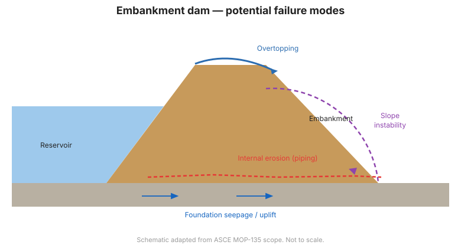

# Capítulo 2 — Desempeño de la Presa y Modos de Falla Potenciales

## 2.1 El monitoreo se organiza en torno a los modos de falla

Los programas de monitoreo más eficaces se construyen **de arriba abajo a partir de
los modos de falla potenciales (PFM, por sus siglas en inglés)**, y no de abajo
arriba a partir de una lista de instrumentos. Un *modo de falla* es una forma
creíble en que la presa podría fallar, o una condición que podría conducir a la
falla. Una vez identificados los PFM creíbles, el ingeniero se pregunta: *¿qué
mediciones revelarían un avance hacia ese modo de falla antes de que sea peligroso?*

Esta es la idea central de planificación, que se desarrolla en el
[Capítulo 4](chapter-04-planning.md).

## 2.2 Por qué fallan las presas

La mayoría de las fallas e incidentes de presas se remontan a un pequeño conjunto de
mecanismos físicos:

| Mecanismo | Firma típica | Mediciones principales |
|-----------|--------------|------------------------|
| **Erosión interna / tubificación (piping)** | Filtración que arrastra suelo, agua turbia, hundimientos, zonas húmedas | Cantidad y claridad de la filtración, niveles piezométricos, asentamiento |
| **Sobrevertimiento (overtopping)** | Embalse alto, coronamiento (freeboard) inadecuado | Nivel del embalse, precipitación, afluencia |
| **Deslizamiento / inestabilidad de talud** | Grietas, abultamientos, movimiento de taludes | Topografía de deformación, inclinómetros, piezómetros |
| **Falla de cimentación** | Movimiento o filtración excesiva a través de la cimentación | Piezómetros, deformación, filtración |
| **Distrés de concreto/estructural** | Grietas, movimiento de monolitos, filtraciones en juntas | Medidores de grietas, medidores de juntas, piezómetros, topografía |
| **Filtración a través de/bajo accesorios** | Zonas húmedas cerca de conductos, tuberías | Filtración, piezómetros cerca de estructuras |

!!! danger "La erosión interna es la causa principal"
    Gran parte de las fallas de presas de terraplén involucran **erosión interna**
    — el transporte gradual de partículas de suelo por la filtración. A menudo
    comienza en silencio y se acelera, por lo que la detección temprana mediante el
    monitoreo de la filtración *y* de la presión de poros es crítica.

## 2.3 Presas de terraplén

Para las presas de terraplén, las preocupaciones dominantes son:

- **Erosión interna** a través del terraplén, la cimentación o en la interfaz con
  conductos y muros.
- **Deslizamiento** del talud aguas arriba o aguas abajo, especialmente durante el
  vaciado rápido o el llenado rápido.
- **Filtración y tubificación de la cimentación**, particularmente a través de
  cimentaciones erodibles.
- **Liquefacción** de cimentaciones o terraplenes saturados y sin cohesión bajo
  carga sísmica.
- **Sobrevertimiento** durante inundaciones extremas.

Los signos de alerta clásicos —**hundimientos, manantiales, filtración turbia o
fangosa, asentamiento inexplicado y grietas en taludes**— son exactamente lo que la
vigilancia visual y la instrumentación buscan detectar a tiempo.

## 2.4 Presas de concreto y mampostería

Para presas de gravedad, bóveda y contrafuertes de concreto, las preocupaciones
cambian a:

- **Grietas estructurales** y movimiento de monolitos.
- **Movimiento de la cimentación** y presión de levantamiento (uplift) bajo la base.
- **Filtraciones a través de juntas, galerías y cortinas de inyección (grouting)**.
- **Envejecimiento de los accesorios** (vertederos, compuertas, conductos).

La presión de levantamiento (presión de poros bajo la base de la presa) es una
magnitud de diseño y monitoreo de primer orden para las presas de gravedad.

## 2.5 El valor de una línea base de desempeño

Muchos modos de falla se desarrollan lentamente. Los primeros años de operación
establecen la **línea base** — el rango de respuesta normal a los ciclos estacionales
del embalse y las temperaturas. Las desviaciones de esa línea base son mucho más
fáciles de detectar cuando la línea base existe
([Capítulo 11](chapter-11-data-management.md)).

## 2.6 Del modo de falla a la medición

Para cada PFM creíble, el ingeniero define:

1. El **indicador** (qué cambiaría — p. ej., caudal de filtración, carga piezométrica).
2. La **ubicación** donde el indicador es más informativo.
3. El **instrumento** que lo mide.
4. El **umbral** que dispara una revisión ([Capítulo 9](chapter-09-automated.md)).

Este mapeo es el puente del Capítulo 2 al Capítulo 4.

**Figura.** Modos de falla potenciales de una presa de terraplén: sobrevertimiento,
erosión interna (tubificación), inestabilidad de talud y filtración de cimentación
(alcance ASCE MOP-135).

## 2.7 Puntos clave

- Planifique el monitoreo a partir de modos de falla creíbles, no de un catálogo de
  instrumentos.
- La erosión interna y la inestabilidad de talud dominan el riesgo de presas de
  terraplén.
- La presión de levantamiento y las grietas estructurales importan más en presas de
  concreto.
- Establezca una línea base pronto; las desviaciones de ella son la señal.
