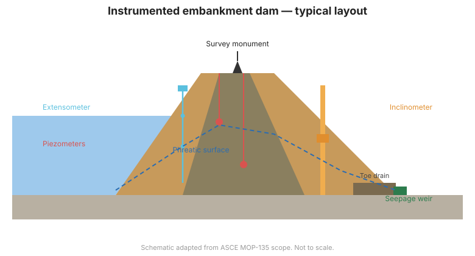

# Capítulo 5 — Familias de Instrumentos para Monitoreo de Presas

## 5.1 Un menú de mediciones

Este capítulo presenta las familias de instrumentos usados para monitorear presas.
Capítulos posteriores profundizan en los más críticos para la seguridad. Para
procedimientos detallados de instalación, consulte los manuales
[Dunnicliff](../dunnicliff/index.md) y [FHWA](../fhwa/index.md) en esta base de
conocimientos.

## 5.2 Categorías de medición

| Categoría | Qué mide | Instrumentos representativos |
|----------|----------|------------------------------|
| **Nivel de agua / embalse** | Elevación del espejo, nivel | Reglas limnímetras, transductores de presión, flotadores |
| **Presión de poros / levantamiento** | Presión del agua en suelo/roca/concreto | Piezómetros de cuerda vibratoria, neumáticos, de tubo abierto, hidráulicos |
| **Filtración / escape** | Caudal y calidad | Vertederos, baldes basculantes, sensores de turbidez, observaciones |
| **Deformación — superficial** | Movimiento de la superficie de la presa | Monolitos de referencia, GNSS, estación total |
| **Deformación — interna** | Movimiento dentro del terraplén/cimentación | Inclinómetros, extensómetros, sistemas de asentamiento, SAA |
| **Estructural** | Grietas, apertura de juntas, carga | Medidores de grietas, medidores de juntas, celdas de carga, galgas extensométricas |
| **Ambiental** | Precipitación, temperatura, presión de aire en poros | Pluviómetros, termistores, barómetros |
| **Concreto / envejecimiento** | Distrés, álcali, corrosión | Sondas de corrosión de acero de refuerzo, emisión acústica |

## 5.3 Tecnologías de sensores

Los instrumentos convierten una magnitud física en una señal legible. Tecnologías
comunes:

- **Cuerda vibratoria (VW)** — un alambre tensado cuya frecuencia cambia con la
  deformación; robusta, sin deriva y la caballía de batalla del monitoreo moderno de
  presas.
- **Neumática** — la presión de gas equilibra la presión medida; útil donde la
  energía o los cables son impracticables.
- **Hidráulica** — presión de columna de líquido; simple y de probada duración.
- **Eléctrica/resistiva e inductancia** — potenciómetros, LVDT y galgas extensométricas.
- **Piezoeléctrica y MEMS** — acelerómetros, inclinómetros de pendiente y sensores
  inerciales modernos.

## 5.4 Manual vs. automatizado

- Los instrumentos **manuales** se leen en sitio con un lector portátil. Bajo costo,
  pero frecuencia limitada y exposición del personal a condiciones peligrosas.
- Los instrumentos **automatizados** alimentan adquisidores de datos y telemetría,
  permitiendo alta frecuencia, acceso remoto y alarmas
  ([Capítulo 9](chapter-09-automated.md)).

## 5.5 Precisión, resolución y rango

Tres conceptos distintos a menudo confundidos:

- **Precisión** — cercanía al valor verdadero (importa la calibración).
- **Resolución** — el cambio más pequeño que el instrumento puede detectar.
- **Rango** — el intervalo sobre el cual sigue siendo válido.

Una presa puede necesitar solo precisión moderada pero alta resolución para detectar
tendencias lentas. Especifique los tres y un presupuesto de error realista.

## 5.6 Seleccionar una familia

La elección sigue el paso de planificación: empareje el instrumento con el
indicador, la ubicación, la energía disponible, la accesibilidad, la vida útil
esperada y el sistema de datos. La redundancia en las ubicaciones más críticas es
prudente — si falla el único piezómetro que resguarda un modo de falla, el programa
tiene un punto ciego.

**Figura.** Disposición típica de instrumentos en una presa de terraplén: monolitos
de coronación, piezómetros, extensómetro, inclinómetro, drenaje de pie y vertedero
de filtración (alcance ASCE MOP-135).

## 5.7 Puntos clave

- Los instrumentos se agrupan en familias de nivel de agua, presión de poros,
  filtración, deformación, estructural y ambiental.
- Los sensores de cuerda vibratoria son la caballía de batalla moderna; los
  neumáticos e hidráulicos siguen siendo útiles.
- Distinga precisión, resolución y rango — la detección de tendencias a menudo
  necesita más resolución.
- Empareje la familia con el indicador y el ambiente planeados; agregue redundancia
  en puntos críticos.
