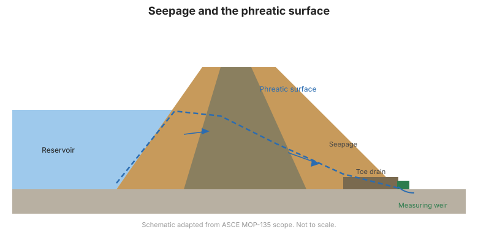

# Capítulo 7 — Filtraciones, Escapes y Monitoreo de la Superficie Freática

## 7.1 La filtración es a la vez normal y peligrosa

Alguna filtración a través y bajo una presa es esperada y aceptable. El peligro es el
**cambio** — flujo creciente, turbidez o filtración por caminos nuevos. El monitoreo
de filtraciones responde dos preguntas: *¿cuánta* y *¿qué tan limpia*?

## 7.2 Medir la cantidad

| Método | Cómo | Notas |
|--------|------|-------|
| **Vertedero / canaleta (flume)** | Mide la profundidad sobre un escotadura, calcula el caudal | Medición simple y confiable del flujo total |
| **Balde basculante** | Cuenta vuelcos de un volumen conocido | Bueno para registro automatizado de bajo caudal |
| **Recipiente + cronómetro** | Tiempo para llenar un volumen conocido | Crudo pero útil para comprobaciones puntuales |
| **Observación + mapeo** | Ubicación, área, humedad | Esencial; muchas filtraciones son difusas |

## 7.3 Medir la calidad — turbidez

La **claridad** de la filtración a menudo es más importante que su volumen. La
filtración clara por un camino conocido suele ser benigna; la filtración **turbia o
arenosa** puede señalar erosión interna. Observaciones simples (visuales, "prueba de
frasco") y, cada vez más, sensores de turbidez o dispositivos de captura de filtro
proporcionan alerta temprana.

!!! danger "La filtración fangosa es una bandera roja"
    La turbidez súbita, especialmente tras un aumento del embalse o un sismo, puede
    indicar erosión interna. Requiere verificación de campo inmediata y, a menudo,
    monitoreo intensificado.

## 7.4 La superficie freática

La **superficie freática** (línea de filtración) dentro de un terraplén es el
límite entre las zonas saturada y no saturada. Se infiere a partir de las lecturas de
piezómetros ([Capítulo 6](chapter-06-piezometers.md)). Una línea freática que sube
por encima del supuesto de diseño reduce la estabilidad del talud aguas abajo y puede
indicar drenajes obstruidos.

## 7.5 Fugas en los accesorios

Conductos, obras de descarga y contactos con los estribos son caminos de filtración
comunes. Monitoree la humedad, las manchas y el flujo cerca de:

- Estructuras de entrada y salida de conductos.
- Cortinas de inyección y muros de corte (busque filtración aguas abajo creciente).
- Contactos de estribo entre terraplén y cimentación o muros.

## 7.7 Establecer una línea base y tendencia

Siga la filtración frente al nivel del embalse. Grafique **filtración vs. elevación
del embalse** para cada punto de medición. Un punto que se separa hacia arriba de su
banda histórica —especialmente con turbidez— es una anomalía que exige evaluación
([Capítulo 12](chapter-12-evaluation.md)).

**Figura.** Filtración y superficie freática a través de una presa de terraplén, con
un drenaje de pie y un vertedero de medición (alcance ASCE MOP-135).

## 7.8 Puntos clave

- Monitoree la filtración en *cantidad* y *calidad*; la turbidez a menudo importa
  más que el volumen.
- Los vertederos y baldes basculantes cuantifican el flujo; la observación mapea las
  filtraciones difusas.
- Siga la superficie freática a partir de los piezómetros; una línea ascendente
  reduce la estabilidad del talud.
- Vigile los accesorios; la filtración fangosa o creciente es una bandera roja.
