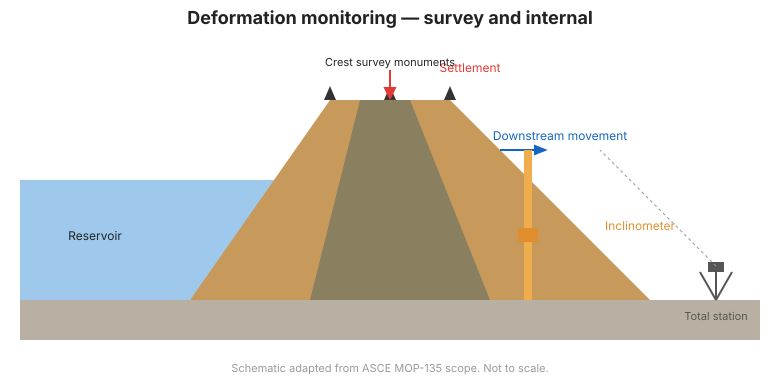

# Capítulo 8 — Monitoreo de Deformación: Topografía y Sensores Geotécnicos

## 8.1 El movimiento es la señal definitiva

La deformación —el movimiento de la presa o la cimentación— es a menudo el signo más
directo de distrés. Se monitorea tanto en la superficie (topografía) como
internamente (sensores geotécnicos).

## 8.2 Deformación superficial — topografía

Una **red de control topográfico** de monolitos sobre la coronación, los taludes y
los estribos es el eje del monitoreo de deformación:

- La **estación total / GNSS** mide posición horizontal y vertical con milímetros de
  precisión.
- La **frecuencia** va de mensual en estado estable a diaria durante la construcción
  o tras un evento.
- Los **datums** deben estar en terreno estable fuera de la zona de influencia.

La topografía revela asentamiento, acortamiento de coronación y abultamiento de
taludes.

## 8.3 Deformación interna — inclinómetros

Un **inclinómetro** mide el desplazamiento lateral de una camisa instalada en un
barreno. Detecta superficies de cizalla (la profundidad donde se concentra el
movimiento) —la firma de la inestabilidad de talud o la erosión interna.

- Instale la camisa a través de la zona de interés, anclada por debajo de ella.
- Lea de abajo hacia arriba; la base es la referencia.
- La **integridad de la camisa** es crítica: una camisa agrietada o descentrada da
  lecturas falsas.

## 8.4 Deformación interna — extensómetros y sistemas de asentamiento

- Los **extensómetros** (de varilla, magnético, de cable) miden el movimiento entre
  un ancla profunda en terreno estable y un punto más cercano a la superficie —
  detectando asentamiento o hinchamiento (heave) a profundidades específicas.
- Los **sistemas de asentamiento** (líquido, magnético, medidores de asentamiento)
  siguen el movimiento vertical a través de un terraplén.

## 8.5 Inclinómetros de pendiente y medidores de grietas

- Los **inclinómetros de pendiente (tiltmeters)** detectan la rotación de una
  superficie; útiles en estructuras de concreto y taludes empinados.
- Los **medidores de grietas / juntas** miden la apertura de grietas o juntas en
  presas de concreto, estribos y cimentaciones.

## 8.6 Combinar mediciones

La deformación es más potente cuando se correlaciona: una topografía superficial
muestra *dónde* se movió la presa; un inclinómetro muestra *a qué profundidad*; los
piezómetros muestran *por qué* (cambio de presión de poros). Juntos localizan el
mecanismo.

!!! tip "Construya una línea base de deformación pronto"
    Los terraplenes se asientan al consolidarse; los primeros años definen la tasa
    de asentamiento normal. Una aceleración posterior se destaca claramente contra
    esa línea base.

**Figura.** Monitoreo de deformación: monolitos de referencia de coronación
(asentamiento, movimiento aguas abajo) más un inclinómetro para la cizalla interna
(alcance ASCE MOP-135).

## 8.7 Puntos clave

- La deformación es la señal de distrés más directa; monitoreela adentro y afuera.
- Las redes topográficas dan el movimiento superficial; los inclinómetros revelan la
  profundidad de cizalla.
- Los extensómetros y sistemas de asentamiento dan movimiento vertical resuelto por
  profundidad.
- Correlacione la deformación con los piezómetros para identificar el mecanismo y la
  ubicación.
