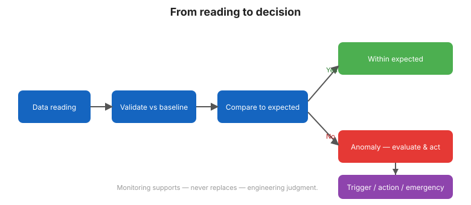

# Capítulo 13 — Evaluación del Desempeño y Toma de Decisiones

## 13.1 El monitoreo existe para apoyar decisiones

El propósito de todo el trabajo previo es una respuesta defendible a una pregunta:
**dado lo que muestra el monitoreo, ¿qué deberíamos hacer?** Este capítulo conecta
la medición con la acción.

## 13.2 Una respuesta estructurada a las anomalías

Cuando se supera un umbral o una evaluación encuentra una desviación real:

1. **Verifique** —confirme que no es una falla de sensor o de datos.
2. **Evalúe** —compárela con el modo de falla que resguarda; califique la gravedad.
3. **Intensifique** —aumente la frecuencia de lectura y despache inspección
   ([Capítulo 3](chapter-03-philosophy.md)).
4. **Decida** —continuar normal, investigar, restringir la operación del embalse o
   actuar para remediar.
5. **Documente** —registre la decisión y su razonamiento.

## 13.3 Niveles de acción

Muchos programas definen **niveles de acción** por niveles vinculados a umbrales:

| Nivel | Significado | Respuesta |
|-------|-------------|-----------|
| Normal | Dentro de la línea base | Monitoreo rutinario |
| Alerta | Excede la banda de línea base | Revisar, verificar, vigilar |
| Alarma | Excede el umbral de peligro | Intensificar, restringir operación, notificar |

Estos niveles convierten números crudos en una respuesta compartida y pre-acordada —
más rápida y menos emocional durante una emergencia.

## 13.4 La operación del embalse como palanca

A menudo la acción más inmediata es operativa: **bajar el embalse** para reducir
cargas y filtración mientras se encuentra la causa. Los datos de monitoreo justifican
y guían esa decisión en tiempo real.

## 13.5 Criterio informado por el riesgo

Las decisiones pesan la **consecuencia** de la falla contra la **credibilidad** de la
tendencia observada. Un cambio pequeño y bien explicado en un elemento de baja
consecuencia puede requerir solo monitoreo; el mismo cambio en un modo de falla de
alta consecuencia exige acción urgente. No hay regla universal —se requiere criterio,
informado por el monitoreo.

## 13.6 Cerrar el ciclo

Un buen programa aprende. Cada anomalía, benigna o seria, actualiza la línea base,
los umbrales y el plan. A lo largo de la vida de la presa, el propio programa de
monitoreo mejora.

**Figura.** De la lectura a la decisión: valide contra la línea base, compare con el
comportamiento esperado y luego actúe (alcance ASCE MOP-135).

## 13.7 Puntos clave

- El propósito del monitoreo es una decisión defendible: ¿qué deberíamos hacer?
- Responda con verificar → evaluar → intensificar → decidir → documentar.
- Los niveles de acción pre-acordados hacen las emergencias más rápidas y tranquilas.
- La operación del embalse es a menudo la primera palanca; el criterio pesa
  consecuencia vs. credibilidad.
